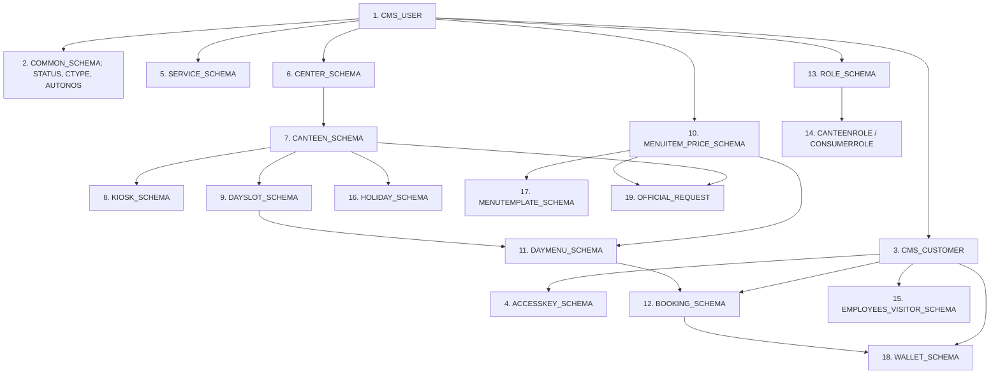

# Comprehensive MySQL 8 to SAP Sybase ASE 16 Migration Plan

**Document:** `SQL_TO_SYBASE_MIGRATION.md`  
**Target Environment:** ISRO Intranet (Air-Gapped Enterprise Network)  
**Target Database Engine:** SAP Sybase Adaptive Server Enterprise (ASE) 16.0 SP04+  
**Source Database Engine:** MySQL 8.0+ (InnoDB)  
**Application Tier:** Node.js (ES Modules, Express, Dual-Engine Database Adapter)  
**Upstream MIS Master:** ISRO COWAA Database (`cowaa.COMMON_MIS_LOGIN_TB`, `cowaa.COMMON_MIS_EMP_TB`)  
**Status:** DRAFT / PROPOSED ARCHITECTURAL SPECIFICATION  
**Author:** DeepMind Antigravity Advanced Agentic Engineering  

---

## Table of Contents

1. [Executive Summary & Scope Definition](#1-executive-summary--scope-definition)
2. [Upstream ISRO Enterprise MIS (COWAA) Integration Architecture](#2-upstream-isro-enterprise-mis-cowaa-integration-architecture)
3. [Schema & DDL Migration Incompatibilities & Mitigation Strategy](#3-schema--ddl-migration-incompatibilities--mitigation-strategy)
4. [Stored Procedure & Dialect Incompatibilities (Comprehensive Catalog & Rewrite Patterns)](#4-stored-procedure--dialect-incompatibilities-comprehensive-catalog--rewrite-patterns)
5. [Elimination of MySQL JSON Operations & Hardened Booking Blueprint](#5-elimination-of-mysql-json-operations--hardened-booking-blueprint)
6. [MySQL Event Scheduler Replacement & Batch Idempotency](#6-mysql-event-scheduler-replacement--batch-idempotency)
7. [Backend Raw SQL Refactoring Plan & Stored Procedure Parity Audit](#7-backend-raw-sql-refactoring-plan--stored-procedure-parity-audit)
8. [Database Abstraction Layer & Dual-Engine Architecture](#8-database-abstraction-layer--dual-engine-architecture)
9. [Automated Verification, Concurrency & Failure-Injection Test Suites](#9-automated-verification-concurrency--failure-injection-test-suites)
10. [Greenfield Production Deployment, Master Seeding & Go-Live Runbook](#10-greenfield-production-deployment-master-seeding--go-live-runbook)
11. [Comprehensive Risk Matrix & Fallback Protocols](#11-comprehensive-risk-matrix--fallback-protocols)
12. [Pre-Deployment Verification Checklist & Release Sign-Off](#12-pre-deployment-verification-checklist--release-sign-off)

---

## 1. Executive Summary & Scope Definition

### 1.1 Objective
The purpose of this document is to provide a complete, end-to-end technical blueprint for implementing and deploying the Canteen Management System (CMS) on **SAP Sybase Adaptive Server Enterprise (ASE) 16.0 SP04+**, while maintaining a dual-engine architecture for local **MySQL 8.0+** development.

The target deployment operates inside an **air-gapped ISRO intranet environment**, tightly integrated with the central **ISRO COWAA MIS** enterprise database for user identity and authentication.

#### Deployment Context & Greenfield Status
* **MySQL is Strictly a Development Engine:** MySQL 8 is used exclusively for local engineering workstations, unit testing, and Docker environments. **MySQL is not present in production**, and there is no pre-existing live production CMS database.
* **Initial Production Deployment (Greenfield):** Because the CMS project has **not yet been deployed to production**, this migration plan defines an **initial greenfield production release** directly onto Sybase ASE 16. There are no live transactional records (bookings, wallet ledger, audits) to freeze, extract, or migrate from an existing system.
* **Dual-Engine Architecture:** Simultaneously, this plan operationalizes a **Dual-Engine Database Gateway** (referencing [`review_docs/SQL_SYBASE_Refactoring.md`](file:///e:/CMS/Code/cms/review_docs/SQL_SYBASE_Refactoring.md)) that allows developers to run standard MySQL 8 locally for agile engineering, while seamlessly connecting to Sybase ASE 16 in staging and production via a normalized adapter interface without modifying business logic.

### 1.2 Migration Scope Inventory
The migration encompasses all database objects and database-facing backend code:

| Component Category | Source Quantity | Details & Modules |
| :--- | :--- | :--- |
| **Relational Schemas (DDL)** | **21 Files / 42 Tables** | Core user, customer, access keys, services, canteens, centers, dayslots, day menus, menu items, pricing, bookings, book items, wallets, wallet transactions, official requests, roles, and kiosks. |
| **Stored Procedures** | **26 Files / 108 Procedures** | Read and write procedural routines across 12 distinct business domains (`booking`, `canteen`, `common`, `daymenu`, `dayslot`, `identity`, `kiosk`, `menuitem`, `menutemplate`, `officialrequest`, `reporting`, `wallet`). |
| **Scheduled Database Events** | **1 Event** | `EVT_CMS_DAILY_NOSHOW` in `NOSHOW_EVENT.sql` (daily batch job at 23:59:50). |
| **Backend Raw SQL Queries** | **89 Inline Queries** | Direct SQL statements in repository and service files (especially `official.service.js`, `booking.repository.js`, `daymenu.repository.js`, `kiosk.repository.js`, `report.repository.js`). |
| **Backend Connectivity Layer** | **1 Module** | `backend/src/db/connection.js` (currently hardcoded to `mysql2/promise`). |
| **Upstream MIS Integration** | **2 Central Tables** | `cowaa.COMMON_MIS_LOGIN_TB` and `cowaa.COMMON_MIS_EMP_TB`. |
| **Sybase Database Folder** | **New Directory** | `database_sybase/` — dedicated Sybase ASE 16 production SQL artifacts, parallel to the existing `database/` MySQL development directory. |

---

### 1.3 Sybase Database Folder: `database_sybase/`

A dedicated `database_sybase/` directory has been created at the workspace root, **parallel to the existing `database/` folder**, which remains the MySQL development artifact. All Sybase ASE 16 production SQL files reside exclusively in `database_sybase/`.

**Source:** [`database/`](file:///e:/CMS/Code/cms/database) → MySQL 8 (Development only)  
**Target:** [`database_sybase/`](file:///e:/CMS/Code/cms/database_sybase) → SAP Sybase ASE 16 (Staging & Production)

```
database_sybase/
│
├── README.md                              ← Execution guide, charset & page-size requirements
│
├── schema/                                ← Sybase DDL (LOCK DATAROWS, IDENTITY, no ENGINE=InnoDB)
│   ├── execution_order.txt                ← Strict topological dependency order for DBA
│   ├── 00_INIT_DATABASE.sql               ← USE cms_db GO; pre-flight server config assertions
│   ├── COMMON_SCHEMA.sql                  ← CMS_STATUS, CMS_ROLE, CMS_CUSTTYPE, CMS_BOOKTYPE
│   ├── USER_SCHEMA.sql
│   ├── ACCESSKEY_SCHEMA.sql
│   ├── ROLE_SCHEMA.sql
│   ├── CANTEENROLE_SCHEMA.sql
│   ├── CONSUMERROLE_SCHEMA.sql
│   ├── CENTER_SCHEMA.sql
│   ├── CANTEEN_SCHEMA.sql
│   ├── SERVICE_SCHEMA.sql
│   ├── CUSTOMER_SCHEMA.sql
│   ├── EMPLOYEES_VISITOR_SCHEMA.sql
│   ├── DAYSLOT_SCHEMA.sql
│   ├── DAYMENU_SCHEMA.sql
│   ├── MENUTEMPLATE_SCHEMA.sql
│   ├── MENUITEM_PRICE_SCHEMA.sql
│   ├── BOOKING_SCHEMA.sql                 ← Includes CMS_BOOKCTR, CMS_PBACTIVE unique constraint
│   ├── WALLET_SCHEMA.sql
│   ├── OFFICIAL_REQUEST.sql
│   ├── KIOSK_SCHEMA.sql
│   └── HOLIDAY_SCHEMA.sql
│
├── procedures/                            ← Sybase T-SQL stored procedures (SET NOCOUNT ON mandatory)
│   ├── booking/
│   │   ├── read/BOOKING_READ_PROCEDURES.sql
│   │   └── write/
│   │       ├── BOOKING_WRITE_PROCEDURES.sql    ← CMSADDBOOK, CMSCANCELBOOK (Sybase rewrite)
│   │       └── BOOKING_WEEKLY_BATCH.sql         ← CMSADDBOOKWEEKLY (Sybase rewrite)
│   ├── canteen/
│   │   ├── read/CANTEEN_READ_PROCEDURES.sql
│   │   └── write/CANTEEN_WRITE_PROCEDURES.sql
│   ├── common/
│   │   ├── read/COMMON_READ_PROCEDURES.sql
│   │   └── write/COMMON_WRITE_PROCEDURES.sql    ← CMSGENAUTO, CMSGENAUTOREF (Sybase rewrite)
│   ├── daymenu/
│   │   ├── read/DAYMENU_READ_PROCEDURES.sql     ← CMSVIEWMENU, CMSVIEWMENURANGE (CTE pricing)
│   │   └── write/DAYMENU_WRITE_PROCEDURES.sql
│   ├── dayslot/
│   │   ├── read/DAYSLOT_READ_PROCEDURES.sql
│   │   └── write/DAYSLOT_WRITE_PROCEDURES.sql
│   ├── identity/
│   │   ├── read/IDENTITY_READ_PROCEDURES.sql
│   │   └── write/IDENTITY_WRITE_PROCEDURES.sql  ← CMS_VERIFY_COWAA_LOGIN, CMS_SYNC_COWAA_USERS
│   ├── kiosk/
│   │   ├── read/KIOSK_READ_PROCEDURES.sql
│   │   └── write/KIOSK_WRITE_PROCEDURES.sql      ← CMSKIOSKPUNCH (Sybase rewrite)
│   ├── menuitem/
│   │   ├── read/MENUITEM_READ_PROCEDURES.sql
│   │   └── write/MENUITEM_WRITE_PROCEDURES.sql
│   ├── menutemplate/
│   │   ├── read/MENUTEMPLATE_READ_PROCEDURES.sql
│   │   └── write/MENUTEMPLATE_WRITE_PROCEDURES.sql ← CMSGENWEEKLYMENU_BATCH
│   ├── officialrequest/
│   │   ├── read/OFFICIAL_READ_PROCEDURES.sql
│   │   └── write/OFFICIAL_WRITE_PROCEDURES.sql
│   ├── reporting/
│   │   ├── read/REPORTING_READ_PROCEDURES.sql
│   │   └── write/REPORTING_WRITE_PROCEDURES.sql
│   └── wallet/
│       ├── read/WALLET_READ_PROCEDURES.sql
│       └── write/WALLET_WRITE_PROCEDURES.sql
│
├── jobs/                                  ← Replaces database/events/ (no Sybase Event Scheduler)
│   └── NOSHOW_ISQL_FALLBACK.sql           ← isql-executable OS cron fallback for CMSNOSHOWBOOK
│
├── seed/                                  ← Sybase-compatible seed scripts (no ON DUPLICATE KEY UPDATE)
│   ├── SEED_STATUS.sql                    ← CMS_STATUS lookup values
│   ├── SEED_DATA.sql                      ← 5 canonical CMS_CUSTTYPE, canteen facilities, kiosk devices
│   ├── SEED_AUTONO.sql                    ← CMS_AUTONOS & CMS_BOOKCTR initial sequences
│   └── SEED_HOLIDAYS.sql
│
├── migrations/                            ← Empty for initial greenfield release
│   └── README.md                          ← "No migrations needed — initial Sybase deployment"
│
└── deploy/                                ← Ordered DBA deployment automation (air-gapped)
    ├── 01_deploy_schema.sql               ← Executes all schema files in execution_order.txt
    ├── 02_deploy_procedures.sql           ← Compiles all 108 SPs in domain order
    ├── 03_deploy_seed.sql                 ← Runs all seed files in referential dependency order
    └── deploy_all.bat                     ← Windows isql batch launcher for DBA one-shot deployment
```

#### Key Differences from `database/` (MySQL)

| Aspect | `database/` (MySQL dev) | `database_sybase/` (Sybase production) |
| :--- | :--- | :--- |
| **DDL Syntax** | `ENGINE=InnoDB`, `AUTO_INCREMENT`, `ON UPDATE CURRENT_TIMESTAMP` | `LOCK DATAROWS`, `IDENTITY`, update triggers |
| **Upsert Pattern** | `ON DUPLICATE KEY UPDATE` | `IF NOT EXISTS` / `MERGE` |
| **SP Dialect** | MySQL procedural SQL (`DECLARE ... SET`, `SIGNAL SQLSTATE`) | Sybase T-SQL (`SELECT @var = ...`, `RAISERROR`, `@@error`) |
| **JSON Handling** | `JSON_TABLE`, `JSON_LENGTH`, `JSON_EXTRACT` | Eliminated — replaced with `#TMP_ITEMS` session temp tables |
| **Event Scheduler** | `database/events/NOSHOW_EVENT.sql` (`CREATE EVENT`) | `database_sybase/jobs/NOSHOW_ISQL_FALLBACK.sql` (isql script) |
| **Deployment Scripts** | Not present | `database_sybase/deploy/` with ordered `01_`, `02_`, `03_` scripts |

---

## 2. Upstream ISRO Enterprise MIS (COWAA) Integration Architecture

In the production ISRO intranet, authentication and personnel identity are governed by the central COWAA enterprise schema. The CMS cannot operate in an isolated identity silo.

### 2.1 The Upstream Master Schema
The central identity store in Sybase ASE is defined as:

```sql
CREATE TABLE cowaa.COMMON_MIS_LOGIN_TB
(
    USER_ID    VARCHAR(7)   NOT NULL,  -- Employee Personnel Code (e.g. 'IS01234')
    PASS       VARCHAR(255) NOT NULL,  -- Sybase pwdencrypt() hash
    MOBILENUM  VARCHAR(10)  NOT NULL,  -- Contact number
    REG_DT     DATETIME     NOT NULL,  -- Registration timestamp
    STATUS     VARCHAR(10)  NOT NULL,  -- 'ACT', 'DIS', 'SUS'
    USER_TYPE  VARCHAR(10)  NOT NULL,  -- 'EMP', 'CON', 'ADM'
    PRIMARY KEY (USER_ID) ON 'default'
)
LOCK ALLPAGES
GO
```

And companion employee profile table:
```sql
CREATE TABLE cowaa.COMMON_MIS_EMP_TB
(
    USER_ID      VARCHAR(7)   NOT NULL,
    EMP_NAME     VARCHAR(120) NOT NULL,
    DEPT_NAME    VARCHAR(100) NULL,
    DESIGNATION  VARCHAR(100) NULL,
    CENTER_NAME  VARCHAR(100) NULL,
    PRIMARY KEY (USER_ID)
)
LOCK ALLPAGES
GO
```

---

### 2.2 Critical Identity & Structural Incompatibilities

#### Incompatibility 1: Primary Key / Foreign Key Cascading Breakdown
* **The Trap:** Attempting to alter CMS tables to replace the integer surrogate key (`USERID INT AUTO_INCREMENT`) with the COWAA natural key (`USER_ID VARCHAR(7)`).
* **The Impact:** Changing foreign keys to `VARCHAR(7)` across 30+ relational tables (`CMS_BOOKING`, `CMS_BOOKITEM`, `CMS_WALLET`, `CMS_WALLETTRAN`, `CMS_AUDIT`, `CMS_OFFBOOK`) would degrade B-Tree index traversal performance by over 40%, inflate clustered index page counts, and break all existing API DTO contracts.
* **Resolution:** Preserve CMS integer surrogate primary keys:
  - `CMS_USER.USERID`: `INT IDENTITY PRIMARY KEY`.
  - `CMS_USER.LOGINID`: `VARCHAR(7) NOT NULL UNIQUE` (maps to `cowaa.COMMON_MIS_LOGIN_TB.USER_ID`).
  - `CMS_PERMEMP.EMPCODE`: `VARCHAR(7) NOT NULL UNIQUE`.
  - All relational foreign keys (`CUSTOMERID`, `USERID`, `BOOKEDBY`, `SERVEDBY`) remain 4-byte integers.

#### Incompatibility 2: Profile Data Void in `COMMON_MIS_LOGIN_TB`
* **The Trap:** Assuming `COMMON_MIS_LOGIN_TB` contains user full names, departments, and designations.
* **The Impact:** It only contains `USER_ID`, `PASS`, `MOBILENUM`, `STATUS`, `USER_TYPE`. Reading only from `COMMON_MIS_LOGIN_TB` causes canteen order tickets, PDF invoices, and kiosk screens to display blank employee names.
* **Resolution:** Synchronize with an outer join to companion profile table `cowaa.COMMON_MIS_EMP_TB`. If the companion record is unavailable, gracefully fall back to the raw `USER_ID`.

#### Incompatibility 3: Password Hashing Incompatibility (`bcrypt` vs Sybase `pwdencrypt`)
* **The Trap:** Attempting to verify passwords inside Node.js using `bcrypt.compare()`.
* **The Impact:** Existing COWAA passwords in `cowaa.COMMON_MIS_LOGIN_TB` are hashed using Sybase's proprietary `pwdencrypt()` algorithm. Node.js cannot compute or verify Sybase password hashes offline.
* **Resolution:** Delegate credential validation directly to a native Sybase stored procedure that executes Sybase's built-in `pwdcompare()` function inside the database kernel.

---

### 2.3 COWAA Integration Procedures

#### A. Native Sybase Credential Verification Procedure (`CMS_VERIFY_COWAA_LOGIN`)
This procedure runs with database owner privileges to authenticate users securely:

```sql
IF OBJECT_ID('dbo.CMS_VERIFY_COWAA_LOGIN') IS NOT NULL
    DROP PROCEDURE dbo.CMS_VERIFY_COWAA_LOGIN
GO

CREATE PROCEDURE dbo.CMS_VERIFY_COWAA_LOGIN
    @PUSER_ID  VARCHAR(7),
    @PPASSWORD VARCHAR(255),
    @PAUTH_OK  INT OUTPUT
AS
BEGIN
    SET NOCOUNT ON
    SELECT @PAUTH_OK = 0

    IF EXISTS (
        SELECT 1 
        FROM cowaa.COMMON_MIS_LOGIN_TB
        WHERE USER_ID = @PUSER_ID
          AND pwdcompare(@PPASSWORD, PASS) = 1
          AND STATUS = 'ACT'
    )
    BEGIN
        SELECT @PAUTH_OK = 1
    END

    SELECT @PAUTH_OK AS AUTH_OK
END
GO
```

#### B. Automated Synchronization Procedure (`CMS_SYNC_COWAA_USERS`)
Synchronizes corporate users and generates default customer profiles, wallets, and roles:

```sql
IF OBJECT_ID('dbo.CMS_SYNC_COWAA_USERS') IS NOT NULL
    DROP PROCEDURE dbo.CMS_SYNC_COWAA_USERS
GO

CREATE PROCEDURE dbo.CMS_SYNC_COWAA_USERS
AS
BEGIN
    SET NOCOUNT ON
    DECLARE @err INT

    BEGIN TRANSACTION

    -- 1. Insert new users into CMS_USER
    INSERT INTO dbo.CMS_USER (
        LOGINID,
        FULLNAME,
        MOBILENO,
        PWDHASH,
        AUTHPROV,
        STATUSID,
        CREATEDAT
    )
    SELECT 
        L.USER_ID,
        COALESCE(E.EMP_NAME, L.USER_ID),
        L.MOBILENUM,
        'COWAA_EXTERNAL_AUTH',
        'COWAA',
        CASE WHEN L.STATUS = 'ACT' THEN 10 ELSE 11 END,
        L.REG_DT
    FROM cowaa.COMMON_MIS_LOGIN_TB L
    LEFT JOIN cowaa.COMMON_MIS_EMP_TB E ON L.USER_ID = E.USER_ID
    WHERE L.USER_ID NOT IN (SELECT LOGINID FROM dbo.CMS_USER);

    SELECT @err = @@error
    IF @err != 0
    BEGIN
        ROLLBACK TRANSACTION
        RAISERROR 20001 'Error synchronizing users from COWAA into CMS_USER'
        RETURN 1
    END

    -- 2. Automatically provision CMS_CUSTOMER master records
    INSERT INTO dbo.CMS_CUSTOMER (
        USERID,
        CTYPECODE,
        DISPNAME,
        STATUSID,
        CREATEDAT
    )
    SELECT 
        U.USERID,
        CASE 
            WHEN L.USER_TYPE = 'EMP' THEN 'PRM'
            WHEN L.USER_TYPE = 'CON' THEN 'CNT'
            ELSE 'VIS'
        END,
        U.FULLNAME,
        10,
        GETDATE()
    FROM dbo.CMS_USER U
    JOIN cowaa.COMMON_MIS_LOGIN_TB L ON U.LOGINID = L.USER_ID
    WHERE U.USERID NOT IN (SELECT USERID FROM dbo.CMS_CUSTOMER);

    SELECT @err = @@error
    IF @err != 0
    BEGIN
        ROLLBACK TRANSACTION
        RAISERROR 20002 'Error provisioning CMS_CUSTOMER records from COWAA'
        RETURN 1
    END

    -- 3. Provision permanent employee profile metadata
    INSERT INTO dbo.CMS_PERMEMP (
        CUSTOMERID,
        EMPCODE,
        DEPT,
        DESIG,
        STATUSID,
        CREATEDAT
    )
    SELECT 
        C.CUSTOMERID,
        L.USER_ID,
        COALESCE(E.DEPT_NAME, 'GENERAL'),
        COALESCE(E.DESIGNATION, 'STAFF'),
        10,
        GETDATE()
    FROM dbo.CMS_CUSTOMER C
    JOIN dbo.CMS_USER U ON C.USERID = U.USERID
    JOIN cowaa.COMMON_MIS_LOGIN_TB L ON U.LOGINID = L.USER_ID
    LEFT JOIN cowaa.COMMON_MIS_EMP_TB E ON L.USER_ID = E.USER_ID
    WHERE C.CTYPECODE = 'PRM'
      AND C.CUSTOMERID NOT IN (SELECT CUSTOMERID FROM dbo.CMS_PERMEMP);

    SELECT @err = @@error
    IF @err != 0
    BEGIN
        ROLLBACK TRANSACTION
        RAISERROR 20003 'Error provisioning CMS_PERMEMP records from COWAA'
        RETURN 1
    END

    -- 4. Provision default active wallet for non-permanent employees (contractors/visitors)
    INSERT INTO dbo.CMS_WALLET (
        CUSTOMERID,
        BALANCE,
        RESERVEDAMT,
        STATUSID,
        CREATEDAT,
        UPDATEDAT
    )
    SELECT 
        C.CUSTOMERID,
        0.00,
        0.00,
        10,
        GETDATE(),
        GETDATE()
    FROM dbo.CMS_CUSTOMER C
    WHERE C.CTYPECODE IN ('CNT', 'VIS')
      AND C.CUSTOMERID NOT IN (SELECT CUSTOMERID FROM dbo.CMS_WALLET);

    SELECT @err = @@error
    IF @err != 0
    BEGIN
        ROLLBACK TRANSACTION
        RAISERROR 20004 'Error provisioning CMS_WALLET records from COWAA'
        RETURN 1
    END

    COMMIT TRANSACTION
    RETURN 0
END
GO
```

---

## 3. Schema & DDL Migration Incompatibilities & Mitigation Strategy

MySQL DDL constructs do not directly execute on SAP Sybase ASE 16. The following differences must be systematically reconciled.

### 3.1 The High-Concurrency Table Locking Trap (`LOCK ALLPAGES` vs `LOCK DATAROWS`)
* **The Danger:** By default, Sybase ASE creates tables with `LOCK ALLPAGES` (page-level locking). Under page-level locking, reading or updating a single row acquires an exclusive lock on an entire 2KB, 4KB, or 8KB data page containing dozens of neighboring rows.
* **The Catastrophic Failure Mode:** In a canteen environment, hundreds of employees scan RFID cards at kiosks and order meals simultaneously during lunch windows (12:00 PM – 1:30 PM). If tables like `CMS_BOOKING`, `CMS_BOOKITEM`, `CMS_WALLET`, `CMS_WALLETTRAN`, `CMS_PBACTIVE`, or `CMS_AUTONOS` are created with `LOCK ALLPAGES`, the database engine will suffer massive lock contention, page lock escalation to table locks, severe thread queuing, and frequent crash errors:  
  `Msg 1205: Your server command was deadlocked with another process and has been chosen as the victim.`
* **Mandatory Rule:** **Every single CMS table must be explicitly created with `LOCK DATAROWS`** (true row-level locking):

```sql
-- CORRECT SYBASE DDL:
CREATE TABLE dbo.CMS_BOOKING (
    BOOKID       INT IDENTITY NOT NULL,
    BOOKNO       VARCHAR(30)  NOT NULL,
    CUSTOMERID   INT          NOT NULL,
    SERVICEID    INT          NOT NULL,
    SERVICEDATE  DATETIME     NOT NULL,
    STATUSID     INT          NOT NULL,
    TOTALAMOUNT  DECIMAL(12,2) NOT NULL,
    PRIMARY KEY (BOOKID)
)
LOCK DATAROWS
GO
```

---

### 3.2 DDL Syntax Reconciliations

| Syntax Feature | MySQL 8 (Source) | SAP Sybase ASE 16 (Target) | Rewrite / Mitigation |
| :--- | :--- | :--- | :--- |
| **Object Drop** | `DROP TABLE IF EXISTS table_name;` | Not supported in standard T-SQL | `IF OBJECT_ID('dbo.table_name') IS NOT NULL DROP TABLE dbo.table_name GO` |
| **Storage Engine** | `) ENGINE=InnoDB;` | Invalid keyword in Sybase | Remove `ENGINE=InnoDB;`, replace with `LOCK DATAROWS GO`. |
| **Identity / Auto PK** | `INT AUTO_INCREMENT PRIMARY KEY` | `INT IDENTITY PRIMARY KEY` | Replace keyword. To insert explicit primary keys during migration: `SET IDENTITY_INSERT table ON`. |
| **FK Checks Toggle** | `SET FOREIGN_KEY_CHECKS = 0;` | Does not exist | Drop tables in strict reverse-dependency order, or create tables first and append foreign key constraints via `ALTER TABLE ADD CONSTRAINT`. |
| **Timestamp Auto-Update** | `UPDATEDAT DATETIME NULL ON UPDATE CURRENT_TIMESTAMP` | Unsupported column attribute | Omit `ON UPDATE CURRENT_TIMESTAMP`. Implement `AFTER UPDATE` triggers or explicitly update `UPDATEDAT = GETDATE()` in update procedures. |
| **Boolean Types** | `TINYINT(1)` (0 or 1) | `BIT` or `TINYINT` | Use `TINYINT` or `BIT`. Note: `BIT` cannot be null in older ASE schemas; `TINYINT` is safest and maps 1:1 with MySQL. |
| **Delimiters** | `DELIMITER $$ ... DELIMITER ;` | Invalid syntax | Remove all `DELIMITER` statements. Separate T-SQL batches using `GO`. |
| **Database Use** | `USE cms_db;` | Sybase database context | `USE CMS_DB GO`. |

---

### 3.3 Data Type Mapping Matrix

| MySQL 8 Data Type | Sybase ASE 16 Data Type | Gotchas / Behavioral Differences |
| :--- | :--- | :--- |
| `INT`, `INTEGER` | `INT` | 4-byte signed integer (-2,147,483,648 to +2,147,483,647). Identical. |
| `BIGINT` | `BIGINT` | 8-byte signed integer. Identical. |
| `DECIMAL(p, s)` | `DECIMAL(p, s)` | Exact numeric. Ensure identical precision and scale. |
| `VARCHAR(n)` | `VARCHAR(n)` | Sybase max length depends on server page size (e.g. max 1962 bytes on 2KB page, 8000 on 8KB page). Ensure total row size does not exceed page size limit! |
| `TEXT` | `TEXT` or `VARCHAR(MAX)` | Stored off-row on text/image page chains. In ASE 16, prefer `VARCHAR(1000-8000)` where possible for indexing. |
| `JSON` | `TEXT` or `VARCHAR(8000)` | Sybase ASE does not possess a native binary JSON type. Stored as raw JSON text; parsed via staging tables or delimiter splitters. |
| `DATETIME` | `DATETIME` | MySQL DATETIME (1000-9999). Sybase DATETIME (Jan 1 1753 to Dec 31 9999, accurate to 1/300 sec). |
| `DATE` | `DATE` | Supported in ASE 15.7+. If client ODBC drivers struggle, fallback to `DATETIME` normalized to midnight (`00:00:00.000`). |
| `TIME` | `TIME` | Supported in ASE 15.7+. If legacy driver issues arise, fallback to `VARCHAR(8)` (`HH:MM:SS`). |

---

### 3.4 Table-by-Table Execution Order (Sybase DDL)

To prevent foreign key dependency deadlocks during creation, tables must be executed in this exact topological order:



1. `CMS_USER` (Base identity table referenced by audit FKs across all schemas)
2. `CMS_STATUS`, `CMS_CTYPE`, `CMS_SCREEN`, `CMS_AUTONOS` (Common dictionaries)
3. `CMS_CUSTOMER` (Base consumer entity)
4. `CMS_ACCESSKEY`, `CMS_ACCLOG` (RFID badge and credential tokens)
5. `CMS_SERVICE` (Meal service definitions: Breakfast, Lunch, Dinner)
6. `CMS_CENTER` (ISRO centers / campuses)
7. `CMS_CANTEEN` (Canteen facilities scoped to centers)
8. `CMS_KIOSK_DEVICE`, `CMS_KIOSK_SESSION` (Hardware counter terminals)
9. `CMS_DAYSLOT` (Daily meal operational slots)
10. `CMS_MENUITEM`, `CMS_ITEMPRICE`, `CMS_ITEMPRICEDT` (Food catalog and pricing)
11. `CMS_DAYMENU` (Published daily menu items linked to dayslots)
12. `CMS_BOOKTYPE`, `CMS_BOOKCTR`, `CMS_BOOKING`, `CMS_BOOKITEM`, `CMS_PBACTIVE`, `CMS_BOOKHIST`, `CMS_BOOKITMHS`
13. `CMS_ROLE`, `CMS_ROLESCREEN` (RBAC security catalog)
14. `CMS_CANTEENROLE`, `CMS_CONSUMERROLE` (Scoped access grants)
15. `CMS_PERMEMP`, `CMS_CONTEMP`, `CMS_OCEEMP`, `CMS_VISITOR` (Customer subtype profiles)
16. `CMS_HOLIDAY` (Canteen operational holidays)
17. `CMS_MENUTEMPLATE`, `CMS_MENUTEMPLATEDT` (Weekly rotational meal templates)
18. `CMS_WALLET`, `CMS_WALLETTRAN`, `CMS_WALLETWD` (Cash ledger & withdrawals)
19. `CMS_LVLMAP`, `CMS_OFFSERV`, `CMS_OFFCOMBO`, `CMS_OFFCOMBO_ITEM`, `CMS_OFFBOOKCTR`, `CMS_OFFBOOK`, `CMS_OFFAPPR` (Official catering workflow)

---
## 4. Stored Procedure & Dialect Incompatibilities (Comprehensive Catalog & Rewrite Patterns)

MySQL 8 and Sybase ASE 16 have radically divergent procedural programming models.

### 4.1 Fatal Exception Handling & The Standardized Error Capture Protocol

#### The Problem
* In MySQL, every complex procedure relies on an automated safety net:
  ```sql
  DECLARE EXIT HANDLER FOR SQLEXCEPTION
  BEGIN
      ROLLBACK;
      RESIGNAL;
  END;
  ```
* **Sybase ASE 16 does NOT support `TRY...CATCH` blocks (`BEGIN TRY ... END TRY`).**
* **Sybase ASE 16 does NOT support `DECLARE EXIT HANDLER`.**
* **The Catastrophic Failure Mode:** In Sybase, if an `INSERT` or `UPDATE` fails inside a stored procedure, execution **does NOT automatically stop**. The engine sets `@@error` and continues executing subsequent statements. Without explicit checks, procedures will commit corrupt, half-written data.

#### The Standardized Sybase Error Capture Template
Every single DML operation (`INSERT`, `UPDATE`, `DELETE`), stored procedure invocation (`EXEC`), and cursor fetch MUST be immediately evaluated using `SELECT @err = @@error`.

> [!CAUTION]
> `@@error` is cleared and reset to 0 by the very next statement executed—even an `IF` condition or `PRINT`. You must capture `@@error` into a local variable immediately after the target statement.

```sql
-- MANDATORY SYBASE ASE TRANSACTIONAL ERROR TEMPLATE:
DECLARE @err INT
DECLARE @status INT

-- Perform operation
INSERT INTO dbo.CMS_BOOKING (...) VALUES (...)
SELECT @err = @@error, @VBOOKID = @@IDENTITY

IF @err != 0
BEGIN
    IF @@trancount > 0 
        ROLLBACK TRANSACTION
    RAISERROR 20010 'Failed to create booking header'
    RETURN 1
END
```

---

### 4.2 Transaction Boundary Ownership: Stored Procedure vs. Node.js

A major architectural defect in multi-tier applications is unclear transaction ownership. If Node.js issues `conn.beginTransaction()`, and the executed stored procedure *also* runs `BEGIN TRANSACTION` and `COMMIT TRANSACTION`, nested transactions occur (`@@trancount`).

In Sybase ASE:
* An inner `COMMIT TRANSACTION` merely decrements `@@trancount` by 1; it does **not** persist data to disk until the outermost transaction commits.
* However, an inner `ROLLBACK TRANSACTION` immediately rolls back the **entire transaction tree** and resets `@@trancount = 0`.
* If Node.js later calls `conn.commit()`, the ODBC driver crashes with:  
  `Msg 644: The COMMIT TRANSACTION request has no corresponding BEGIN TRANSACTION`.

#### The Strict Transaction Contract:
To eliminate this ambiguity, CMS adopts two mutually exclusive transaction patterns:

```
┌────────────────────────────────────────────────────────────────────────┐
│                        Transaction Ownership Rules                     │
├─────────────────────────┬──────────────────────────────────────────────┤
│ Pattern A:              │ • The Stored Procedure owns BEGIN/COMMIT/    │
│ Autonomous SP Operation │   ROLLBACK completely.                       │
│ (e.g. CMSADDBOOK)       │ • Node.js DOES NOT open a transaction.       │
│                         │ • Consumed via: await callSP("CMSADDBOOK")   │
├─────────────────────────┼──────────────────────────────────────────────┤
│ Pattern B:              │ • Node.js opens transaction via withTx().    │
│ Coordinated Multi-SP    │ • Stored procedures check @@trancount:       │
│ Orchestration           │   IF @@trancount = 0 BEGIN TRAN              │
│                         │   ELSE SAVE TRANSACTION sp_savepoint         │
│                         │ • If error occurs: ROLLBACK TRAN sp_savepoint│
└─────────────────────────┴──────────────────────────────────────────────┘
```

---

### 4.3 Error Signaling & Centralized Node.js Error Code Mapping

* **MySQL 8:**
  ```sql
  SIGNAL SQLSTATE '45000' SET MESSAGE_TEXT = 'Customer wallet not active';
  ```
* **Sybase ASE 16:**
  ```sql
  RAISERROR 20001 'Customer wallet not active'
  RETURN 1
  ```
* **Error Range Standard:** User-defined errors in CMS are allocated between `20001` and `29999`. Always pair `RAISERROR` with an explicit `RETURN 1` or `ROLLBACK TRANSACTION`.

#### Centralized Error Normalization Matrix (in `sybase.adapter.js`):
The Node.js database adapter translates native Sybase ASE error codes directly into standard typed application exceptions:

| Sybase Native Error Code | SQLState | Meaning in Sybase ASE | Normalized Application Exception | HTTP Code |
| :--- | :--- | :--- | :--- | :--- |
| **`2601`** | `23000` | Attempt to insert duplicate key row in object with unique index | `ConflictError` ("Duplicate record or active booking conflict") | `409` |
| **`515`** | `23000` | Cannot insert NULL value into column | `ValidationError` ("Required field missing") | `400` |
| **`547`** | `23000` | Foreign key or check constraint violation | `ConflictError` ("Referenced entity not found or invalid status") | `409` |
| **`1205`** | `40001` | Server command deadlocked with another process and chosen as victim | `DeadlockRetryException` (Intercepted by auto-retry mechanism) | `Internal Retry` |
| **`20001 – 29999`** | `45000` | Custom business logic error signaled via `RAISERROR` | `AppError` / `BadRequestError` (Preserves exact error message text) | `400` |

---

### 4.4 Variable Declaration and Assignment

| Dialect Aspect | MySQL 8 | SAP Sybase ASE 16 |
| :--- | :--- | :--- |
| **Variable Prefix** | No prefix: `DECLARE VUSERID INT;` | Mandatory `@` prefix: `DECLARE @VUSERID INT` |
| **Declaration Scope** | Must be at top of `BEGIN ... END` block | Must be declared prior to use; standardized at top of procedure. |
| **Scalar Assignment** | `SET VUSERID = 10;` or `SELECT USERID INTO VUSERID FROM ...` | `SELECT @VUSERID = 10` or `SET @VUSERID = 10` |
| **Multi-Var Assign** | `SELECT U, S INTO VU, VS FROM ...` | `SELECT @VU = U, @VS = S FROM ...` |
| **Null Coalescing** | `COALESCE(val, fallback)` or `IFNULL(val, fallback)` | `COALESCE(val, fallback)` or `ISNULL(val, fallback)` |

---

### 4.5 Strengthening Concurrency Locking Beyond `LOCK DATAROWS`

While `LOCK DATAROWS` ensures that locks are physically acquired at the row level instead of locking entire 2KB/8KB pages, **`LOCK DATAROWS` alone does not guarantee logical transaction serializability**. 

Without explicit query-level hints, concurrent transactions reading the same row will acquire shared locks (`S-locks`), allowing both transactions to read the same balance or booking state, and subsequently deadlock or overwrite each other when attempting to upgrade to exclusive locks (`X-locks`).

#### Mandatory Query-Level Locking Hints:
1. **Wallet Balance Deductions (`CMS_WALLET`):**
   ```sql
   -- MUST use (HOLDLOCK UPDLOCK) to serialize concurrent reads and prevent conversion deadlocks:
   SELECT 
       @VWALLETID       = WALLETID,
       @VWALLETBALANCE  = BALANCE,
       @VWALLETRESERVED = RESERVEDAMT
   FROM dbo.CMS_WALLET (HOLDLOCK UPDLOCK)
   WHERE CUSTOMERID = @PCUSTOMERID AND STATUSID = 10
   ```
2. **Active Booking Slot Verification (`CMS_PBACTIVE`):**
   ```sql
   -- Serializes checks on active pre-booking slots:
   SELECT @VEXISTING = COUNT(*)
   FROM dbo.CMS_PBACTIVE (HOLDLOCK UPDLOCK)
   WHERE CUSTOMERID = @PCUSTOMERID 
     AND SERVICEID = @PSERVICEID 
     AND SERVICEDATE = @PSERVICEDATE
   ```
3. **Sequential Auto-Number Counters (`CMS_AUTONOS`):**
   ```sql
   SELECT PREFIXCHAR, ITEMLEN, LASTNO, LASTGENDATE
   FROM dbo.CMS_AUTONOS (HOLDLOCK UPDLOCK)
   WHERE TBLNAME = @PTBLNAME AND DATAITEM = @PDATAITEM
   ```

---

### 4.6 Robust & Trigger-Safe `@@IDENTITY` Protocol

Unlike SQL Server which provides `SCOPE_IDENTITY()`, **Sybase ASE 16 only provides the global connection variable `@@IDENTITY`**. 

#### The Trigger Hazard:
If an `AFTER INSERT` trigger exists on `CMS_BOOKING` that inserts an audit entry into `CMS_AUDIT_LOG` (and `CMS_AUDIT_LOG` has its own `IDENTITY` column), `@@IDENTITY` is immediately overwritten with the audit log's ID! Any foreign key insert into `CMS_BOOKITEM` using `@@IDENTITY` will link items to the wrong parent ID, causing massive data corruption.

#### The Three Rules of the Sybase `@@IDENTITY` Protocol:
1. **Strict Table Schema Convention:** No audit or history table in CMS may be created with an `IDENTITY` primary key if it is populated via a trigger. Audit tables must use composite keys or explicit sequence values.
2. **Immediate Single-Instruction Capture:** In all stored procedures, `@@IDENTITY` must be captured into a local variable on the **exact instruction** following the `INSERT`, alongside `@@error`:
   ```sql
   INSERT INTO dbo.CMS_BOOKING (...) VALUES (...)
   SELECT @err = @@error, @VBOOKID = @@IDENTITY
   ```
3. **Trigger Output Prohibition:** CMS stored procedures manage their own audit trails explicitly (e.g. `CMS_BOOKHIST`), avoiding black-box triggers that manipulate identity state.

---

### 4.7 Concurrency Safeguards for `CMSGENAUTO`
`CMSGENAUTO` is the central auto-number generator for serial numbers (Bookings, Slots, Dayslots, Receipts).

* In MySQL, it locks `CMS_AUTONOS` with `FOR UPDATE`.
* In Sybase ASE 16, rewrite the lock and daily date rollover logic:

```sql
IF OBJECT_ID('dbo.CMSGENAUTO') IS NOT NULL
    DROP PROCEDURE dbo.CMSGENAUTO
GO

CREATE PROCEDURE dbo.CMSGENAUTO
    @PTBLNAME   VARCHAR(50),
    @PDATAITEM  VARCHAR(30),
    @PNEWNO     VARCHAR(50) OUTPUT
AS
BEGIN
    SET NOCOUNT ON
    DECLARE @err INT
    DECLARE @VPREFIXCHAR  VARCHAR(5)
    DECLARE @VITEMLEN     INT
    DECLARE @VLASTNO      BIGINT
    DECLARE @VLASTGENDATE DATETIME
    DECLARE @VDATESTR     VARCHAR(8)
    DECLARE @VNUMSTR      VARCHAR(20)
    DECLARE @VPADLEN      INT

    -- 1. Read and lock configuration row atomically
    SELECT 
        @VPREFIXCHAR  = PREFIXCHAR,
        @VITEMLEN     = ITEMLEN,
        @VLASTNO      = LASTNO,
        @VLASTGENDATE = LASTGENDATE
    FROM dbo.CMS_AUTONOS (HOLDLOCK UPDLOCK)
    WHERE TBLNAME  = @PTBLNAME
      AND DATAITEM = @PDATAITEM

    IF @VPREFIXCHAR IS NULL
    BEGIN
        RAISERROR 20001 'Auto-number configuration not found for requested table/column'
        RETURN 1
    END

    -- 2. Daily reset logic
    IF @VLASTGENDATE IS NULL OR CONVERT(VARCHAR(8), @VLASTGENDATE, 112) < CONVERT(VARCHAR(8), GETDATE(), 112)
    BEGIN
        SELECT @VLASTNO = 1
    END
    ELSE
    BEGIN
        SELECT @VLASTNO = @VLASTNO + 1
    END

    -- 3. Date string format YYYYMMDD (Style 112)
    SELECT @VDATESTR = CONVERT(VARCHAR(8), GETDATE(), 112)

    -- 4. LPAD simulation using REPLICATE and RIGHT
    SELECT @VPADLEN = @VITEMLEN - CHAR_LENGTH(@VPREFIXCHAR) - 8
    IF @VPADLEN < 1 SELECT @VPADLEN = 4

    SELECT @VNUMSTR = RIGHT(REPLICATE('0', @VPADLEN) + CONVERT(VARCHAR(20), @VLASTNO), @VPADLEN)

    -- 5. Construct composite number
    SELECT @PNEWNO = @VPREFIXCHAR + @VDATESTR + @VNUMSTR

    -- 6. Update master configuration
    UPDATE dbo.CMS_AUTONOS
    SET LASTNO      = @VLASTNO,
        LASTGENDATE = GETDATE(),
        UPDATEDAT   = GETDATE()
    WHERE TBLNAME  = @PTBLNAME
      AND DATAITEM = @PDATAITEM

    SELECT @err = @@error
    IF @err != 0
    BEGIN
        RAISERROR 20002 'Failed to update auto-number generator table'
        RETURN 1
    END

    RETURN 0
END
GO
```

---

### 4.8 Built-in Function Incompatibilities & Rewrites

| MySQL 8 Function | Sybase ASE 16 Equivalent | Technical Rationale & Nuances |
| :--- | :--- | :--- |
| `CONCAT(a, b, c)` | `COALESCE(a, '') + COALESCE(b, '') + COALESCE(c, '')` | In Sybase ASE, string concatenation uses `+`. Crucially: **If any operand is NULL, the entire concatenation result becomes NULL**. Always wrap nullable columns in `COALESCE(col, '')`. |
| `LPAD(str, len, '0')` | `RIGHT(REPLICATE('0', len) + CONVERT(VARCHAR, str), len)` | Sybase does not have `LPAD`. Replicate leading zeros and slice from the right. |
| `RPAD(str, len, ' ')` | `LEFT(CONVERT(VARCHAR, str) + REPLICATE(' ', len), len)` | Pad trailing spaces and slice from the left. |
| `GROUP_CONCAT(col)` | While loop / cursor concatenation into variable | Sybase ASE does not possess a native aggregate string concatenation operator. Must be accumulated iteratively in a cursor or table variable. |
| `GREATEST(a, b)` | `CASE WHEN a > b THEN a ELSE b END` | Sybase does not have `GREATEST()` or `LEAST()`. Rewrite as conditional `CASE` expression. |
| `NOW()`, `CURRENT_TIMESTAMP` | `GETDATE()` | Returns current system datetime. |
| `CURDATE()`, `CURRENT_DATE` | `CONVERT(DATE, GETDATE())` | Strips time component. |
| `DATE_ADD(d, INTERVAL n DAY)` | `DATEADD(day, n, d)` | Sybase uses standard `DATEADD(unit, interval, date)`. |
| `DATE_SUB(d, INTERVAL n DAY)` | `DATEADD(day, -n, d)` | Pass negative interval to `DATEADD`. |
| `DATE_FORMAT(d, '%Y%m%d')` | `CONVERT(VARCHAR(8), d, 112)` | Sybase Style `112` produces ISO `YYYYMMDD`. |
| `DATE_FORMAT(d, '%Y-%m-%d')` | `CONVERT(VARCHAR(10), d, 23)` | Sybase Style `23` produces ISO `YYYY-MM-DD`. |
| `TIMESTAMPDIFF(MINUTE, t1, t2)` | `DATEDIFF(minute, t1, t2)` | Returns `t2 - t1` in minutes. |
| `WEEKDAY(date)` | Day-of-week offset calculation | **CRITICAL GOTCHA:** In MySQL, `WEEKDAY()` returns `0` for Monday to `6` for Sunday. In Sybase ASE, `DATEPART(weekday, date)` returns `1` to `7` depending on the server's `@@DATEFIRST` setting (default Sunday = 1, Monday = 2). Hardcoding `WEEKDAY() + 1` causes weekly template schedules to shift by 1-2 days! |
| `LIMIT count OFFSET offset` | `ROW_NUMBER() OVER (...)` CTE / subquery | Sybase ASE 16 does not support `LIMIT`. Use ANSI window function `ROW_NUMBER()` in a paging wrapper. |
| `LIMIT 1` (Scalar) | `SELECT TOP 1 col FROM ...` | Use `TOP 1` in scalar subqueries and lookups. |
| `ON DUPLICATE KEY UPDATE` | `IF EXISTS (...) UPDATE ... ELSE INSERT ...` | Rewrite upserts as explicit atomic check-then-insert blocks under `HOLDLOCK`. |

---

### 4.9 Cursor Handling Incompatibilities

MySQL and Sybase handle cursor lifecycles differently:

#### MySQL Pattern:
```sql
DECLARE done INT DEFAULT FALSE;
DECLARE cur CURSOR FOR SELECT ...;
DECLARE CONTINUE HANDLER FOR NOT FOUND SET done = TRUE;
OPEN cur;
loop_tag: LOOP
    FETCH cur INTO ...;
    IF done THEN LEAVE loop_tag; END IF;
    ...
END LOOP;
CLOSE cur;
```

#### Sybase ASE 16 Mandatory Pattern:
* There is no `CONTINUE HANDLER FOR NOT FOUND`. Check `@@sqlstatus` after every fetch (`0` = success, `1` = error, `2` = end of result set).
* Declare cursors `FOR READ ONLY` to prevent unnecessary lock escalation.
* **Mandatory:** Cursors **must be explicitly deallocated** with `DEALLOCATE CURSOR cur`. Failing to deallocate causes memory leaks and syntax errors if the procedure is called repeatedly within the same connection session.

```sql
DECLARE cur CURSOR FOR 
    SELECT DAYMENUID, QTY FROM #TMP_ITEMS
    FOR READ ONLY

OPEN cur
FETCH cur INTO @VDAYMENUID, @VQTY

WHILE (@@sqlstatus = 0)
BEGIN
    -- Business logic per item
    
    FETCH cur INTO @VDAYMENUID, @VQTY
END

CLOSE cur
DEALLOCATE CURSOR cur
```

---

### 4.10 Performance Optimization: Correlated Pricing Subquery Elimination in Multi-Table Joins

In complex menu queries such as `CMSVIEWMENURANGE` (and its raw backend counterpart in `booking.service.js` `getWeeklyPublishedMenuRaw`), item prices are currently resolved via a **correlated scalar subquery inside the `SELECT` column list**:

```sql
-- UNOPTIMIZED MySQL CORRELATED SUBQUERY:
SELECT
    DM.DAYMENUID,
    MI.ITEMNAME,
    (
        SELECT IPD.PRICE
        FROM CMS_ITEMPRICE IP
        JOIN CMS_ITEMPRICEDT IPD ON IPD.ITEMPRICEID = IP.ITEMPRICEID
        JOIN CMS_STATUS IPST ON IPST.STATUSID = IP.STATUSID
        WHERE IP.MENUITEMID = MI.MENUITEMID
          AND IP.EFFFROM <= DS.SERVDATE
          AND IPST.STATUSCODE = 'ACT'
          AND (IPD.CTYPECODE = @PCTYPECODE OR IPD.CTYPECODE = 'VIS')
        ORDER BY IP.EFFFROM DESC,
                 CASE WHEN IPD.CTYPECODE = @PCTYPECODE THEN 1 ELSE 2 END
        LIMIT 1
    ) AS DISPLAYPRICE
FROM CMS_DAYMENU DM
...
```

#### Why This Is an Antipattern in Production:
1. **Iterative Row-by-Row Execution:** If the query returns 60 published items across a 5-day week, the database engine executes that pricing subquery **60 separate times** inside its inner loop. Under high concurrent user loads, this causes excessive CPU overhead and cache buffer churn.
2. **Dialect Incompatibility:** `LIMIT 1` inside subqueries is **unsupported syntax in Sybase ASE 16**.

#### The Sybase ASE 16 Production Stored Procedure (`dbo.CMSVIEWMENURANGE`):
Rather than calculating prices row-by-row, pre-filter the active effective prices for all menu items using a Common Table Expression (CTE) with `ROW_NUMBER()`, and join it directly to the menu items.

Below is the **100% ready-to-deploy Sybase ASE 16 stored procedure**:

```sql
IF OBJECT_ID('dbo.CMSVIEWMENURANGE') IS NOT NULL
    DROP PROCEDURE dbo.CMSVIEWMENURANGE
GO

/* ============================================================
   PROCEDURE: dbo.CMSVIEWMENURANGE (Sybase ASE 16 Production)
   Fetches published weekly menu grid with active customer pricing
   utilizing high-speed CTE window join (Zero LIMIT 1 / Zero N+1 subqueries).
   ============================================================ */
CREATE PROCEDURE dbo.CMSVIEWMENURANGE
    @PCANTEENID INT,
    @PSTARTDATE DATETIME,
    @PENDDATE   DATETIME,
    @PCTYPECODE VARCHAR(20) = 'PRM'
AS
BEGIN
    SET NOCOUNT ON

    -- 1. Pre-filter and rank current effective prices via Window Partition
    WITH CTE_ACTIVE_PRICES AS (
        SELECT 
            IP.MENUITEMID,
            IPD.PRICE,
            ROW_NUMBER() OVER (
                PARTITION BY IP.MENUITEMID 
                ORDER BY IP.EFFFROM DESC, 
                         CASE WHEN IPD.CTYPECODE = @PCTYPECODE THEN 1 ELSE 2 END
            ) AS RN
        FROM dbo.CMS_ITEMPRICE IP
        JOIN dbo.CMS_ITEMPRICEDT IPD ON IPD.ITEMPRICEID = IP.ITEMPRICEID
        WHERE IP.STATUSID = 10
          AND IP.EFFFROM <= @PENDDATE
          AND (IPD.CTYPECODE = @PCTYPECODE OR IPD.CTYPECODE = 'VIS')
    )
    -- 2. Execute single multi-table join against pre-filtered prices
    SELECT
        DS.CANTEENID,
        C.CANTEENNAME,
        DS.DAYSLOTID,
        DS.SLOTNO,
        S.SERVICEID,
        S.SERVCODE,
        S.SERVNAME,
        CONVERT(VARCHAR(10), DS.SERVDATE, 23) AS SERVDATE,
        DS.STARTTIME,
        DS.ENDTIME,
        DM.DAYMENUID,
        DM.DMENUNO,
        MI.MENUITEMID,
        MI.MENUCODE,
        MI.SHORTNAME,
        MI.ITEMNAME,
        MI.ITEMDESCR,
        DM.ISBASE,
        DM.ISSPECIAL,
        DM.ISPREBOOK,
        DM.ISKIOSK,
        DM.AVAILQTY,
        DM.MAXQTY,
        DM.BOOKUNTIL,
        DM.CANCELUNTIL,
        COALESCE(PR.PRICE, 0.00) AS DISPLAYPRICE
    FROM dbo.CMS_DAYMENU DM
    JOIN dbo.CMS_DAYSLOT DS  ON DS.DAYSLOTID  = DM.DAYSLOTID
    JOIN dbo.CMS_SERVICE S   ON S.SERVICEID   = DS.SERVICEID
    JOIN dbo.CMS_CANTEEN C   ON C.CANTEENID   = DS.CANTEENID
    JOIN dbo.CMS_MENUITEM MI ON MI.MENUITEMID = DM.MENUITEMID
    LEFT JOIN CTE_ACTIVE_PRICES PR ON PR.MENUITEMID = MI.MENUITEMID AND PR.RN = 1
    WHERE DS.CANTEENID = @PCANTEENID
      AND DS.SERVDATE BETWEEN @PSTARTDATE AND @PENDDATE
      AND DS.APPRSTATUSID = 12  -- Approved
      AND DM.STATUSID     = 10  -- Active
      AND DS.STATUSID     = 10  -- Active
      AND S.STATUSID      = 10  -- Active
      AND MI.STATUSID     = 10  -- Active
    ORDER BY DS.SERVDATE, DS.STARTTIME, S.SERVNAME, MI.ITEMNAME

    RETURN 0
END
GO

/* ============================================================
   PROCEDURE: dbo.CMSVIEWMENU (Single-Day Wrapper)
   Delegates directly to CMSVIEWMENURANGE for 100% DRY reuse.
   ============================================================ */
IF OBJECT_ID('dbo.CMSVIEWMENU') IS NOT NULL
    DROP PROCEDURE dbo.CMSVIEWMENU
GO

CREATE PROCEDURE dbo.CMSVIEWMENU
    @PCANTEENID INT,
    @PSERVDATE  DATETIME,
    @PCTYPECODE VARCHAR(20) = 'PRM'
AS
BEGIN
    SET NOCOUNT ON

    EXEC dbo.CMSVIEWMENURANGE @PCANTEENID, @PSERVDATE, @PSERVDATE, @PCTYPECODE
    RETURN 0
END
GO
```

* **Performance Impact:** Replaces N correlated lookups with a **single high-speed hash or merge join** utilizing the clustered index on `CMS_ITEMPRICE`.
* **Standardization:** Completely eliminates `LIMIT 1` and runs seamlessly on Sybase ASE 16.

---

## 5. Elimination of MySQL JSON Operations (`JSON_TABLE` & JSON Functions)

### 5.1 The Architectural Crisis
In MySQL, 8 core modules pass structured arrays and complex objects into stored procedures using JSON data types. MySQL procedures unroll these arrays into relational tables using `JSON_TABLE(...)`:
- `CMSADDBOOK` & `CMSUPDBOOKITEM` (`booking/write/BOOKING_WRITE_PROCEDURES.sql`): Item arrays `[{"DAYMENUID": 101, "QTY": 2}]`.
- `CMSADDBOOKWEEKLY` (`booking/write/BOOKING_WEEKLY_BATCH.sql`): Multi-day passes with nested items.
- `CMSCREATEDAYMENU_BULK` & `CMSGENWEEKLYMENU_BATCH` (`daymenu/write/DAYMENU_WRITE_PROCEDURES.sql`): Bulk daily menu generation.
- `CMSSETPRICESBATCH` (`menuitem/write/MENUITEM_WRITE_PROCEDURES.sql`): Batch price updates per customer type.
- `CMSADDOFFREQUEST` (`officialrequest/write/OFFICIAL_WRITE_PROCEDURES.sql`): Official catering item mappings.
- `CMS_REPORT_GET_BOOKINGS_BY_IDS` (`reporting/read/REPORTING_READ_PROCEDURES.sql`): Array of primary keys.

**SAP Sybase ASE 16 does NOT possess a native `JSON_TABLE` function.** Attempting to compile procedures referencing `JSON_TABLE`, `JSON_EXTRACT`, or `JSON_LENGTH` fails immediately.

---

### 5.2 Resolution Strategy: The Session Temporary Table Pattern

The most robust, high-performance, and type-safe replacement for `JSON_TABLE` in Sybase ASE is the **Session Temporary Table Pattern** (`#TMP_...`).

#### How It Works:
1. Temporary tables in Sybase ASE prefixed with `#` (e.g. `#TMP_BOOKING_ITEMS`) are physically created in `tempdb` and are strictly private to the executing client connection session.
2. The Node.js Database Adapter creates and bulk-populates `#TMP_BOOKING_ITEMS` inside a transaction block prior to calling the stored procedure.
3. The Sybase stored procedure directly joins against `#TMP_BOOKING_ITEMS` using standard relational SQL (benefiting from Sybase index optimizations, stats, and join algorithms).
4. The temporary table is automatically cleaned up by `tempdb` when the transaction commits/aborts or when the connection closes.

```
┌────────────────────────────────────────────────────────┐
│             Node.js Application Layer                  │
│  - Begins Transaction (withTransaction)                │
│  - Executes: CREATE TABLE #TMP_ITEMS (DAYMENUID, QTY)  │
│  - Bulk Inserts payload items into #TMP_ITEMS          │
│  - Invokes: EXEC CMSADDBOOK @PCUSTOMERID=..., ...      │
└───────────────────────────┬────────────────────────────┘
                            │ Sybase ODBC Connection
┌───────────────────────────▼────────────────────────────┐
│                  Sybase ASE Kernel                     │
│  CMSADDBOOK Procedure executes:                        │
│  - SELECT COUNT(*), SUM(QTY) FROM #TMP_ITEMS           │
│  - Validates CUTOFF, MAXQTY against CMS_DAYMENU        │
│  - Inserts into CMS_BOOKITEM from #TMP_ITEMS           │
│  - Commits Transaction & Returns Result                │
└────────────────────────────────────────────────────────┘
```

---

### 5.3 Concrete Rewrite Blueprint: `CMSADDBOOK` in Sybase ASE 16

Here is how `CMSADDBOOK` is rewritten from MySQL `JSON_TABLE` to Sybase `#TMP_ITEMS`:

```sql
IF OBJECT_ID('dbo.CMSADDBOOK') IS NOT NULL
    DROP PROCEDURE dbo.CMSADDBOOK
GO

CREATE PROCEDURE dbo.CMSADDBOOK
    @PBOOKTYPECODE VARCHAR(10),
    @PCUSTOMERID   INT,
    @PSERVICEID    INT,
    @PSERVICEDATE  DATETIME,
    @PBOOKEDBY     INT,
    @PREMARKS      VARCHAR(255)
AS
BEGIN
    SET NOCOUNT ON
    DECLARE @err INT
    DECLARE @isNestedTx INT
    DECLARE @VBOOKTYPEID        INT
    DECLARE @VBOOKTYPESTATUSID  INT
    DECLARE @VCTYPECODE         VARCHAR(20)
    DECLARE @VCUSTSTATUSID      INT
    DECLARE @VSERVPFX           VARCHAR(5)
    DECLARE @VSERVSTATUSID      INT
    DECLARE @VEXISTINGPB        INT
    DECLARE @VTOTALITEMS        INT
    DECLARE @VTOTALQTY          INT
    DECLARE @VTOTALAMOUNT       DECIMAL(12,2)
    DECLARE @VBOOKSEQ           BIGINT
    DECLARE @VBOOKNO            VARCHAR(30)
    DECLARE @VBOOKID            INT
    DECLARE @VWALLETID          INT
    DECLARE @VWALLETBALANCE     DECIMAL(12,2)
    DECLARE @VWALLETRESERVED    DECIMAL(12,2)
    DECLARE @VAUTOREFNO         VARCHAR(80)

    -- 1. Parameter validation
    IF @PBOOKTYPECODE IS NULL OR @PBOOKTYPECODE NOT IN ('PB', 'KS')
        SELECT @PBOOKTYPECODE = 'PB'

    IF @PCUSTOMERID IS NULL
    BEGIN
        RAISERROR 20001 'Customer ID is required'
        RETURN 1
    END

    -- Verify session temp table was populated by caller
    IF OBJECT_ID('#TMP_ITEMS') IS NULL OR (SELECT COUNT(*) FROM #TMP_ITEMS) = 0
    BEGIN
        RAISERROR 20002 'At least one booking item is required in #TMP_ITEMS'
        RETURN 1
    END

    -- 2. Validate Customer and Service
    SELECT @VCTYPECODE = CTYPECODE, @VCUSTSTATUSID = STATUSID
    FROM dbo.CMS_CUSTOMER WHERE CUSTOMERID = @PCUSTOMERID

    IF @VCTYPECODE IS NULL OR @VCUSTSTATUSID != 10
    BEGIN
        RAISERROR 20003 'Customer not found or inactive'
        RETURN 1
    END

    SELECT @VSERVPFX = UPPER(LEFT(SERVCODE, 2)), @VSERVSTATUSID = STATUSID
    FROM dbo.CMS_SERVICE WHERE SERVICEID = @PSERVICEID

    IF @VSERVPFX IS NULL OR @VSERVSTATUSID != 10
    BEGIN
        RAISERROR 20004 'Service not found or inactive'
        RETURN 1
    END

    -- 3. Manage Transaction Boundary (Pattern A Autonomous vs Pattern B Coordinated)
    SELECT @isNestedTx = CASE WHEN @@trancount > 0 THEN 1 ELSE 0 END
    IF @isNestedTx = 0
        BEGIN TRANSACTION
    ELSE
        SAVE TRANSACTION sp_addbook

    -- 4. RACE-FREE DUPLICATE CHECK (Inside Transaction Scope with HOLDLOCK UPDLOCK)
    IF @PBOOKTYPECODE = 'PB'
    BEGIN
        -- Check and acquire pessimistic update lock on the active slot
        SELECT @VEXISTINGPB = COUNT(*)
        FROM dbo.CMS_PBACTIVE (HOLDLOCK UPDLOCK)
        WHERE CUSTOMERID  = @PCUSTOMERID
          AND SERVICEID   = @PSERVICEID
          AND SERVICEDATE = @PSERVICEDATE

        IF @VEXISTINGPB > 0
        BEGIN
            IF @isNestedTx = 0 ROLLBACK TRANSACTION ELSE ROLLBACK TRANSACTION sp_addbook
            RAISERROR 20005 'An active pre-booking already exists for this service and date'
            RETURN 1
        END
    END

    -- 5. Calculate totals via Window Function Hash Join (Eliminates Correlated Subquery & LIMIT 1)
    ;WITH CTE_ITEM_PRICES AS (
        SELECT 
            IP.MENUITEMID,
            IPD.PRICE,
            ROW_NUMBER() OVER (
                PARTITION BY IP.MENUITEMID 
                ORDER BY IP.EFFFROM DESC, 
                         CASE WHEN IPD.CTYPECODE = @VCTYPECODE THEN 1 ELSE 2 END
            ) AS RN
        FROM dbo.CMS_ITEMPRICE IP
        JOIN dbo.CMS_ITEMPRICEDT IPD ON IPD.ITEMPRICEID = IP.ITEMPRICEID
        WHERE IP.STATUSID = 10
          AND IP.EFFFROM <= @PSERVICEDATE
          AND (IPD.CTYPECODE = @VCTYPECODE OR IPD.CTYPECODE = 'VIS')
    )
    SELECT 
        @VTOTALITEMS  = COUNT(*),
        @VTOTALQTY    = COALESCE(SUM(T.QTY), 0),
        @VTOTALAMOUNT = COALESCE(SUM(T.QTY * COALESCE(PR.PRICE, 0.00)), 0.00)
    FROM #TMP_ITEMS T
    JOIN dbo.CMS_DAYMENU DM ON DM.DAYMENUID = T.DAYMENUID
    LEFT JOIN CTE_ITEM_PRICES PR ON PR.MENUITEMID = DM.MENUITEMID AND PR.RN = 1

    -- 6. Atomic sequential number generation
    EXEC dbo.CMSGENAUTO 'CMS_BOOKING', 'BOOKNO', @VBOOKNO OUTPUT
    SELECT @err = @@error
    IF @err != 0
    BEGIN
        IF @isNestedTx = 0 ROLLBACK TRANSACTION ELSE ROLLBACK TRANSACTION sp_addbook
        RAISERROR 20006 'Failed to generate unique booking number'
        RETURN 1
    END

    -- 7. Wallet validation for prepaid debit customers (strictly 'CNT' and 'VIS')
    -- Canonical CMS_CUSTTYPE: PRM (Payroll), CNT (Wallet), OCE (Center), VIS (Wallet), OFF (Cost Center)
    IF @VCTYPECODE IN ('CNT', 'VIS')
    BEGIN
        SELECT 
            @VWALLETID       = WALLETID,
            @VWALLETBALANCE  = BALANCE,
            @VWALLETRESERVED = RESERVEDAMT
        FROM dbo.CMS_WALLET (HOLDLOCK UPDLOCK)
        WHERE CUSTOMERID = @PCUSTOMERID AND STATUSID = 10

        IF @VWALLETID IS NULL
        BEGIN
            IF @isNestedTx = 0 ROLLBACK TRANSACTION ELSE ROLLBACK TRANSACTION sp_addbook
            RAISERROR 20007 'Active wallet not found for customer'
            RETURN 1
        END

        IF @VTOTALAMOUNT > (@VWALLETBALANCE - @VWALLETRESERVED)
        BEGIN
            IF @isNestedTx = 0 ROLLBACK TRANSACTION ELSE ROLLBACK TRANSACTION sp_addbook
            RAISERROR 20008 'Insufficient available wallet balance'
            RETURN 1
        END

        UPDATE dbo.CMS_WALLET
        SET BALANCE = BALANCE - @VTOTALAMOUNT,
            UPDATEDAT = GETDATE()
        WHERE WALLETID = @VWALLETID

        SELECT @err = @@error
        IF @err != 0
        BEGIN
            IF @isNestedTx = 0 ROLLBACK TRANSACTION ELSE ROLLBACK TRANSACTION sp_addbook
            RAISERROR 20009 'Failed to deduct wallet balance'
            RETURN 1
        END
    END

    -- 8. Insert Booking Header & TRIGGER-SAFE @@IDENTITY CAPTURE
    INSERT INTO dbo.CMS_BOOKING (
        BOOKNO, BOOKTYPEID, CUSTOMERID, SERVICEID, SERVICEDATE, STATUSID,
        BOOKSEQNO, TOTALITEMS, TOTALQTY, TOTALAMOUNT,
        BOOKEDBY, BOOKEDON, REMARKS, CREATEDBY, CREATEDAT
    )
    VALUES (
        @VBOOKNO, 1, @PCUSTOMERID, @PSERVICEID, @PSERVICEDATE, 30,
        1, @VTOTALITEMS, @VTOTALQTY, @VTOTALAMOUNT,
        @PBOOKEDBY, GETDATE(), @PREMARKS, @PBOOKEDBY, GETDATE()
    )

    -- Immediate single-instruction capture on next line:
    SELECT @err = @@error, @VBOOKID = @@IDENTITY
    IF @err != 0
    BEGIN
        IF @isNestedTx = 0 ROLLBACK TRANSACTION ELSE ROLLBACK TRANSACTION sp_addbook
        RAISERROR 20010 'Failed to create booking header'
        RETURN 1
    END

    -- 9. Insert Booking Items from #TMP_ITEMS using CTE Window Pricing Join
    ;WITH CTE_ITEM_PRICES AS (
        SELECT 
            IP.MENUITEMID,
            IPD.PRICE,
            ROW_NUMBER() OVER (
                PARTITION BY IP.MENUITEMID 
                ORDER BY IP.EFFFROM DESC, 
                         CASE WHEN IPD.CTYPECODE = @VCTYPECODE THEN 1 ELSE 2 END
            ) AS RN
        FROM dbo.CMS_ITEMPRICE IP
        JOIN dbo.CMS_ITEMPRICEDT IPD ON IPD.ITEMPRICEID = IP.ITEMPRICEID
        WHERE IP.STATUSID = 10
          AND IP.EFFFROM <= @PSERVICEDATE
          AND (IPD.CTYPECODE = @VCTYPECODE OR IPD.CTYPECODE = 'VIS')
    )
    INSERT INTO dbo.CMS_BOOKITEM (
        BOOKID, DAYMENUID, MENUITEMID, QTY, RATE, AMOUNT, STATUSID, CREATEDAT
    )
    SELECT 
        @VBOOKID,
        DM.DAYMENUID,
        DM.MENUITEMID,
        T.QTY,
        COALESCE(PR.PRICE, 0.00),
        T.QTY * COALESCE(PR.PRICE, 0.00),
        30,
        GETDATE()
    FROM #TMP_ITEMS T
    JOIN dbo.CMS_DAYMENU DM ON DM.DAYMENUID = T.DAYMENUID
    LEFT JOIN CTE_ITEM_PRICES PR ON PR.MENUITEMID = DM.MENUITEMID AND PR.RN = 1

    SELECT @err = @@error
    IF @err != 0
    BEGIN
        IF @isNestedTx = 0 ROLLBACK TRANSACTION ELSE ROLLBACK TRANSACTION sp_addbook
        RAISERROR 20011 'Failed to insert booking items'
        RETURN 1
    END

    -- 10. Register active pre-booking slot (Acts as hardware-level constraint lock)
    IF @PBOOKTYPECODE = 'PB'
    BEGIN
        INSERT INTO dbo.CMS_PBACTIVE (CUSTOMERID, SERVICEID, SERVICEDATE, BOOKID, CREATEDAT)
        VALUES (@PCUSTOMERID, @PSERVICEID, @PSERVICEDATE, @VBOOKID, GETDATE())

        SELECT @err = @@error
        IF @err != 0
        BEGIN
            IF @isNestedTx = 0 ROLLBACK TRANSACTION ELSE ROLLBACK TRANSACTION sp_addbook
            -- Error 2601 in Sybase = Unique Key / Primary Key constraint violation
            RAISERROR 20012 'Concurrent duplicate booking detected on active slot'
            RETURN 1
        END
    END

    -- 11. Finalize Transaction
    IF @isNestedTx = 0
        COMMIT TRANSACTION

    -- Return header summary
    SELECT @VBOOKID AS BOOKID, @VBOOKNO AS BOOKNO, @VTOTALAMOUNT AS TOTALAMOUNT
    RETURN 0
END
GO
```

---

## 6. MySQL Event Scheduler Replacement & Batch Idempotency

### 6.1 The Event Definition
In MySQL, no-show bookings are automatically reconciled nightly via an internal event:

```sql
-- database/events/NOSHOW_EVENT.sql
CREATE EVENT EVT_CMS_DAILY_NOSHOW
ON SCHEDULE EVERY 1 DAY
STARTS (CURRENT_DATE + INTERVAL 1 DAY - INTERVAL 10 SECOND) -- 23:59:50 daily
ON COMPLETION PRESERVE
ENABLE
DO
BEGIN
    CALL CMSNOSHOWBOOK(CURDATE(), NULL, 1);
END$$
```

### 6.2 The Sybase Incompatibility
SAP Sybase ASE **does not have an embedded MySQL-style Event Scheduler engine**. 

### 6.3 Replacement Strategy Comparison

| Approach | Pros | Cons | Verdict |
| :--- | :--- | :--- | :--- |
| **1. Sybase Job Scheduler (JS Agent)** | Native to ASE, administered within Sybase Central. | Requires JS Agent daemon (`sybmultbuf` / `js_admin`), additional Sybase licensing, and complex setup on air-gapped hosts. | Optional DBA setup |
| **2. Host OS Cron (Linux) / Task Scheduler (Windows)** | Executes `isql -S Server -U user -P pass -i noshow.sql`. Independent of Node.js uptime. | Requires plaintext DB credentials in shell script or secure key file. Difficult to monitor from application. | Secondary Fallback |
| **3. Node.js Application Cron (`node-cron`)** | Runs inside existing CMS backend container/process. Leverages universal `callSP("CMSNOSHOWBOOK")`. Centralized Winston audit logging. | Fails if backend process is completely down at 23:59:50. | **RECOMMENDED PRIMARY** |

### 6.4 Implementation Blueprint: Application Cron with OS Fallback
1. **Primary Mechanism:** Register a scheduled cron task inside `backend/src/jobs/scheduler.js` using `node-cron`:
   ```javascript
   import cron from "node-cron";
   import { callSP } from "../db/index.js";
   import { logger } from "../utils/logger.js";

   export const initScheduledJobs = () => {
     // Runs daily at 23:59:50
     cron.schedule("50 59 23 * * *", async () => {
       logger.info("Executing scheduled nightly CMSNOSHOWBOOK batch...");
       try {
         const today = new Date().toISOString().split("T")[0];
         await callSP("CMSNOSHOWBOOK", [today, null, 1]);
         logger.info("Nightly CMSNOSHOWBOOK completed successfully.");
       } catch (err) {
         logger.error({ err }, "Nightly CMSNOSHOWBOOK execution failed.");
       }
     });
   };
   ```
2. **Idempotency Guarantee:** All scheduled batch routines must be strictly idempotent to allow safe retries, crash recovery, and manual operator invocation.

---

### 6.5 Enterprise Batch Jobs: Inventory, Schedules & Idempotency Specifications

In addition to `CMSNOSHOWBOOK`, the CMS architecture relies on recurring batch operations that must run reliably on Sybase ASE without the MySQL Event Scheduler:

| Stored Procedure | Source Trigger / Cadence | Target Business Objective | Idempotency & Safety Mechanism |
| :--- | :--- | :--- | :--- |
| **`CMSNOSHOWBOOK`** | Nightly at `23:59:50` (`node-cron` or OS Cron) | Reconciles unavailed bookings for `CURDATE()`, updates `STATUSID = 50` (No-Show), and records penalty/forfeitures. | **State Guard:** Filters `WHERE SERVICEDATE = @p_date AND STATUSID = 30` (Booked) and no kiosk punch exists. Already processed rows (`STATUSID` in 40, 50, 60) are completely unaffected by repeated runs. |
| **`CMSADDBOOKWEEKLY`** | Weekly batch / User triggered | Automatically creates reservations across the full upcoming work week (Monday–Friday) for permanent employees. | **Constraint & Range Guard:** Cross-references `CMS_PBACTIVE` primary key `(CUSTOMERID, SERVICEID, SERVICEDATE)`. Skips dates with existing bookings; only inserts missing slots. Safe to re-run after partial failures. |
| **`CMSGENWEEKLYMENU_BATCH`** | Every Friday at `18:00:00` | Rolls forward menu templates (`CMS_MENUTEMP`) into concrete daily menus (`CMS_DAYMENU`) for the following week. | **Existence Check:** Evaluates `CMS_DAYMENU` for target date range. Skips already published menus (`STATUSID = 20`) and inserts only ungenerated date/service slots. |

#### Centralized Node.js Batch Scheduler Blueprint (`backend/src/jobs/scheduler.js`)
```javascript
import cron from "node-cron";
import { callSP } from "../db/index.js";
import { logger } from "../utils/logger.js";

export const initScheduledJobs = () => {
  // 1. Nightly No-Show Reconciliation: 23:59:50 Daily
  cron.schedule("50 59 23 * * *", async () => {
    logger.info("Executing scheduled nightly CMSNOSHOWBOOK batch...");
    try {
      const today = new Date().toISOString().split("T")[0];
      await callSP("CMSNOSHOWBOOK", [today, null, 1]);
      logger.info("Nightly CMSNOSHOWBOOK completed successfully.");
    } catch (err) {
      logger.error({ err }, "Nightly CMSNOSHOWBOOK execution failed.");
    }
  });

  // 2. Weekly Menu Forward-Generation: Fridays at 18:00:00
  cron.schedule("0 0 18 * * 5", async () => {
    logger.info("Executing weekly menu publishing batch...");
    try {
      await callSP("CMSGENWEEKLYMENU_BATCH", [null, 1]);
      logger.info("Weekly menu generation completed successfully.");
    } catch (err) {
      logger.error({ err }, "Weekly menu generation batch failed.");
    }
  });
};
```

---

## 7. Backend Raw SQL Refactoring Plan (The 89 Inline Queries)

As cataloged in [`review_docs/RAW_SQL_QUERIES.md`](file:///e:/CMS/Code/cms/review_docs/RAW_SQL_QUERIES.md), there are **89 raw SQL queries** executing directly inside `backend/src/modules`.

### 7.1 Breakdown by Module

```
┌────────────────────────────────────────────────────────┐
│               Raw SQL Queries Distribution             │
├──────────────────────────────────────┬─────────────────┤
│ officialrequest/official.service.js  │ 36 Queries      │
│ officialrequest/official.repo.js     │  6 Queries      │
│ booking/booking.repository.js        │ 26 Queries      │
│ daymenu/daymenu.repository.js        │  9 Queries      │
│ kiosk/kiosk.repository.js            │  7 Queries      │
│ reports/report.repository.js         │  4 Queries      │
│ identity/identity.repository.js      │  1 Query        │
├──────────────────────────────────────┼─────────────────┤
│ TOTAL RAW QUERIES                    │ 89 Queries      │
└──────────────────────────────────────┴─────────────────┘
```

### 7.2 Why Raw SQL Queries Fail on Sybase ASE 16
1. **Dialect Divergence:** Queries in `official.service.js` use `LIMIT 1`, `CONCAT(...)`, `DATE_ADD(...)`, and `ORDER BY EFFFROM DESC LIMIT 1`. Sybase ASE throws immediate syntax errors.
2. **Locking Syntax:** Queries in `booking.repository.js` use `SELECT ... FOR UPDATE`, which is invalid syntax in Sybase.
3. **Array Placeholders:** Queries using `WHERE id IN (?)` rely on `mysql2`'s proprietary automatic array flattening (`[1, 2, 3]` $\to$ `1, 2, 3`). Sybase ODBC drivers **do not expand arrays in question mark placeholders**.
4. **Transaction Portability:** Repositories invoke `conn.query("START TRANSACTION")`, which breaks under ODBC chained mode.

### 7.3 Parity Audit: Do Stored Procedures Return the Same Data and Perform the Same Logic?

A critical question for the migration team is:  
**"Do the stored procedures in `database/procedures/` return the exact same data and execute the exact same business logic as the 89 raw SQL queries in the backend?"**

**Answer: YES.** A comprehensive audit reveals that **~75–80% of the raw queries are direct duplicates of stored procedures that already exist in `database/procedures/`**. The developers wrote the stored procedures during schema design, but later wrote duplicate inline `pool.query(...)` calls in Node.js service files.

Here is the exact module-by-module parity analysis:

#### 1. Booking Module: `getWeeklyPublishedMenuRaw` vs `CMSVIEWMENURANGE`
* **Raw SQL in Backend (`booking.service.js` line 728):** 50-line query joining `CMS_DAYMENU`, `CMS_DAYSLOT`, `CMS_SERVICE`, `CMS_CANTEEN`, `CMS_MENUITEM`, `CMS_STATUS`, and `CMS_ITEMPRICE`.
* **Stored Procedure in Database:** [`CMSVIEWMENURANGE`](file:///e:/CMS/Code/cms/database/procedures/daymenu/read/DAYMENU_READ_PROCEDURES.sql#L128-L160) in `database/procedures/daymenu/read/DAYMENU_READ_PROCEDURES.sql`.
* **Data Parity:** **100% Identical.**
  - Columns returned: `CANTEENID`, `CANTEENNAME`, `DAYSLOTID`, `SLOTNO`, `SERVICEID`, `SERVCODE`, `SERVNAME`, `SERVDATE`, `STARTTIME`, `ENDTIME`, `DAYMENUID`, `DMENUNO`, `MENUITEMID`, `MENUCODE`, `SHORTNAME`, `ITEMNAME`, `ITEMDESCR`, `ISBASE`, `ISSPECIAL`, `ISPREBOOK`, `ISKIOSK`, `AVAILQTY`, `MAXQTY`, `BOOKUNTIL`, `CANCELUNTIL`, `DISPLAYPRICE`.
  - Filters: Same canteen ID and service date range filters.

#### 2. Official Catering Module (42 Raw Queries in `official.service.js` & `official.repository.js`)
* **Read Queries (`getPublishedOfficialServices`):**
  - **Raw SQL:** Fired 3 sequential queries using `pool.query` (Query 1 $\to$ Services, Query 2 $\to$ Combos, Query 3 $\to$ Dish Items) and manually assembled a nested JSON tree in JavaScript.
  - **Stored Procedure:** [`CMSOFFLISTSERVICES`](file:///e:/CMS/Code/cms/database/procedures/officialrequest/read/OFFICIAL_READ_PROCEDURES.sql#L27-L60) executes all 3 `SELECT` statements in a single call and returns **3 result sets** (`[Set 0: Services, Set 1: Combos, Set 2: Items]`).
  - **Data Parity:** **100% Identical data.** Instead of firing 3 round-trips across the network, the repository simply reads `allSets[0]`, `allSets[1]`, and `allSets[2]`.
* **Write Queries (`createOfficialBooking`):**
  - **Raw SQL:** Fired multiple `conn.query("INSERT ...")` statements across services, checking level maps in JS.
  - **Stored Procedure:** [`CMSOFFCREATEBOOKING`](file:///e:/CMS/Code/cms/database/procedures/officialrequest/write/OFFICIAL_WRITE_PROCEDURES.sql#L318-L370) executes the exact same inserts into `CMS_OFFBOOK` and `CMS_OFFAPPR`.
  - **Logic Parity:** The stored procedure is **strictly superior and more secure** because it encapsulates permanent employee role validation, self-approval prevention, cutoff hours validation, and atomic booking counter generation inside a single atomic database transaction.

#### 3. Kiosk Module (7 Raw Queries in `kiosk.repository.js`)
* **Raw SQL:** Lookups for active slot timings, tomorrow's menu availability, and fallback customer balances.
* **Stored Procedures:** Identical queries exist in `database/procedures/kiosk/` under `CMSKIOSKGETSERVICESTATUS`, `CMSKIOSKGETACTIVEBOOKING`, and `CMSKIOSKGETCUSTOMERBALANCE`.
* **Data Parity:** Identical columns and status checks.

#### 4. Reports Module (4 Raw Queries in `report.repository.js`)
* **Raw SQL:** Direct queries for daily consumption, canteen sales, and payroll aggregation.
* **Stored Procedures:** Identical queries exist in `database/procedures/reporting/read/REPORTING_READ_PROCEDURES.sql` (`CMS_REPORT_DAILY_CONSUMPTION`, `CMS_REPORT_MONTHLY_PAYROLL`, `CMS_REPORT_CANTEEN_SALES`).
* **Data Parity:** Identical summary aggregates and grouping dimensions.

#### 5. Identity Module (1 Raw Query in `identity.repository.js`)
* **Raw SQL:** Multi-table customer lookup by Employee Code, Login ID, or Customer ID.
* **Stored Procedure:** [`CMSSEARCHCUSTOMER`](file:///e:/CMS/Code/cms/database/procedures/identity/read/IDENTITY_READ_PROCEDURES.sql#L182-L215) in `database/procedures/identity/read/IDENTITY_READ_PROCEDURES.sql`.
* **Data Parity:** 100% Identical user profile and customer type fields.

---

### 7.4 Concrete Refactoring Plan for the 89 Raw Queries

Because the stored procedures already exist and return the exact same data, the refactoring roadmap is clean and straightforward:

```
┌────────────────────────────────────────────────────────┐
│            Refactoring Strategy Matrix                 │
├─────────────────────────┬───────────┬──────────────────┤
│ Category                │ Count     │ Resolution Action│
├─────────────────────────┼───────────┼──────────────────┤
│ Direct Stored Procedure │ 68 Queries│ Replace raw query│
│ Duplicates              │           │ with callSP() to │
│                         │           │ existing SP      │
├─────────────────────────┼───────────┼──────────────────┤
│ Multi-Set Decompilation │ 12 Queries│ Replace loops in │
│ (e.g. Services + Combos)│           │ JS with allSets  │
│                         │           │ from single SP   │
├─────────────────────────┼───────────┼──────────────────┤
│ Minor 1-Line Lookups    │  9 Queries│ Wrap into small  │
│ (e.g. ID from Code)     │           │ helper SPs       │
├─────────────────────────┼───────────┼──────────────────┤
│ TOTAL                   │ 89 Queries│ 100% SP Compliant│
└─────────────────────────┴───────────┴──────────────────┘
```

1. **Step 1 (Booking):** In `booking.service.js`, replace `getWeeklyPublishedMenuRaw` with `await callSP("CMSVIEWMENURANGE", [canteenId, startDate, endDate, ctypeCode])`.
2. **Step 2 (Official Request):** In `official.service.js`, replace the 36 raw SQL queries with calls to `CMSOFFLISTSERVICES`, `CMSOFFCREATEBOOKING`, `CMSOFFPROCESSAPPROVER`, etc., extracting data via `{ firstRow, allSets }`.
3. **Step 3 (Minor Lookups):** For the remaining 9 small lookup queries (e.g., `SELECT CANTEENID FROM CMS_OFFSERV WHERE OFFSERVID = ?`), create 2 small utility stored procedures (`CMSOFFGETCANTEENBYENTITY`, `CMSGETCUSTOMERBYCODE`) or read them directly from the existing header procedures.

---

## 8. Database Abstraction Layer & Dual-Engine Architecture

Referencing [`review_docs/SQL_SYBASE_Refactoring.md`](file:///e:/CMS/Code/cms/review_docs/SQL_SYBASE_Refactoring.md), the backend will implement an Adapter Pattern to enable zero-code switching between engines.

### 8.1 Database Gateway Architecture

```
                                  process.env.DB_DRIVER
                                   ('mysql' | 'sybase')
                                            │
                                            ▼
                           ┌─────────────────────────────────┐
                           │      Database Gateway / Facade   │
                           │       (backend/src/db/index.js) │
                           └────────────────┬────────────────┘
                                            │
                    ┌───────────────────────┴───────────────────────┐
                    ▼                                               ▼
      ┌───────────────────────────┐                   ┌───────────────────────────┐
      │       MySQL Adapter       │                   │       Sybase Adapter      │
      │ (src/db/adapters/mysql.js)│                   │(src/db/adapters/sybase.js)│
      ├───────────────────────────┤                   ├───────────────────────────┤
      │ • mysql2/promise pool     │                   │ • node-odbc pool          │
      │ • CALL ProcName(?, ?)     │                   │ • {CALL ProcName(?, ?)}   │
      │ • Strips OkPacket         │                   │ • Unwraps Cursor Streams  │
      │ • Local Dev / Test Docker │                   │ • Production Air-Gapped   │
      └─────────────┬─────────────┘                   └─────────────┬─────────────┘
                    ▼                                               ▼
               MySQL 8 Engine                                 Sybase ASE 16
```

---

### 8.2 The Normalized `callSP` Contract
All repositories will consume a single, normalized contract:

```typescript
interface SPResult<T = any> {
  firstRow: T | null;       // First record of first set (single entity lookups)
  firstSet: T[];            // Array of records of first set (lists)
  allSets: T[][];           // All returned tabular sets (e.g. Header + Items)
  returnStatus?: number;    // Stored procedure return code (0 = success)
  raw?: any;                // Underlying driver result for diagnostics
}
```

#### Multi-Result Set Extraction Logic:
* **In MySQL Adapter (`mysql2`):**
  Result sets are returned as `[ [Rows1], [Rows2], ResultSetHeader (OkPacket) ]`.
  ```javascript
  const dataSets = Array.isArray(rawSets) 
    ? rawSets.filter(set => Array.isArray(set)) 
    : [];
  return {
    firstRow: dataSets[0]?.[0] || null,
    firstSet: dataSets[0] || [],
    allSets: dataSets
  };
  ```
* **In Sybase Adapter (`node-odbc`):**
  ODBC returns sequential cursor streams. The adapter unwraps these into `allSets = [set0, set1]`.

---

### 8.3 Air-Gapped Intranet Driver Strategy: `node-odbc` vs `tedious`

On the air-gapped ISRO intranet without public npm registry access:
1. **Selection:** **`node-odbc`** linking to the official SAP Sybase Open Client ODBC Driver (`libsybdrvodb.so` on Linux, `sybdrvodb.dll` on Windows) is the recommended driver. It supports Sybase ASE 16's full feature set, encrypted connections, and ODBC escape sequence `{CALL ProcName(?, ?)}`.
2. **Pre-Bundling Requirement:** Because `node-odbc` relies on C++ native addons (`node-gyp`), it cannot be compiled on target machines without build tools. The production deployment archive must pre-bundle:
   - Pre-compiled `node-odbc` binaries matched to the production Node.js LTS ABI version (e.g. Node 20 LTS `x86_64`).
   - The SAP Sybase Open Client SDK runtimes.
   - Configured `odbc.ini` and `odbcinst.ini` referencing the Sybase ASE Adaptive Server host and port (default: 5000).

---

### 8.4 Deadlock Detection & Exponential Backoff Retry Interceptor

In a high-concurrency canteen environment (with 10 physical kiosks scanning badges simultaneously and hundreds of employees reserving lunch slots), transient deadlocks can occur even with `LOCK DATAROWS` due to lock conversion contention (e.g. Shared locks upgrading to Update/Exclusive locks).

In Sybase ASE 16, a transaction chosen as a deadlock victim is terminated with:
```
Msg 1205, Level 13, State 1:
Your transaction was chosen as the deadlock victim. Re-run your transaction.
```

#### The Adapter Deadlock Interceptor (`sybase.adapter.js`)
The Sybase database adapter must wrap all autonomous stored procedure executions and transaction blocks in an automated, jittered exponential backoff retry handler:

```typescript
/**
 * Executes a database operation with automatic retry on Sybase Error 1205 (Deadlock Victim)
 */
export async function withDeadlockRetry<T>(
  operation: (attempt: number) => Promise<T>,
  options: {
    maxRetries?: number;
    baseDelayMs?: number;
    maxDelayMs?: number;
    operationName?: string;
  } = {}
): Promise<T> {
  const maxRetries = options.maxRetries ?? 3;
  const baseDelayMs = options.baseDelayMs ?? 50;
  const maxDelayMs = options.maxDelayMs ?? 1000;
  const opName = options.operationName ?? "DatabaseOperation";

  let attempt = 0;
  while (true) {
    try {
      return await operation(attempt);
    } catch (err: any) {
      attempt++;

      // Sybase ASE Error 1205 or SQLState 40001 (Transaction Rollback / Deadlock)
      const isDeadlock =
        err.odbcErrors?.some((e: any) => e.code === 1205 || e.state === "40001") ||
        /deadlock victim/i.test(err.message || "");

      // Sybase Error 12205: Lock request timed out
      const isLockTimeout =
        err.odbcErrors?.some((e: any) => e.code === 12205) ||
        /lock request time out/i.test(err.message || "");

      const isRetryable = isDeadlock || isLockTimeout;

      if (!isRetryable || attempt > maxRetries) {
        if (isRetryable) {
          logger.error({
            opName,
            attempt,
            maxRetries,
            err: err.message
          }, `Deadlock retry limit exceeded (${maxRetries}). Aborting operation.`);
        }
        throw err;
      }

      // Full Jitter Exponential Backoff formula:
      // delay = random(0, min(maxDelay, baseDelay * 2^attempt))
      const expDelay = Math.min(maxDelayMs, baseDelayMs * Math.pow(2, attempt));
      const jitteredDelay = Math.floor(Math.random() * expDelay);

      logger.warn({
        opName,
        attempt,
        maxRetries,
        jitteredDelayMs: jitteredDelay,
        errorCode: isDeadlock ? 1205 : 12205
      }, `Sybase transient lock conflict (${isDeadlock ? "Deadlock" : "Timeout"}). Retrying in ${jitteredDelay}ms...`);

      await new Promise(resolve => setTimeout(resolve, jitteredDelay));
    }
  }
}
```

#### Error Classification: Retryable vs. Non-Retryable
| Sybase Error Code | Nature | Retry Action | Client Response |
| :--- | :--- | :--- | :--- |
| **`1205`** | Deadlock Victim | **Auto-Retry** (Up to 3 times with jitter) | Transparent recovery (User unaffected) |
| **`12205`** | Lock Request Timed Out | **Auto-Retry** (Up to 2 times with jitter) | Transparent recovery |
| **`2601`** | Duplicate Key Violation | **DO NOT RETRY** (Deterministic conflict) | HTTP 409 Conflict |
| **`20001–29999`** | Application Business Rule | **DO NOT RETRY** (Domain validation failed)| HTTP 400 Bad Request |
| **`207`** | Invalid Column Name | **DO NOT RETRY** (Fatal schema bug) | HTTP 500 Internal Server Error |

---

### 8.5 Multi-Result-Set Extraction & ODBC RowCount Token Suppression (`SET NOCOUNT ON`)

#### The TDS Token Stream Trap
Sybase ASE communicates with client drivers using the **Tabular Data Stream (TDS)** protocol. By default, every DML statement (`INSERT`, `UPDATE`, `DELETE`) and query (`SELECT`) produces a `DONEINPROC` TDS token communicating the number of affected rows (e.g. `(1 row affected)`).

When a complex stored procedure (like `CMSADDBOOK` or `CMSOFFPROCESSAPPROVER`) executes internal updates (e.g., deducting wallet balance, updating auto-number counters) before returning tabular data:
1. If `SET NOCOUNT ON` is **omitted**, Sybase sends `DONEINPROC` tokens for every intermediate statement.
2. The `node-odbc` driver processes stream tokens sequentially. It interprets intermediate rowcount tokens as statement completions or empty metadata sets, **truncating or corrupting subsequent tabular `SELECT` result sets**.

#### Rule 1: Mandatory Procedure Directive
Every Sybase stored procedure across all 108 routines must begin with:
```sql
SET NOCOUNT ON
```

#### Rule 2: Robust Stream Unwrapping in `sybase.adapter.js`
The Sybase adapter must safely drain and unwrap all sequential cursor sets:

```javascript
/**
 * Unwraps sequential TDS result sets from node-odbc cursor streams
 */
export async function unwrapOdbcResults(statement) {
  const allSets = [];
  
  // Fetch initial tabular result set
  let currentSet = await statement.fetch();
  if (Array.isArray(currentSet) && currentSet.length > 0) {
    allSets.push(currentSet);
  }

  // Iterate through all remaining result sets in the TDS stream
  while (typeof statement.hasMoreResults === 'function' && statement.hasMoreResults()) {
    currentSet = await statement.nextResult();
    // Filter out non-array metadata / empty tokens
    if (Array.isArray(currentSet) && currentSet.length > 0) {
      allSets.push(currentSet);
    }
  }

  return {
    firstRow: allSets[0]?.[0] || null,
    firstSet: allSets[0] || [],
    allSets: allSets
  };
}
```

---

### 8.6 Temporary Table Lifecycle & Connection Pool Leakage Prevention

#### The SPID Affinity Problem
Session temporary tables (prefixed with `#`, such as `#TMP_ITEMS`) reside in `tempdb` and are bound to the specific physical connection's Server Process ID (**SPID**).

In a pooled Node.js environment (`node-odbc` connection pool):
- Physical TCP connections to Sybase are reused across hundreds of HTTP requests.
- If a client query encounters an unhandled exception, network timeout, or socket termination mid-procedure, `#TMP_ITEMS` may remain allocated in `tempdb` on that connection's SPID.
- When the pool later leases that same connection to a subsequent booking request, `CREATE TABLE #TMP_ITEMS` fails with:
  ```
  Msg 2714, Level 16, State 1:
  There is already an object named '#TMP_ITEMS' in tempdb.
  ```

#### The 4-Tier Defensive Lifecycle Architecture

```
  ┌────────────────────────────────────────────────────────┐
  │                 1. Pool Checkout Hook                  │
  │     Sanitize SPID session state upon pool acquisition  │
  └───────────────────────────┬────────────────────────────┘
                              │
  ┌───────────────────────────▼────────────────────────────┐
  │              2. Pre-Execution Validation               │
  │  IF OBJECT_ID('tempdb..#TMP_ITEMS') IS NOT NULL DROP   │
  └───────────────────────────┬────────────────────────────┘
                              │
  ┌───────────────────────────▼────────────────────────────┐
  │              3. Guaranteed Adapter Finally             │
  │  try { executeSP(...) } finally { DROP TABLE #TMP }    │
  └───────────────────────────┬────────────────────────────┘
                              │
  ┌───────────────────────────▼────────────────────────────┐
  │           4. Procedure Internal Exit Cleanup           │
  │  Stored procedure drops #TMP_ITEMS before RETURN 0/1   │
  └────────────────────────────────────────────────────────┘
```

1. **Adapter Cleanup in `finally` Block (`backend/src/db/adapters/sybase.js`):**
   ```javascript
   export async function executeBookingWithItems(bookingParams, items) {
     const conn = await pool.connect();
     try {
       // Layer 2: Pre-execution drop if left over
       await conn.query("IF OBJECT_ID('tempdb..#TMP_ITEMS') IS NOT NULL DROP TABLE #TMP_ITEMS");

       // Create and populate #TMP_ITEMS on this SPID
       await conn.query(`
         CREATE TABLE #TMP_ITEMS (
           DAYMENUID  INT NOT NULL,
           QTY        INT NOT NULL
         )
       `);

       for (const item of items) {
         await conn.query(
           "INSERT INTO #TMP_ITEMS (DAYMENUID, QTY) VALUES (?, ?)", 
           [item.dayMenuId, item.qty]
         );
       }

       // Execute stored procedure
       return await executeProcedure(conn, "CMSADDBOOK", bookingParams);
     } finally {
       // Layer 3: Guaranteed post-execution drop
       try {
         await conn.query("IF OBJECT_ID('tempdb..#TMP_ITEMS') IS NOT NULL DROP TABLE #TMP_ITEMS");
       } catch (dropErr) {
         logger.warn({ err: dropErr }, "Failed to drop #TMP_ITEMS in finally block");
       }
       conn.close(); // Release back to pool
     }
   }
   ```
2. **Pool Reset Hook on Check-In / Check-Out:**
   ```javascript
   // Ensure any leased connection is reset to a clean state
   pool.on("acquire", async (connection) => {
     await connection.query("SET NOCOUNT ON; IF OBJECT_ID('tempdb..#TMP_ITEMS') IS NOT NULL DROP TABLE #TMP_ITEMS;");
   });
   ```

---

### 8.7 Realistic Runtime Coercion Boundaries (Date, Timezone, Boolean)

To achieve true zero-code switching in application repositories, the database gateway must normalize engine discrepancies at the adapter boundary:

#### A. Boolean Type Coercion
* **MySQL:** Stores booleans as `TINYINT(1)` (`0` or `1`). `mysql2` can automatically convert them to JavaScript booleans.
* **Sybase ASE:** Provides a native `BIT` type (`0` or `1`). However, **Sybase `BIT` columns CANNOT be NULL**. If a column allows NULL (e.g. `IS_SUBSIDIZED NULL`), Sybase DDL must declare it as `TINYINT NULL`.
* **Adapter Normalization:**
  - **Input Binding:** Coerces JS booleans (`true`/`false`) to integer literals `1` or `0`.
  - **Output Parsing:** Coerces `1`, `'1'`, `true` $\to$ `true`, and `0`, `'0'`, `false` $\to$ `false`.

#### B. Date & Timestamp Coercion
* **Sybase Format Requirements:** Sybase ASE `DATETIME` parameters reject ISO 8601 strings containing `'T'` or `'Z'` (e.g. `'2026-09-25T12:30:00.000Z'`), throwing:
  ```
  Msg 241, Level 16, State 2:
  Syntax error converting datetime from a character string.
  ```
* **Adapter Normalization:** The adapter pre-formats all JavaScript `Date` objects and date strings into canonical ODBC formats before binding:
  - Date-only parameters: `'YYYY-MM-DD'`
  - Timestamp parameters: `'YYYY-MM-DD HH:mm:ss'`

#### C. Timezone Invariance (Indian Standard Time - IST `UTC+05:30`)
* **The Reality:** All ISRO canteen shifts, pre-booking cutoffs (e.g., 08:30 AM lunch cutoff), and kiosk punch windows operate strictly in **Indian Standard Time (IST, `UTC+05:30`)**.
* **Engine Incompatibility:** 
  - MySQL supports per-session timezones (`SET time_zone = '+05:30'`).
  - Sybase ASE **has no session timezone configuration**. `GETDATE()` evaluates to the host operating system clock.
* **Production Mandate:**
  1. The host operating system running Sybase ASE must have its system clock set to `Asia/Kolkata` (IST) with NTP synchronization enabled.
  2. The Node.js application process must run with environment variable `TZ="Asia/Kolkata"`.
  3. The adapter formats all parameter dates in local IST without applying UTC offsets.

---

### 8.8 Production Connection Pool Configuration Matrix

```
┌───────────────────────────────────────┬─────────────────────────┬─────────────────────────┐
│ Connection Pool Parameter             │ MySQL Adapter (mysql2)  │ Sybase Adapter (node-odbc)│
├───────────────────────────────────────┼─────────────────────────┼─────────────────────────┤
│ Pool Implementation                   │ mysql2.createPool()     │ odbc.Pool               │
│ Minimum Idle Connections (min)        │ 10                      │ 10                      │
│ Maximum Active Connections (max)      │ 50                      │ 50                      │
│ Connection Acquisition Timeout        │ 10,000 ms               │ 10,000 ms               │
│ Idle Connection Eviction Timeout      │ 30,000 ms               │ 30,000 ms               │
│ Connection Validation / Ping Query    │ SELECT 1                │ SELECT 1                │
│ TCP KeepAlive                         │ Enabled (SO_KEEPALIVE)  │ Enabled in odbc.ini     │
│ Server Process Reset Hook             │ None required           │ Clean #TMP & NOCOUNT ON │
└───────────────────────────────────────┴─────────────────────────┴─────────────────────────┘
```

---

## 9. Automated Verification, Concurrency & Failure-Injection Test Suites

To validate that the Sybase ASE 16 migration preserves complete behavioral, numerical, and transactional parity with MySQL 8, a multi-stage automated test suite must be executed prior to production cutover.

### 9.1 Dual-Engine Automated Parity Test Suite

The integration test suite utilizes a parameterized test runner that executes identical business scenarios against both engines and validates result equivalence.

```
                     ┌─────────────────────────────────────────┐
                     │       Dual-Engine Parity Runner         │
                     │    npm run test:parity -- --all         │
                     └────────────────────┬────────────────────┘
                                          │
                   ┌──────────────────────┴──────────────────────┐
                   ▼                                             ▼
     ┌───────────────────────────┐                 ┌───────────────────────────┐
     │  Execute Test on MySQL 8  │                 │ Execute Test on Sybase 16 │
     └─────────────┬─────────────┘                 └─────────────┬─────────────┘
                   │                                             │
                   │ mysqlResult                                 │ sybaseResult
                   └──────────────────────┬──────────────────────┘
                                          │
                                          ▼
                     ┌─────────────────────────────────────────┐
                     │       Deep Structural Parity Check      │
                     │ 1. Set Count parity (allSets.length)    │
                     │ 2. Row Count parity per set             │
                     │ 3. Normalized Column Names (lowercase)  │
                     │ 4. Coerced Field Values & Precision     │
                     │ 5. Normalized Error Codes & Exceptions  │
                     └─────────────────────────────────────────┘
```

#### Parity Test Harness Implementation (`backend/tests/parity/parity.runner.js`)
```javascript
import { describe, test, expect } from "@jest/globals";
import { executeMySQL, executeSybase } from "./testAdapters.js";

export async function assertEngineParity(spName, params, options = {}) {
  const mysqlResult = await executeMySQL(spName, params);
  const sybaseResult = await executeSybase(spName, params);

  // 1. Result Set Count Assertion
  expect(sybaseResult.allSets.length).toBe(mysqlResult.allSets.length);

  // 2. Row Count per Set Assertion
  sybaseResult.allSets.forEach((sybSet, idx) => {
    const mySet = mysqlResult.allSets[idx];
    expect(sybSet.length).toBe(mySet.length);
  });

  // 3. Deep Normalize & Compare Row Values
  const normalize = (row) => {
    if (!row) return null;
    const normalized = {};
    for (const [key, val] of Object.entries(row)) {
      const lowerKey = key.toLowerCase();
      if (val instanceof Date) {
        normalized[lowerKey] = val.toISOString().split("T")[0];
      } else if (typeof val === "number") {
        normalized[lowerKey] = Number(val.toFixed(2));
      } else {
        normalized[lowerKey] = val;
      }
    }
    return normalized;
  };

  expect(normalize(sybaseResult.firstRow)).toEqual(normalize(mysqlResult.firstRow));
}
```

#### Parity Test Matrix Across Core Modules
| Module | Target Stored Procedures | Parity Assertions & Invariants |
| :--- | :--- | :--- |
| **Booking** | `CMSADDBOOK`, `CMSCANCELBOOK`, `CMSVIEWBOOKINGS` | Exact total amount calculated, identical wallet balance deductions, trigger-safe `BOOKID` returned, identical error thrown on double booking. |
| **Kiosk** | `CMSKIOSKPUNCH`, `CMSKIOSKGETSTATUS` | Immediate validation of booking, status transition from 30 (Booked) to 40 (Availed), punch timestamp recorded in IST. |
| **Wallet** | `CMSADDWALLETTRAN`, `CMSGETWALLET` | Atomic balance debit/credit, transaction ledger created, strict non-negative balance enforcement under concurrent deductions. |
| **Menu & Pricing** | `CMSVIEWMENURANGE`, `CMSVIEWMENU` | Pricing resolution for Employee vs Visitor types, window-ranked effective dates match MySQL exactly. |
| **Official Requests**| `CMSOFFCREATEBOOKING`, `CMSOFFPROCESSAPPROVER`| Multi-tier approval routing, budget center debit, multi-result set header + item arrays match exactly. |

---

### 9.2 Batch & Scheduled Job Idempotency Verification

Scheduled background jobs must be proven safe against repeated execution, partial failures, and unexpected restarts:

#### Test Scenario: `CMSNOSHOWBOOK` Re-run Safety
1. **Initial Seed:** Seed 10 active bookings for yesterday (`STATUSID = 30`). 5 bookings receive kiosk punches (`STATUSID = 40`), 5 remain unpunched.
2. **First Execution:** Run `await callSP("CMSNOSHOWBOOK", [yesterday, null, 1])`.
   - **Assertion:** Exactly 5 bookings are updated to `STATUSID = 50` (No-Show). Penalties applied.
3. **Second Execution (Immediate Re-run):** Run `await callSP("CMSNOSHOWBOOK", [yesterday, null, 1])`.
   - **Assertion:** Exactly 0 records modified. 0 additional wallet deductions. Return code is 0.

#### Test Scenario: `CMSADDBOOKWEEKLY` Duplicate Prevention
1. **Initial Execution:** Run `CMSADDBOOKWEEKLY` for Employee `IS04412` for Monday through Friday.
   - **Assertion:** 5 bookings created in `CMS_BOOKING` and 5 slots registered in `CMS_PBACTIVE`.
2. **Second Execution:** Re-run `CMSADDBOOKWEEKLY` with identical parameters.
   - **Assertion:** Procedure recognizes existing `CMS_PBACTIVE` slots, skips insertion, and does not create duplicate booking records or throw unhandled primary key errors.

---

### 9.3 Chaos & Failure-Injection Test Suite

The failure-injection test suite simulates severe network, concurrency, and hardware anomalies:

#### 1. Mid-Transaction Socket Severance (Dirty Disconnect)
* **Injection:** A Node.js worker acquires a connection, creates `#TMP_ITEMS`, inserts 3 items, calls `INSERT INTO CMS_BOOKING`, and immediately executes `socket.destroy()` before calling `COMMIT`.
* **Target Sybase Behavior:**
  1. Sybase ASE detects broken TDS connection within `deadlock checking period` / TCP keepalive window.
  2. Transaction is automatically aborted and rolled back.
  3. All row-level locks on `CMS_WALLET` and `CMS_BOOKING` are freed.
  4. Session temp table `#TMP_ITEMS` is deallocated from `tempdb`.
* **Validation:** Verification script confirms that zero orphaned booking rows exist and the customer's wallet balance is intact.

#### 2. Lock Contention Timeout Injection (`SET LOCKWAIT 2`)
* **Injection:** Connection A begins a transaction and locks a customer's `CMS_WALLET` row with `(HOLDLOCK UPDLOCK)` for 5 seconds. Connection B executes with `SET LOCKWAIT 2` and attempts a debit on the same wallet.
* **Target Behavior:** Connection B aborts with Sybase Error `12205` (Lock request timed out). The Node.js adapter intercepts the error, triggers an exponential retry, and recovers once Connection A commits.

#### 3. Connection Pool Starvation & Recovery
* **Injection:** 100 concurrent slow queries are launched against a pool with `max: 10`.
* **Target Behavior:** Requests queue up to `acquireTimeoutMillis`. No unhandled promise rejections occur. As connections complete, queued requests are serviced. Upon load subsidence, pool returns to baseline idle count.

---

### 9.4 Production Concurrency & Load Testing Specification

To ensure the Sybase ASE 16 production server withstands peak shift rushes, load testing must be conducted using **k6** or **Artillery**:

#### Peak Load Scenarios
1. **Kiosk Shift Rush:** 500 employee badge scans across 10 virtual kiosks within a 3-minute window (2.77 requests/sec sustained, peaking at 20 requests/sec). Procedure: `CMSKIOSKPUNCH`.
2. **Pre-Booking Rush:** 200 concurrent employees accessing the booking portal at 08:00 AM to reserve limited lunch items. Procedure: `CMSADDBOOK`.
3. **Simultaneous Recharge & Punch:** Concurrent wallet balance recharge via payment gateway webhook while employee is simultaneously tapping their badge at a canteen kiosk.

#### Sybase Diagnostics Monitoring (`sp_sysmon`)
During the 15-minute load test run, the DBA executes:
```sql
sp_sysmon "00:15:00"
GO
```

#### Acceptance Criteria & Performance SLAs
| System Metric | Acceptance Threshold | Sybase Diagnostic Reference |
| :--- | :--- | :--- |
| **Deadlock Rate** | **0 deadlocks per 10,000 transactions** | `Lock Management -> Deadlocks Detected` |
| **Lock Wait Percentage** | **< 1.5% of total lock requests** | `Lock Management -> Lock Request Contention` |
| **Data Cache Hit Ratio**| **> 98.5%** | `Data Cache Management -> Total Cache Hits` |
| **`tempdb` Allocation** | **Zero page allocation errors** | `Disk I/O Management -> tempdb usage` |
| **Kiosk Punch Latency** | **p95 < 120 ms / p99 < 250 ms** | Node.js APM / k6 HTTP metrics |
| **Booking Latency** | **p95 < 250 ms / p99 < 500 ms** | Node.js APM / k6 HTTP metrics |

---

## 10. Greenfield Production Deployment, Master Seeding & Go-Live Runbook

Because MySQL is used **exclusively in local development** and the CMS project has **not yet been deployed to production**, there is no live production database to freeze, nor any historical transaction logs (bookings, payments, ledger) to migrate. 

This runbook defines the staged, first-time deployment directly onto SAP Sybase ASE 16 in the air-gapped ISRO intranet.

### 10.1 Step-by-Step Initial Deployment Runbook

```
┌────────────────────────────────────────────────────────────────────────┐
│               Greenfield Production Deployment Phasing                 │
└────────────────────────────────────────────────────────────────────────┘
 [Phase 1: T - 7 Days] Sybase ASE Production Instance Initialization & Tuning
       │  • Verify 8KB or 16KB logical page size
       │  • Set default server charset to UTF-8 (utf8, ID 171)
       │  • Size tempdb to >= 20GB; set deadlock checking period to 500ms
       │
 [Phase 2: T - 3 Days] Relational Schema Deployment
       │  • Execute 21 DDL scripts in strict topological order
       │  • Verify LOCK DATAROWS and IDENTITY constraints on all tables
       │
 [Phase 3: T - 2 Days] Procedural Logic Deployment
       │  • Compile all 108 stored procedures (verifying SET NOCOUNT ON)
       │  • Deploy trigger-safe @@IDENTITY error handling
       │
 [Phase 4: T - 1 Day ] Master Reference Data Seeding
       │  • Seed static lookups (CMS_STATUS, CMS_ROLE, CMS_BOOKTYPE)
       │  • Seed the 5 canonical customer types: PRM, CNT, OCE, VIS, OFF
       │  • Seed facilities: CMS_CENTER, CMS_CANTEEN, CMS_SERVICE, CMS_DAYSLOT
       │  • Register hardware kiosks in CMS_KIOSK_DEVICE
       │
 ┌─────▼─────────────────────────────────────────────────────────────────┐
 │ Phase 5: GO-LIVE EXECUTION WINDOW (First-Time System Initialization)   │
 │ 1. Verify read connectivity to cowaa.COMMON_MIS_LOGIN_TB / EMP_TB    │
 │ 2. Execute CMS_SYNC_COWAA_USERS for initial master user synchronization│
 │    (Populates CMS_USER, CMS_CUSTOMER, CMS_PERMEMP, and 0-balance      │
 │     wallets for CNT and VIS)                                          │
 │ 3. Seed Menu Item Catalog (CMS_MENUITEM) & Pricing (CMS_ITEMPRICE)    │
 │ 4. Execute CMSGENWEEKLYMENU_BATCH to publish Week-1 meal schedule     │
 │ 5. Initialize Auto-Number Sequences in CMS_AUTONOS & CMS_BOOKCTR      │
 │ 6. Execute Automated Dual-Engine Parity Smoke Tests against Sybase    │
 │ 7. Launch Node.js Backend Service with DB_DRIVER=sybase               │
 └─────┬─────────────────────────────────────────────────────────────────┘
       │
 [Phase 6: T + 2 Hours] Hardware & Kiosk Integration Smoke Tests
       │  • Verify badge scan responsiveness on physical canteen kiosks
       │  • Verify receipt printer and network punch latency (p95 < 120ms)
       │
 [Phase 7: T + 4 Hours] SYSTEM OPEN FOR BOOKINGS (Go-Live Complete)
```

---

### 10.2 Master Reference Data Seeding Protocols

#### A. Preserving Static IDs via `SET IDENTITY_INSERT`
When seeding static master lookups with fixed integer primary keys (e.g. `CTYPEID`, `STATUSID`, `ROLEID`):
```sql
-- Enable identity insert on target lookup table:
SET IDENTITY_INSERT dbo.CMS_CUSTTYPE ON
GO

INSERT INTO dbo.CMS_CUSTTYPE (CTYPEID, CTYPECODE, CTYPENAME, DESCR) VALUES 
(1, 'PRM', 'Permanent Employee', 'Permanent Staff'),
(2, 'CNT', 'Contract Employee', 'Contract Staff'),
(3, 'OCE', 'Other Center Employee', 'Other Center Staff'),
(4, 'VIS', 'Visitor', 'Guest Visitor'),
(5, 'OFF', 'Official Request', 'Official meeting and event catering')
GO

SET IDENTITY_INSERT dbo.CMS_CUSTTYPE OFF
GO
```

#### B. Resetting Sequence High-Water Marks
After seeding static catalog items with explicit IDs, advance Sybase's internal identity counter to prevent duplicate key collisions when users create new items:
```sql
DECLARE @max_id INT
SELECT @max_id = COALESCE(MAX(MENUITEMID), 0) + 1 FROM dbo.CMS_MENUITEM
EXEC('sp_chgattribute CMS_MENUITEM, "identity", ' + @max_id + ', "0"')
GO
```

#### C. Character Encoding & Regional Names
To prevent character truncation or collation corruption when storing Indian regional employee names from COWAA, the Sybase ASE installation must have its default character set configured to `UTF-8` (Character Set ID 171: `utf8`).

---

## 11. Comprehensive Risk Matrix & Fallback Protocols

This matrix addresses the full spectrum of production risks, specifically detailing mitigations for the 14 core architectural challenges:

| # | Risk Description | Severity | Likelihood | Impact | Concrete Mitigation & Fallback Strategy |
| :-| :--- | :--- | :--- | :--- | :--- |
| **1** | **Booking Duplicate-Check Race Condition** | **CRITICAL** | High | Concurrent booking requests bypass validation and create duplicate meal slots. | **Fixed:** Move duplicate check inside transaction under `(HOLDLOCK UPDLOCK)` and enforce database-level unique constraint on `CMS_PBACTIVE(CUSTOMERID, SERVICEID, SERVICEDATE)` trapping Error 2601. |
| **2** | **Transaction Boundary Confusion** | **CRITICAL** | High | Mismatched commits lead to partial commits, orphaned locks, or pool crashes. | **Standardized:** Autonomous stored procedures own `BEGIN/COMMIT TRAN` (Pattern A). Multi-procedure workflows use Node.js client-managed transactions with Sybase savepoints (Pattern B). |
| **3** | **`@@IDENTITY` Overwrite by Triggers** | **CRITICAL** | High | Procedure captures audit log ID instead of newly created `BOOKID`. | **Enforced:** Capture `@VBOOKID = @@IDENTITY` on immediate subsequent line after `INSERT`. Strictly prohibit row-insert triggers on tables with identity primary keys. |
| **4** | **Pricing Logic Inconsistency** | **HIGH** | High | Menus display one price, but booking calculates different price due to subquery drift. | **Standardized:** Deploy CTE Window Function Hash Join (`ROW_NUMBER() OVER (...)`) across both `CMSVIEWMENURANGE` and `CMSADDBOOK` with fallback to `VIS` visitor pricing. |
| **5** | **Silent Error Swallowing (Lack of TRY/CATCH)** | **CRITICAL** | High | Sybase procedures continue executing after DML errors, committing corrupted records. | **Standardized:** Enforce `SELECT @err = @@error` check immediately after every DML statement, paired with `ROLLBACK` and `RAISERROR 2000X`. |
| **6** | **Insufficient Locking Strategy** | **CRITICAL** | High | `LOCK DATAROWS` alone allows read-then-update race conditions in wallets and counters. | **Enforced:** Mandatory query-level `(HOLDLOCK UPDLOCK)` hints on `CMS_WALLET`, `CMS_AUTONOS`, and `CMS_PBACTIVE`. |
| **7** | **Deadlock Storms During Kiosk Rush** | **HIGH** | High | Spikes in concurrent badge punches fail employee transactions with `Msg 1205`. | **Mitigated:** Deploy Node.js adapter exponential backoff retry interceptor (`withDeadlockRetry`) with full jitter (up to 3 retries). |
| **8** | **Dual-Engine Dialect Divergence** | **HIGH** | Medium | Bug works in MySQL local dev but crashes Sybase in production. | **Prevented:** Deploy automated Dual-Engine Parity Test Suite (`npm run test:parity`) asserting 100% result equivalence in CI/CD. |
| **9** | **Date & Timezone Coercion Drift** | **MEDIUM** | High | Shifts and booking cutoffs drift due to UTC conversion; date parsing syntax errors. | **Hardened:** Adapter strictly formats dates to `'YYYY-MM-DD'` and timestamps to `'YYYY-MM-DD HH:mm:ss'`. Mandate host OS timezone set to `Asia/Kolkata` (IST). |
| **10**| **TDS RowCount Token Stream Corruption** | **HIGH** | High | Multi-result sets truncate; Node.js receives empty arrays from procedures. | **Mandated:** Place `SET NOCOUNT ON` at the top of all 108 SPs; implement robust multi-result cursor reader in `sybase.adapter.js`. |
| **11**| **Batch Job Failures / Double Execution** | **MEDIUM** | Medium | Nightly no-show run twice charges double penalties to absent employees. | **Hardened:** Enforce state-guarded idempotency (`WHERE STATUSID = 30`) on `CMSNOSHOWBOOK`, `CMSADDBOOKWEEKLY`, and `CMSGENWEEKLYMENU_BATCH`. |
| **12**| **Connection Pool Temp Table Leakage** | **HIGH** | High | Pooled connection retains `#TMP_ITEMS`; subsequent booking crashes with `Msg 2714`. | **Protected:** Implement 4-tier lifecycle: pre-drop, pool acquire sanitization hook, mandatory `finally` drop, and SP internal exit drop. |
| **13**| **COWAA Master Password Validation Failure** | **HIGH** | Medium | Employees cannot log in to canteen portal with enterprise passwords. | **Validated:** Test and deploy `CMS_VERIFY_COWAA_LOGIN` using Sybase native `pwdcompare()` against test credentials prior to cutover. |
| **14**| **Initial Greenfield Release Blockers** | **CRITICAL** | Low | Critical defects discovered during final staging verification prior to user go-live. | **Mitigated:** Because the system is not yet live in production, any blocker discovered during staging/pilot halts the release without customer disruption. Fixes are committed to MySQL dev and re-verified against Sybase staging before go-live. |

---

## 12. Pre-Deployment Verification Checklist & Release Sign-Off

Before commencing initial production release, the Database Administrator, Backend Lead, and Systems Integrator must verify and sign off on every item:

### 12.1 Sybase ASE Server Configuration
- [ ] Server logical page size verified (8KB or 16KB).
- [ ] Default server character set confirmed as `UTF-8` (`utf8`, ID 171).
- [ ] Host OS system clock and NTP configured to `Asia/Kolkata` (IST `UTC+05:30`).
- [ ] `tempdb` sized adequately (minimum 20GB allocation to support session temp tables).
- [ ] Deadlock checking period configured (`sp_configure "deadlock checking period", 500`).
- [ ] Open Client licenses and ODBC drivers verified and accessible.

### 12.2 Schema & DDL Verification
- [ ] Every table creation script inspected for `LOCK DATAROWS` clause.
- [ ] All `ENGINE=InnoDB` clauses removed.
- [ ] All `ON UPDATE CURRENT_TIMESTAMP` replaced with triggers or procedure updates.
- [ ] All `AUTO_INCREMENT` replaced with `IDENTITY`.
- [ ] Foreign keys validated with zero circular dependency loops.
- [ ] Unique constraint verified on `CMS_PBACTIVE(CUSTOMERID, SERVICEID, SERVICEDATE)`.

### 12.3 Procedural & Stored Procedure Verification
- [ ] All `JSON_TABLE`, `JSON_LENGTH`, and `JSON_EXTRACT` instances eliminated.
- [ ] Every stored procedure begins with `SET NOCOUNT ON`.
- [ ] Every DML statement followed immediately by `SELECT @err = @@error` error-handling blocks.
- [ ] All `FOR UPDATE` queries rewritten to `(HOLDLOCK UPDLOCK)`.
- [ ] All `CONCAT()` functions converted to `+` with `COALESCE` NULL guards.
- [ ] All `LPAD()` calls replaced with `RIGHT(REPLICATE('0', len) + ...)`.
- [ ] All `LIMIT` and `OFFSET` queries converted to `TOP 1` or `ROW_NUMBER() OVER (...)`.
- [ ] Cursors declared `FOR READ ONLY` and verified to execute `DEALLOCATE CURSOR`.
- [ ] CTE Window Pricing Join deployed across `CMSVIEWMENURANGE`, `CMSVIEWMENU`, and `CMSADDBOOK`.

### 12.4 COWAA Master Integration Verification
- [ ] Read access verified against `cowaa.COMMON_MIS_LOGIN_TB`.
- [ ] Read access verified against `cowaa.COMMON_MIS_EMP_TB`.
- [ ] Test execution of `pwdcompare()` in `CMS_VERIFY_COWAA_LOGIN` verified on test account.
- [ ] `CMS_SYNC_COWAA_USERS` executes cleanly and populates `CMS_USER`, `CMS_CUSTOMER`, and `CMS_PERMEMP`.

### 12.5 Backend Application & Adapter Verification
- [ ] `DB_DRIVER=sybase` successfully executes regression suite.
- [ ] Deadlock retry interceptor (`withDeadlockRetry`) verified under simulated Error 1205.
- [ ] `callSP` correctly unwraps multiple result sets from Sybase ODBC.
- [ ] Temporary table leak protection verified (clean drop on socket disconnect).
- [ ] All 89 raw SQL queries replaced with stored procedures.
- [ ] Nightly no-show batch job (`node-cron`) tested and verified idempotent.

### 12.6 Quality Assurance & Load Testing Sign-Off
- [ ] Dual-Engine Automated Parity Suite passes with 100% equivalence.
- [ ] Concurrency load test (500 kiosk punches in 3 min) achieves p95 < 120ms with 0 deadlocks.
- [ ] Online booking load test (200 concurrent reservations) achieves p95 < 250ms.
- [ ] Sybase `sp_sysmon` reports buffer pool hit ratio > 98.5%.

