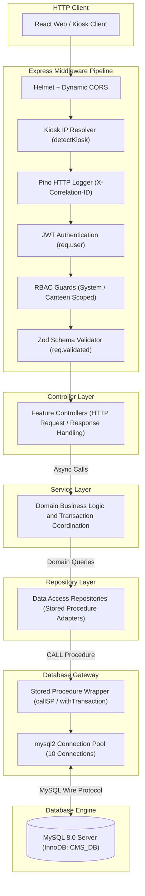

# Backend Architecture - ISRO Canteen Management System (CMS)

## Document Information
- Target Subsystem: CMS Backend Application Server (`backend/src/`)
- Classification: Architectural and Technical Specification
- Status: Verified against Implementation Codebase
- File Location: `documents/architecture/backend-architecture.md`

---

## 1. Architectural Principles and Source of Truth

The CMS Backend is engineered as an enterprise-grade, layered RESTful application server. The architecture adheres to the following foundational principles:

1. **Strict Stored Procedure Boundary:** The backend does not generate dynamic CRUD SQL statements in production. All persistent state transitions, financial balance modifications, menu approvals, and concurrency locks execute exclusively through parameterized MySQL stored procedures (`CALL <procedure>(?, ?)`).
2. **Defensive N-Tier Layering:** Code is organized into strict horizontal layers: `Router -> Middleware -> Controller -> Service -> Repository -> Database Gateway`. Layers only communicate with immediately adjacent layers.
3. **Decoupled Identity and Two-Tier Access Governance:** Login identity (`CMS_USER`) is isolated from consumer profile identity (`CMS_CUSTOMER`). Authorization is enforced along two orthogonal vectors: System-level administrative roles (`SYSTEMROLES`) and Canteen-scoped operational roles (`CANTEENROLES`).
4. **Zero-Assumptions Validation and Sanitization:** Every incoming request body, query parameter, and route path variable is strictly parsed and typed using Zod schemas before reaching business logic controllers.
5. **Edge and Hardware Awareness:** The backend provides dedicated middleware and routing infrastructure to identify, authenticate, and synchronize autonomous Raspberry Pi kiosk terminals deployed at physical canteen counters.

---

## 2. Technology Stack and Verified Dependencies

All dependencies and version specifications are verified directly against `backend/package.json`:

| Category | Library / Tool | Version | Operational Responsibility |
| :--- | :--- | :--- | :--- |
| **Runtime Environment** | Node.js | >= 18.0.0 | Asynchronous event-driven JavaScript runtime executing in ECMAScript Modules (`"type": "module"`) mode. |
| **Web Application Framework** | Express.js | ^5.2.1 | HTTP routing engine, middleware pipeline composition, and REST endpoint exposure. |
| **Database Client / Driver** | `mysql2` | ^3.22.5 | High-performance MySQL driver utilizing `mysql2/promise` connection pooling, prepared statements, and binary result-set handling. |
| **Authentication & Tokens** | `jsonwebtoken` | ^9.0.3 | Cryptographic signing (HMAC-SHA256) and verification of stateless Bearer JWTs. |
| **Password Security** | `bcrypt` | ^6.0.0 | Adaptive one-way salt generation and password hashing for local authentication. |
| **Schema Validation** | `zod` | ^4.4.3 | Type-safe declarative schema validation for HTTP request payloads, query strings, and path parameters. |
| **Structured Logging** | `pino` & `pino-http` | ^10.3.1 / ^11.0.0 | High-throughput JSON logger with automatic HTTP request tracing, custom log levels, and PII redaction. |
| **Development Log Formatter** | `pino-pretty` | ^13.1.3 | Human-readable colorized terminal output for local development environments. |
| **Security Header Hardening** | `helmet` | ^8.2.0 | Security header injection (Content Security Policy, Cross-Origin Embedder, HSTS, X-Frame-Options). |
| **Cross-Origin Resource Sharing**| `cors` | ^2.8.6 | Strict dynamic origin validation supporting local development, containerized DNS, and authorized frontend domains. |
| **Rate Limiting** | `express-rate-limit` | ^8.5.2 | Volumetric brute-force attack prevention on authentication endpoints (`/api/auth/login`). |
| **Date & Timezone Engine** | `dayjs` | ^1.11.21 | Timezone parsing, operational meal cutoff evaluations, and MySQL DATETIME string formatting in IST (`Asia/Kolkata`). |
| **Real-Time WebSockets** | `socket.io` | ^4.7.4 | Bidirectional event-based communication infrastructure for counter operations and kitchen alerts. |
| **OpenAPI Documentation** | `swagger-ui-express` & `swagger-jsdoc` | ^5.0.1 / ^6.3.0 | Automated OpenAPI 3.0 specification generation and interactive API explorer rendered at `/api-docs`. |
| **Environment Configuration** | `dotenv` | ^17.4.2 | Loads environment variables from `.env` into `process.env`. |
| **Process Monitoring (Dev)** | `nodemon` | ^3.1.14 | Automatic server process restart upon source code modification. |
| **Test Runner & Assertions** | `vitest` & `supertest` | ^3.0.0 / ^7.0.0 | Unit, integration, and HTTP route assertion testing framework. |

---

## 3. Application Entry Points and Lifecycle

### 3.1 Server Bootstrap (`src/server.js`)
The root executable entry point initializes the HTTP server, validates database availability, and manages process signals:

1. **Port and Interface Binding:** Listens on `0.0.0.0` at `env.PORT` (default: 8080) to ensure containerized visibility across Docker bridge networks.
2. **Initial Database Health Check:** Immediately invokes `testDbConnection()` during startup to verify MySQL responsiveness. Connection warnings are logged cleanly without causing premature crash-loops during database container warm-up.
3. **Windows Console Signal Normalization:** On Windows platforms, Node.js console wrappers do not reliably trap `Ctrl+C`. A `readline` interface is bound to `process.stdin` to emit synthetic `SIGINT` events upon user termination.
4. **Graceful Shutdown Protocol:** Upon receiving `SIGINT` or `SIGTERM`:
   - Closes idle keep-alive sockets immediately via `server.closeIdleConnections()`.
   - Halts ingestion of new HTTP requests via `server.close()`.
   - Arms a 1.5-second force-close timer (`server.closeAllConnections()`).
   - Arms a 3.0-second emergency safety timer to guarantee process termination if open handles linger.
   - Flushes and cleanly closes the MySQL database connection pool (`pool.end()`).
   - Delays final exit by 150 ms to ensure asynchronous Pino worker thread buffers flush completely to `stdout`.
5. **Crash Isolation:** Global listeners trap `unhandledRejection` and `uncaughtException`, recording fatal JSON logs before initiating graceful teardown.

### 3.2 Application Factory (`src/app.js`)
The Express application factory configures global middleware, security policies, diagnostics, and routing:

```
[ Incoming HTTP Request ]
           │
           ▼
[ Trust Proxy (1 hop) ]
           │
           ▼
[ Helmet Security Headers ]
           │
           ▼
[ Dynamic CORS Verification ]
           │
           ▼
[ Body Parsers (json, urlencoded) ]
           │
           ▼
[ Kiosk IP Detection (detectKiosk) ]
           │
           ▼
[ Pino HTTP Request Logger ]
           │
           ▼
[ Login Rate Limiter (/api/auth/login) ]
           │
           ▼
[ Health Probes (/health, /health/db) & Swagger UI (/api-docs) ]
           │
           ▼
[ Central API Router (/api) ]
           │
           ▼
[ Catch-all 404 Route Handler ]
           │
           ▼
[ Centralized Error Handler (errorHandler) ]
```

- **Trust Proxy:** Configured with `app.set("trust proxy", 1)` to allow reverse proxies (such as Nginx or Docker ingress) to pass real client IP addresses in `X-Forwarded-For`.
- **Dynamic CORS Policy:** Matches request origins against `env.FRONTEND_URL`, localhost addresses, `.vercel.app` staging domains, and private RFC-1918 subnets (`192.168.*`, `10.*`, `172.16-31.*`) during local development. Exposes `X-Correlation-ID` and `X-Canteen-ID` headers to client applications.
- **Rate Limiting:** Protects `/api/auth/login` by capping requests to 10 attempts per 15-minute window per IP.
- **Diagnostic Probes:**
  - `GET /health`: Lightweight process uptime probe returning environment mode.
  - `GET /health/db`: Deep probe executing `testDbConnection()` to assert database readiness.
  - `GET /api-docs`: Serves the interactive Swagger UI explorer.
  - `GET /api-docs.json`: Emits raw OpenAPI 3.0 JSON specification.

---

## 4. Layered Architectural Pattern (N-Tier)

Requests flow through a unidirectional, layered pipeline where each tier maintains dedicated responsibilities:



### Layer Responsibilities

1. **Middleware Layer (`src/middlewares/`):**
   - Intercepts requests prior to routing.
   - Enforces security constraints: token verification, role permissions, rate limits, schema validation, and hardware IP resolution.
   - Attaches verified context to the request object: `req.user`, `req.kiosk`, `req.canteenId`, `req.validated`, and `req.id`.
2. **Router Layer (`src/routes/` and `src/modules/*/*.routes.js`):**
   - Maps HTTP methods and URL paths to middleware chains and target controller functions.
   - Does not contain application logic or database queries.
3. **Controller Layer (`src/modules/*/*.controller.js`):**
   - Wrapped with `asyncHandler` to eliminate repetitive `try/catch` boilerplate.
   - Extracts validated parameters from `req.validated`, `req.params`, `req.query`, or `req.user`.
   - Delegates operations to domain services.
   - Serializes standard HTTP responses via `sendSuccess` or `sendError` from `src/utils/apiResponse.js`.
4. **Service Layer (`src/modules/*/*.service.js`):**
   - Encapsulates business logic, domain computations, timezone conversions (`dateTime.js`), and operational rules.
   - Coordinates multi-entity workflows (e.g. validating cutoff time, checking existing active bookings, determining applicable tariffs, and orchestrating wallet debits).
   - Manages atomic transactions using `withTransaction` where multiple stored procedure invocations must succeed or fail together.
5. **Repository Layer (`src/modules/*/*.repository.js`):**
   - Serves as the data access boundary.
   - Formats input variables for stored procedure signatures.
   - Invokes procedures via `callSP(spName, params, executor)`.
   - Unwraps result sets, maps dual-aliased field names, and handles database error signals.
6. **Database Gateway Layer (`src/db/connection.js`):**
   - Manages the singleton connection pool.
   - Provides reusable execution wrappers (`callSP`, `withTransaction`, `testDbConnection`).

---

## 5. Backend Directory Structure

```
backend/
├── Dockerfile                      # Container specification (Rocky Linux 9 + PM2)
├── ecosystem.config.cjs            # PM2 cluster and process configuration
├── package.json                    # Dependencies, engine constraints, and run scripts
├── package-lock.json               # Locked dependency tree
├── vitest.config.js                # Vitest test runner configuration
├── scripts/
│   ├── db-init.js                  # Database connection verification utility
│   ├── db-sync.js                  # Stored procedure synchronization utility
│   ├── db-verify.js                # Schema and constraint verification script
│   └── run-all-sql.js              # Comprehensive SQL runner (schema, procs, events, seed)
└── src/
    ├── app.js                      # Express application factory and middleware pipeline
    ├── server.js                   # Executable server bootstrap and lifecycle manager
    ├── config/
    │   ├── env.js                  # Centralized, typed environment variable access
    │   └── swagger.config.js       # Swagger / OpenAPI 3.0 JSDoc configuration
    ├── db/
    │   └── connection.js           # MySQL pool, callSP wrapper, withTransaction helper
    ├── common/
    │   ├── errors/
    │   │   └── appError.js         # Custom exception hierarchy (BadRequest, NotFound, etc.)
    │   └── responses/              # Standardized response structures
    ├── middlewares/
    │   ├── auth.middleware.js      # JWT extraction, signature verification, claim parsing
    │   ├── error.middleware.js     # Centralized error handler, SQLSTATE 45000 translation
    │   ├── kioskDevice.middleware.js # Client IP extraction, kiosk hardware resolution
    │   ├── requestLogger.middleware.js # Pino HTTP logger, correlation ID injection
    │   ├── role.middleware.js      # System and canteen-scoped RBAC authorization
    │   └── validate.middleware.js  # Zod schema validation factory
    ├── utils/
    │   ├── apiResponse.js          # sendSuccess and sendError formatting helpers
    │   ├── asyncHandler.js         # Async controller wrapper for unhandled rejections
    │   ├── dateTime.js             # IST timezone utilities, cutoff comparisons
    │   └── logger.js               # Pino logger instance with sensitive field redaction
    ├── docs/
    │   └── health.docs.js          # Swagger documentation annotations for health probes
    ├── routes/
    │   └── index.routes.js         # Central API route index mounting all module routers
    └── modules/
        ├── auth/                   # Local authentication and ISRO SSO callback
        ├── booking/                # Advance meal pre-booking, batching, serving, cancellation
        ├── canteen/                # Centers and Canteens master facility governance
        ├── common/                 # Reference lookup tables (status, custtypes, autonumbers)
        ├── daymenu/                # Day menu planning, assistant drafts, manager approval
        ├── dayslot/                # Operational meal time slots, cutoffs, serving windows
        ├── holidays/               # Institutional facility holiday configuration
        ├── identity/               # Users, roles, customer profiles, RFID access keys
        ├── kiosk/                  # Kiosk hardware fleet, self-service, counter POS, edge sync
        ├── menu/                   # Global master menu food dish catalog
        ├── menutemplates/          # Reusable weekly menu planning templates
        ├── officialrequest/        # Departmental catering, combos, grade-based approvals
        ├── pricing/                # Type-2 SCD effective-dated customer-type pricing bands
        ├── reports/                # Kitchen prep sheets, serving manifests, monthly payroll
        ├── service/                # Global meal services catalog (Breakfast, Lunch, etc.)
        ├── walkin/                 # Immediate surplus meal point-of-sale dispensing
        └── wallet/                 # Prepaid wallet accounts, cash top-ups, withdrawal lifecycle
```

---

## 6. Middleware Pipeline and Security Guards

### 6.1 Authentication Middleware (`src/middlewares/auth.middleware.js`)
- **`authenticate`:**
  - Extracts Bearer token from the `Authorization` header (`Bearer <token>`).
  - Verifies token signature against `env.JWT_SECRET`.
  - Normalizes and attaches `req.user` with verified claims:
    - `USERID`: Integer primary key from `CMS_USER`.
    - `LOGINID`: Human-readable login identifier (e.g., `admin`, `perm1`, `mgr1`).
    - `CUSTOMERID`: Integer foreign key pointing to `CMS_CUSTOMER` (or `null`).
    - `CTYPECODE`: Customer classification code (`PRM`, `CNT`, `VIS`, `OCE`, or `null`).
    - `DEFAULTCANTEENID`: User default operational canteen identifier.
    - `SYSTEMROLES`: Array of system-level role codes (e.g., `['SYSADM']`).
    - `CANTEENROLES`: Array of canteen assignment objects: `[{ CANTEENID, CANTEENNAME, CANTEENCODE, ROLECODE, ROLENAME, ISDEFAULT }]`.
  - Rejects missing or invalid tokens with HTTP 401 Unauthorized.
- **`optionalAuthenticate`:**
  - Performs non-blocking token extraction. If a valid token is present, populates `req.user`; otherwise allows the request to proceed without rejecting. Used by kiosk counter endpoints where operations may be initiated anonymously or by local terminal operators.

### 6.2 Role Authorization Middleware (`src/middlewares/role.middleware.js`)
Enforces a two-tier access control model:

1. **`authorizeSystemRoles(...allowedRoles)`:**
   - Validates whether `req.user.SYSTEMROLES` contains at least one of the specified roles (e.g. `SYSADM`).
   - Automatically grants access to the root administrator account (`USERID === 1` or `LOGINID === 'admin'`).
   - Rejects unauthorized users with HTTP 403 Forbidden.
2. **`authorizeCanteenRoles(allowedRoles, getCanteenId)`:**
   - Enforces facility-scoped access governance for canteen operations (`CNTMGR`, `CNTAST`, `CNTSTF`).
   - Dynamically resolves the target `canteenId` using a pluggable resolver (checking route parameters `req.params.canteenId`, query strings `req.query.canteenId`, request body `req.body.CANTEENID`, or executing an asynchronous entity lookup such as `getCanteenIdByBookingId`).
   - Grants access if the user is a `SYSADM` or if their `CANTEENROLES` array contains an assignment matching both the target `canteenId` and one of the `allowedRoles`.
   - Attaches the verified numeric canteen ID to `req.canteenId`.
3. **`authorizeAnyCanteenRole(...allowedRoles)`:**
   - Grants access if the user possesses the required role code across *any* assigned canteen, or is a `SYSADM`. Used for general dashboard and aggregated summary endpoints.

### 6.3 Kiosk Device Middleware (`src/middlewares/kioskDevice.middleware.js`)
- **`getClientIp(req)`:** Extracts the normalized client IP address from `X-Forwarded-For` or the underlying socket. Normalizes IPv6 loopback (`::1`) and IPv4-mapped addresses (`::ffff:127.0.0.1`) to `127.0.0.1`.
- **`resolveKioskFromIp(ip)`:**
  - Ignores loopback/localhost IPs to prevent PC developer machines from masquerading as physical hardware kiosks.
  - Maintains an in-memory resolution cache with a 2-minute Time-To-Live (TTL) to avoid executing database queries on rapid RFID card scans.
  - Queries `KioskRepository.identifyKioskDevice(ip)` to resolve device code, device name, canteen assignment, terminal type (`STAFF_COUNTER` or `EMP_SELF_SERVICE`), and active status.
- **`detectKiosk`:** Non-blocking global middleware. Attaches `req.kiosk` if the remote IP matches a registered active kiosk device.
- **`requireKiosk(allowedTypes)`:** Strict route guard. Rejects requests with HTTP 403 Forbidden if the client IP does not correspond to an active, registered kiosk terminal of the specified type.

### 6.4 Validation Middleware (`src/middlewares/validate.middleware.js`)
- Factory function accepting a Zod schema object structured as `{ body, params, query }`.
- Executes `schema.safeParse()`.
- On validation failure:
  - Formats issues into human-readable paths and messages.
  - Emits a structured `logger.warn` event containing the correlation ID, method, URL, and failure paths. **Raw request body payloads are omitted from logs to prevent PII and credential exposure.**
  - Responds with HTTP 400 Bad Request containing flattened error details.
- On validation success: Assigns the parsed and sanitized data to `req.validated` and delegates to `next()`.

### 6.5 Request Logger Middleware (`src/middlewares/requestLogger.middleware.js`)
- Powered by `pino-http`.
- **Correlation Tracking:** Generates a unique correlation ID formatted as `cms-<UUIDv4>` if not already supplied via `X-Correlation-ID` or `X-Request-ID`. Echoes the correlation ID back to the client in the `X-Correlation-ID` response header.
- **Context Injection:** Injects request metadata into every JSON log record: `CORRELATION_ID`, `CLIENT_IP`, `KIOSK_ID`, `DEVICE_CODE`, `CANTEEN_ID`, `USERID`, `CUSTOMER_ID`, and `LOGINID`.
- **Dynamic Log Levels:** Logs responses with status codes `>= 500` as `error`, `>= 400` as `warn`, and `< 400` as `info`.

### 6.6 Error Handling Middleware (`src/middlewares/error.middleware.js`)
- Centralized Express error handler receiving uncaught exceptions and errors passed via `next(err)`.
- **Operational Error Classification:**
  - Evaluates custom exceptions inheriting from `AppError` (`isOperational === true`).
  - Classifies MySQL signal exceptions (`sqlState === '45000'` or `err.code === 'ER_SIGNAL_EXCEPTION'`) as operational business errors (mapped to HTTP 400).
  - Classifies duplicate key collisions (`err.code === 'ER_DUP_ENTRY'`) as HTTP 409 Conflict.
- **Structured Error Logging:** Emits JSON log payloads with complete correlation context. Logs operational warnings at `warn` level; logs unexpected application errors at `error` level.
- **Production Sanitization:** In production environments (`NODE_ENV === 'production'`), internal 500 error messages are sanitized to `"Internal server error"` and stack traces are suppressed.

---

## 7. Module-by-Module Technical Inventory

The application mounts 17 functional domain routers under the `/api` prefix in `src/routes/index.routes.js`:

### 7.1 Auth Module (`/api/auth`)
- **Controller & Service:** `auth.controller.js`, `auth.service.js`, `auth.repository.js`
- **Key Endpoints:**
  - `POST /login`: Validates credentials, executes stored procedure `CMSLOGININFO`, verifies bcrypt hash, and emits signed JWT.
  - `POST /sso`: Validates external organizational SSO token against `env.SSO_SECRET_KEY`, resolves employee profile, and issues CMS session token.
- **Stored Procedures Called:** `CMSLOGININFO`

### 7.2 Identity Module (`/api/identity`)
- **Controller & Service:** `identity.controller.js`, `identity.service.js`, `identity.repository.js`
- **Key Endpoints:**
  - `GET /users`, `POST /users`: User account lifecycle management.
  - `GET /roles`, `POST /user-roles`: System role assignments (`CMSASSIGNUSERROLE`, `CMSREVOKEUSERROLE`).
  - `GET /canteen-roles`, `POST /canteen-roles`: Facility-scoped operational role assignments (`CMSASSIGNCANTEENROLE`).
  - `GET /customers`, `POST /customers`: Base customer identity creation.
  - `POST /profiles/permanent`, `POST /profiles/contract`, `POST /profiles/visitor`, `POST /profiles/oce`: Domain employee profiles.
  - `POST /access-keys`: RFID card serial UID and barcode key registration (`CMSADDACCKEY`, `CMSDEACTACCKEY`).
- **Permissions:** Restricted primarily to `SYSADM` via `authorizeSystemRoles("SYSADM")`.

### 7.3 Canteen Module (`/api/canteens`)
- **Controller & Service:** `canteen.controller.js`, `canteen.service.js`, `canteen.repository.js`
- **Key Endpoints:**
  - `GET /centers`, `POST /centers`: Institutional research center facilities (`CMS_CENTER`).
  - `GET /`, `POST /`: Canteen master records scoped under centers (`CMS_CANTEEN`).
  - `GET /:id`: Detailed canteen configuration and assigned management roster.
- **Permissions:** Creation and editing restricted to `SYSADM`.

### 7.4 Service Module (`/api/services`)
- **Controller & Service:** `service.controller.js`, `service.service.js`, `service.repository.js`
- **Key Endpoints:**
  - `GET /`: Lists all global meal services (Breakfast, Lunch, Snacks, Dinner).
  - `POST /`, `PUT /:id`: Configures global service definitions and operational properties.
- **Permissions:** Managed by `SYSADM` and Canteen Managers (`CNTMGR`).

### 7.5 Menu Items Module (`/api/menu-items`)
- **Controller & Service:** `menu.controller.js`, `menu.service.js`, `menu.repository.js`
- **Key Endpoints:**
  - `GET /`: Retrieves global food catalog with dietary markers, category filters, and base dish flags.
  - `POST /`, `PUT /:id`: Creates and edits menu items (`CMSADDMENUITEM`, `CMSUPDMENUITEM`).
- **Permissions:** Accessible for reading by authenticated users; modifications restricted to `CNTMGR` and `CNTAST`.

### 7.6 Dynamic Pricing Module (`/api/pricing`)
- **Controller & Service:** `pricing.controller.js`, `pricing.service.js`, `pricing.repository.js`
- **Key Endpoints:**
  - `GET /`: Retrieves effective pricing matrix for dishes.
  - `POST /`: Creates new effective-dated Type-2 SCD price bands (`CMS_ITEMPRICE` and `CMS_ITMPRICDT`).
  - `GET /history/:menuItemId`: Historical audit trail of tariff changes.
- **Business Rules:** Resolves prices using the *serving date* rather than the booking creation date. Supports customer-type tiers (`PRM`, `CNT`, `VIS`, `OCE`).
- **Permissions:** Restricted to `CNTMGR` via `canApproveDayMenu` permission check.

### 7.7 Day Slot Module (`/api/day-slots`)
- **Controller & Service:** `dayslot.controller.js`, `dayslot.service.js`, `dayslot.repository.js`
- **Key Endpoints:**
  - `GET /`: Lists scheduled meal slots for specific dates and canteens.
  - `POST /`: Creates daily meal windows defining start time, end time, and booking cutoff time (`CMSADDDAYSLOT`).
  - `POST /bulk`: Generates operational slots across multiple future calendar dates.
- **Permissions:** Canteen-scoped authorization (`authorizeCanteenRoles(["CNTMGR", "CNTAST"])`).

### 7.8 Day Menu Module (`/api/day-menus`)
- **Controller & Service:** `daymenu.controller.js`, `daymenu.service.js`, `daymenu.repository.js`
- **Key Endpoints:**
  - `GET /`: Retrieves published daily menus.
  - `POST /`: Submits dish selections for a day slot. Assistant creations enter `PENDING` state; Manager creations are immediately `APPROVED` / `PUBLISHED`.
  - `GET /pending`: Lists unapproved draft menus awaiting manager review.
  - `POST /:id/approve`: Canteen Manager approval transition (`CMSAPPRDAYMENU`).
  - `POST /bulk`: Multi-date bulk menu creator.
- **Permissions:** Operational drafting by `CNTAST`; approval restricted to `CNTMGR`.

### 7.9 Pre-Booking Engine Module (`/api/bookings`)
- **Controller & Service:** `booking.controller.js`, `booking.service.js`, `booking.repository.js`
- **Key Endpoints:**
  - `GET /active`: Fetches active booking for a customer/service/date context.
  - `GET /weekly-menu`: Retrieves weekly published menus with base items, holiday flags, and existing user bookings.
  - `POST /`: Standard single advance pre-booking creation (`CMSADDBOOK`).
  - `POST /weekly-batch`: Multi-day advance booking transaction.
  - `PUT /:id/items`: Batch replacement of items in an existing booking with atomic wallet adjustments.
  - `PATCH /:id/cancel`: Booking cancellation before cutoff, issuing automatic wallet refund where applicable (`CMSCANCELBOOK`).
  - `PATCH /:id/serve`: Serving confirmation marking booking as served (`CMSSERVEBOOK`).
  - `PATCH /:id/no-show`: Marks uncollected booking as no-show (`CMSNOSHOWBOOK`).
  - `GET /kitchen-prep`: Aggregated dish preparation quantities for kitchen staff (`CMSRPTPREPSHEET`).
- **Concurrency & Integrity:** Guaranteed via `CMS_PBACTIVE` unique constraint and transaction locking.

### 7.10 Wallet Module (`/api/wallets`)
- **Controller & Service:** `wallet.controller.js`, `wallet.service.js`, `wallet.repository.js`
- **Key Endpoints:**
  - `GET /customer-lookup/:identifier`: Resolves customer profile and wallet by Employee ID, Login ID, or Customer ID.
  - `POST /topup`: Cash top-up executed by Canteen Manager (`CMSTOPUPWALLET`).
  - `GET /customer/:customerId`: Balance and status retrieval.
  - `GET /customer/:customerId/transactions`: Immutable double-entry ledger history (`CMS_WALLETTRAN`).
  - `POST /withdraw/request`: User-submitted balance refund claim (`CMS_WALLETWD`).
  - `POST /withdraw/:walletWdId/approve`: Manager approval and cash disbursement confirmation.
- **Permissions:** Canteen Managers can manage and top up; employees can only view their own wallets and submit withdrawal requests.

### 7.11 Menu Templates Module (`/api/menu-templates`)
- **Controller & Service:** `menutemplate.controller.js`, `menutemplate.service.js`, `menutemplate.repository.js`
- **Key Endpoints:**
  - `GET /`, `POST /`: Template definitions bundling standard dish combinations (`CMS_MENUTPL`, `CMS_MENUTPLDT`).
  - `POST /:id/apply`: Applies template to a target date range and day slot.
- **Permissions:** `CNTMGR` and `CNTAST`.

### 7.12 Holidays Module (`/api/holidays`)
- **Controller & Service:** `holiday.controller.js`, `holiday.service.js`, `holiday.repository.js`
- **Key Endpoints:**
  - `GET /`: Lists facility holiday dates.
  - `POST /`, `DELETE /:id`: Configures facility closed dates preventing menu scheduling.
- **Permissions:** `SYSADM` and `CNTMGR`.

### 7.13 Reports Module (`/api/reports`)
- **Controller & Service:** `report.controller.js`, `report.service.js`, `report.repository.js`
- **Key Endpoints:**
  - `GET /kitchen-summary`: Aggregated preparation quantities grouped by dish and service window.
  - `GET /monthly-payroll`: Monthly meal consumption and deduction totals for permanent employees.
  - `GET /monthly-payroll/:customerId`: Detailed itemized monthly breakdown per employee.
- **Permissions:** Restricted to Canteen Managers and Assistants (`CNTMGR`, `CNTAST`).

### 7.14 Kiosk Subsystem Module (`/api/kiosk`)
- **Controller & Service:** `kiosk.controller.js`, `kiosk.service.js`, `kiosk.repository.js`
- **Sub-Domains:**
  1. **Fleet Management (SYSADM):**
     - `GET /devices`, `POST /devices`: Kiosk terminal registry (`CMS_KIOSK`).
     - `GET /devices/telemetry`: Fleet-wide status, CPU temperature, disk usage, and sync health.
  2. **Device Handshake & Telemetry:**
     - `GET /config`: Resolves kiosk identity, assigned canteen, and terminal type from client IP.
     - `POST /heartbeat`: Telemetry ping recording uptime, memory, and hardware health.
  3. **Self-Service Lobby Terminals:**
     - `POST /self-service/scan`: Resolves employee profile and wallet on card tap.
     - `GET /self-service/services`, `GET /self-service/menu`: Next-day meal options.
     - `POST /self-service/book`: Next-day express booking creation.
  4. **Staff Serving Counter Stations:**
     - `GET /counter/current-slot`: Resolves active serving time slot.
     - `GET /counter/resolve/:identifier`: Resolves active meal reservations for scanned card.
     - `POST /counter/serve`: Marks items or entire order as served with operator attribution.
     - `POST /counter/login`: Staff shift login authentication.
  5. **Edge Offline Synchronization:**
     - `GET /bootstrap-package`: Master data download for edge SQLite cache (supports HTTP 304).
     - `POST /sync-offline`: Ingests offline pre-booking batches with isolated sub-transactions.
     - `POST /sync-serving`: Ingests offline serving and walk-in event batches.

### 7.15 Official Request Module (`/api/official-requests`)
- **Controller & Service:** `official.controller.js`, `official.service.js`, `official.repository.js`
- **Key Endpoints:**
  - `GET /services`, `POST /combos`: Meeting hospitality packages and packaged combo definitions (`CMS_OFFSERV`, `CMS_OFFCOMBO`, `CMS_OFFCOMBDT`).
  - `GET /level-mappings`, `POST /level-mappings`: Grade-to-approver mapping configuration (`CMS_LVLMAP`).
  - `POST /bookings`, `GET /bookings/my`: Official catering request submission (`CMS_OFFBOOK`).
  - `GET /approvals/assigned`, `POST /approvals/:id/action`: Hierarchical peer/subordinate approval processing (`CMS_OFFAPPR`).
  - `GET /manager/pending`, `POST /manager/:id/action`: Canteen Manager acceptance workflow.
  - `GET /kitchen-prep/confirmed`, `GET /kitchen-prep/summary`: Preparation manifests for official events.
  - `PUT /kitchen-prep/bookings/:id/fulfillment`: Delivery and fulfillment tracking.

### 7.16 Walk-In Module (`/api/walkin`)
- **Controller & Service:** `walkin.controller.js`, `walkin.service.js`, `walkin.repository.js`
- **Key Endpoints:**
  - `GET /employee-lookup`: Search by employee code, login ID, or RFID card.
  - `GET /visitor-lookup`: Search visitors by phone number, name, or card.
  - `POST /register-visitor`: Rapid visitor registration creating customer, visitor record, wallet, and card association in one atomic transaction.
  - `GET /active-menu`: Active menu items and customer-specific tariffs for spot dining.
  - `POST /serve`: Direct atomic order submission recording booking in `SRV` status (`CMSWALKINSERVE`), deducting wallet balance where applicable.
- **Permissions:** Restricted to active Canteen Staff (`CNTSTF`, `CNTMGR`, `CNTAST`).

### 7.17 Common Reference Module (`/api/common`)
- **Controller & Service:** `common.controller.js`, `common.service.js`, `common.repository.js`
- **Key Endpoints:** Read-only lookup APIs for system status groups (`CMS_STATUS`), customer types (`CMS_CUSTTYPE`), screen definitions (`CMS_SCREEN`), and auto-number sequences (`CMS_AUTONOS`).

---

## 8. Database Gateway and Execution Mechanics

### 8.1 Connection Pool Architecture (`src/db/connection.js`)
Database connectivity is managed through a singleton `mysql2/promise` connection pool initialized with the following parameters:

```javascript
export const pool = mysql.createPool({
  host: env.DB_HOST,
  port: env.DB_PORT,
  user: env.DB_USER,
  password: env.DB_PASSWORD,
  database: env.DB_NAME,
  waitForConnections: true,
  connectionLimit: 10,
  queueLimit: 0,
  dateStrings: true,
  timezone: "+05:30",
  charset: "utf8mb4",
  ssl: env.DB_SSL ? { rejectUnauthorized: false } : undefined,
});
```

- **`connectionLimit: 10`:** Restricts concurrent active database connections per backend instance to prevent connection exhaustion.
- **`dateStrings: true`:** Prevents the Node.js driver from converting MySQL date/datetime columns into JavaScript `Date` objects in the local machine timezone, ensuring timestamps preserve exact IST values.
- **`timezone: "+05:30"`:** Aligns the MySQL session timezone strictly with Indian Standard Time.
- **`charset: "utf8mb4"`:** Supports full multi-byte Unicode storage.

### 8.2 Stored Procedure Wrapper (`callSP`)
To eliminate boilerplate error-handling and result-set slicing across repositories, database procedures are invoked via `callSP`:

```javascript
export async function callSP(spName, params = [], executor = pool) {
  const placeholders = params.map(() => "?").join(", ");
  const [resultSets] = await executor.query(
    `CALL ${spName}(${placeholders})`,
    params
  );
  const dataSets = Array.isArray(resultSets) ? resultSets.slice(0, -1) : [];
  return {
    firstRow: dataSets[0]?.[0] || null,
    firstSet: dataSets[0] || [],
    allSets: dataSets,
    raw: resultSets,
  };
}
```

- **OkPacket Elimination:** MySQL stored procedure calls return an array of result sets terminated by a trailing `OkPacket` metadata object. `callSP` slices off the trailing packet, providing clean access to raw result rows.
- **Pluggable Executor:** Accepts an optional `executor` argument. When running outside a transaction, defaults to `pool`. When executing within an atomic transaction, receives the active transactional connection `conn`.

### 8.3 Managed Transactions (`withTransaction`)
Multi-statement operations requiring ACID guarantees utilize `withTransaction`:

```javascript
export async function withTransaction(callback) {
  const conn = await pool.getConnection();
  try {
    await conn.beginTransaction();
    const result = await callback(conn);
    await conn.commit();
    return result;
  } catch (err) {
    await conn.rollback();
    throw err;
  } finally {
    conn.release();
  }
}
```

- Automatically acquires a dedicated connection from the pool.
- Begins a transaction, commits upon successful execution of the async callback, rolls back on any exception, and guarantees connection release back to the pool in the `finally` block.

---

## 9. Utility Modules and Cross-Cutting Helpers

### 9.1 Standard API Responses (`src/utils/apiResponse.js`)
All HTTP responses adhere to a consistent JSON envelope structure:

**Success Response (`sendSuccess`):**
```json
{
  "SUCCESS": true,
  "MESSAGE": "Operation completed successfully",
  "DATA": { ... },
  "PAGINATION": null
}
```

**Error Response (`sendError`):**
```json
{
  "SUCCESS": false,
  "MESSAGE": "Error description",
  "ERRORS": null
}
```

### 9.2 Asynchronous Controller Wrapper (`src/utils/asyncHandler.js`)
Wraps controller functions to catch promise rejections and forward them automatically to `next(err)`, eliminating repetitive `try/catch` statements:
```javascript
export const asyncHandler = (fn) => (req, res, next) => {
  Promise.resolve(fn(req, res, next)).catch(next);
};
```

### 9.3 Date & Timezone Utilities (`src/utils/dateTime.js`)
CMS enforces Indian Standard Time (`Asia/Kolkata`, UTC+05:30) across all operational scheduling:
- `getTodayIST()`: Returns current date string formatted as `YYYY-MM-DD`. Prevents midnight-to-5:30 AM date lag bugs.
- `getTomorrowIST()`: Returns tomorrow's date string in IST.
- `toMySQLDateTime(input)`: Converts ISO UTC timestamps or local dates into MySQL `YYYY-MM-DD HH:MM:SS` strings in exact IST.
- `toMySQLDate(input)`: Converts date inputs into MySQL `YYYY-MM-DD` strings.
- `isPastCutoff(cutoffStr)`: Compares current IST time against a slot's booking cutoff deadline to enforce cutoff rules.
- `addDaysIST(dateStr, days)`: Adds calendar days to an IST date without timezone drift.

### 9.4 Logging and Redaction Engine (`src/utils/logger.js`)
Pino logger instance configured with strict security redaction rules:
- Censors sensitive fields across HTTP requests and logs: `req.headers.authorization`, `req.headers.cookie`, `body.PASSWORD`, `body.PASSWORDHASH`, `body.token`, and `body.accessToken` are replaced with `"[REDACTED]"`.
- In development environments, formats logs using `pino-pretty` with standard timestamps and colorization. In production, writes asynchronous raw JSON lines to standard output.

### 9.5 Custom Exception Hierarchy (`src/common/errors/appError.js`)
Domain errors inherit from a base `AppError` class that captures stack traces and flags errors as operational:
- `BadRequestError` (400)
- `UnauthorizedError` / `UnauthenticatedError` (401)
- `ForbiddenError` (403)
- `NotFoundError` (404)
- `ConflictError` (409)
- `DatabaseError` (500)

---

## 10. Environment Configuration Reference

Configuration is managed centrally in `src/config/env.js`, sourced from environment variables:

| Variable Name | Default Value | Description |
| :--- | :--- | :--- |
| `NODE_ENV` | `development` | Runtime environment mode (`development`, `production`, `test`). |
| `PORT` | `8080` | TCP port on which the Express server listens. |
| `FRONTEND_URL` | `http://localhost:3000` | Comma-separated list of allowed CORS client origins. |
| `LOG_LEVEL` | `info` | Minimum logging threshold (`fatal`, `error`, `warn`, `info`, `debug`, `trace`). |
| `DB_HOST` | `localhost` | MySQL database hostname or Docker container service name (`db`). |
| `DB_PORT` | `3306` | MySQL server port. |
| `DB_USER` | `root` | Database username (`cms_app` in production Docker). |
| `DB_PASSWORD` | `""` | Database password. |
| `DB_NAME` | `CMS_DB` | Target database catalog name. |
| `DB_SSL` | `false` | Enables SSL/TLS for database connections when set to `"true"`. |
| `JWT_SECRET` | `cms_default_jwt_secret_key_...` | Cryptographic secret key used to sign and verify session JWTs. |
| `JWT_EXPIRES_IN`| `8h` | Lifetime of issued JWT tokens (e.g. `8h`, `1d`). |
| `SSO_SECRET_KEY`| `0123456789abcdef` | Shared HMAC secret for verifying incoming ISRO SSO payload assertions. |

---

## 11. Database Setup and Automation Scripts

The backend includes database management scripts located in `backend/scripts/`:

### 11.1 Comprehensive SQL Runner (`scripts/run-all-sql.js`)
Automated migration runner executed by Docker during initialization (`cms_init_db`) or manually via npm scripts:
- **Execution Flags:**
  - `--if-empty`: Checks whether `CMS_USER` exists and has data. Skips initialization if database is already populated.
  - `--drop-only`: Executes `DROP_ALL.sql` to cleanly tear down existing tables, views, procedures, and events.
  - `--database=<name>`: Overrides target database name (used for isolated test suites, e.g. `cms_test_db`).
- **Execution Order:**
  1. Strips hardcoded `USE db_name;` statements from scripts to allow dynamic database binding.
  2. Executes schema definitions in dependency order (specified in `database/execution_order.txt`).
  3. Executes backward compatibility views (`COMPATIBILITY_VIEWS.sql`).
  4. Executes stored procedures in preferred module order (`common`, `identity`, `canteen`, `dayslot`, `menuitem`, `daymenu`, `menutemplate`, `booking`, `wallet`, `kiosk`, `officialrequest`, `reporting`). Parses custom MySQL `DELIMITER` commands (`$$` and `//`).
  5. Executes scheduled events (`events/NOSHOW_EVENT.sql`).
  6. Executes initial seed data (`seed/INITIAL_SEED.sql`).

### 11.2 NPM Script Commands
```bash
npm run dev           # Starts backend with nodemon hot-reload
npm start             # Starts backend with node in production
npm run db:run-all    # Runs full schema, procedure, event, and seed migration
npm run db:drop       # Drops all tables, views, procedures, and events
npm run db:init:test  # Rebuilds the cms_test_db test database
npm test              # Executes test suite using Vitest
```
