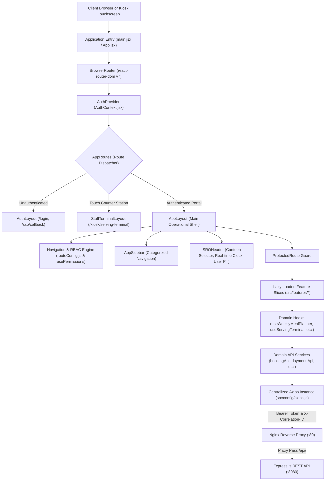
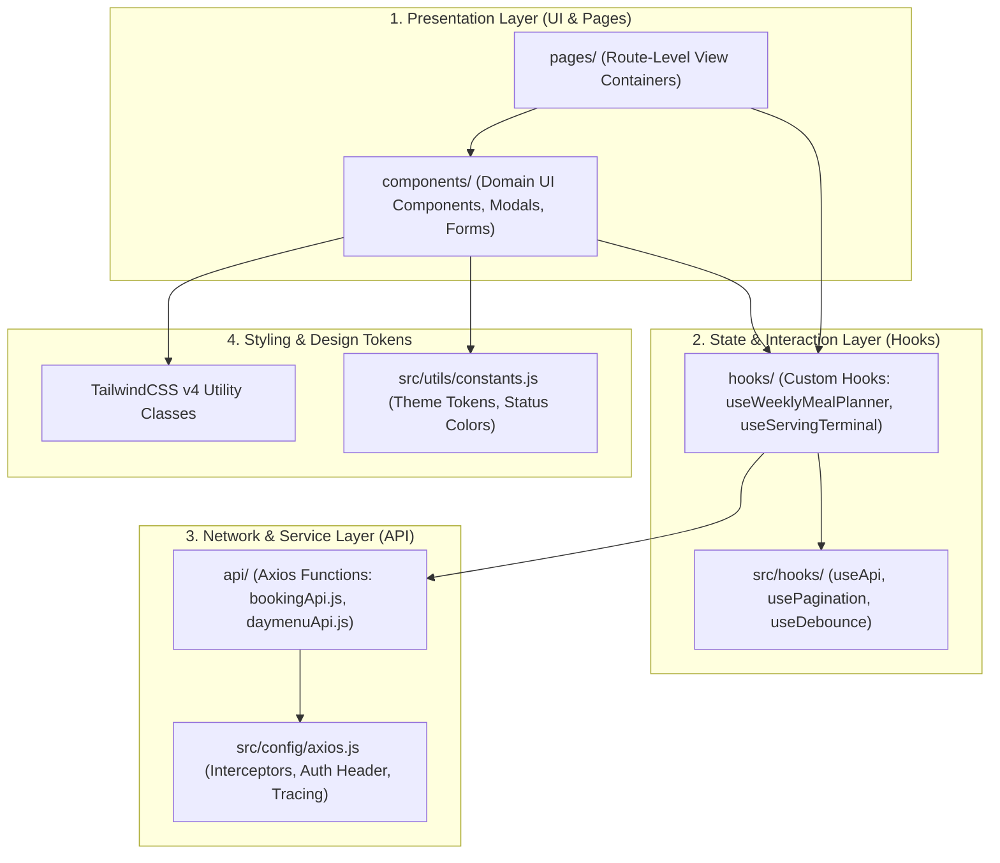
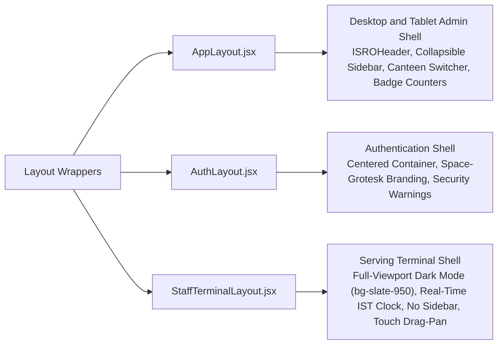
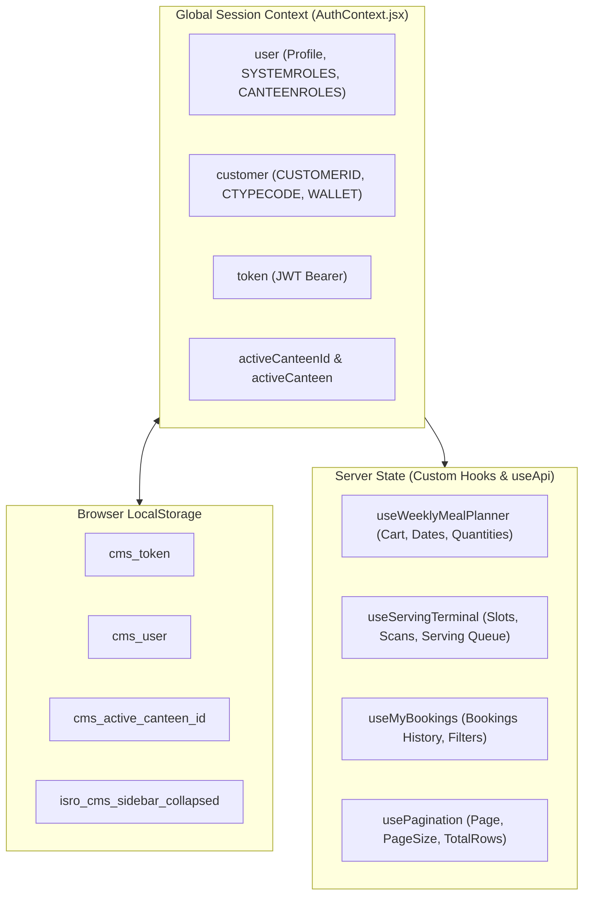
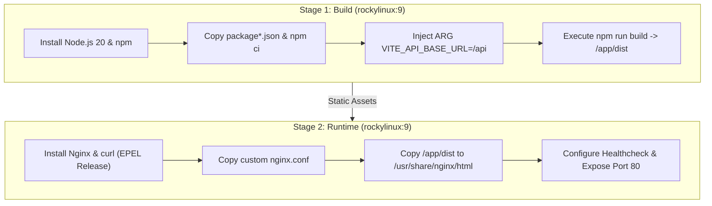

# CanteenMitra Frontend Architecture Specification

## 1. Executive Summary and Architecture Principles

The CanteenMitra Frontend (`cms-frontend`) is a Single Page Application (SPA) designed to interface with the Canteen Management System backend for the Indian Space Research Organisation (ISRO). It provides an interface for multiple distinct user personas: System Administrators, Canteen Managers, Canteen Assistants, Counter Staff Operators, and Employees (Permanent, Contractual, and Visitors).

### Core Architectural Principles

1. **Feature-Driven Domain Architecture (FDD):** Code is co-located by domain slice inside `src/features/`. Each domain slice encapsulates its own presentation components, custom hooks, API service layer, and page views.
2. **Dual-Role Based Access Control (RBAC):** Access control enforces backend role distinctions between global System Roles (`SYSADM`, `ADMIN`) and Canteen-scoped Roles (`CNTMGR`, `CNTAST`, `CNTSTF`), in addition to Customer Classifications (`PRM`, `CNT`, `VIS`).
3. **Decoupled API Integration Layer:** Centralized Axios configuration handles JWT Bearer authentication injection, distributed request tracing via `X-Correlation-ID`, and automatic session termination on HTTP 401 responses.
4. **Hardware and Touch-Optimized Viewports:** Dedicated kiosk and counter station views provide distraction-free, high-contrast, touch-pan enabled layouts designed specifically for Raspberry Pi and POS touch terminals.
5. **Code Splitting and Lazy Loading:** Route definitions load feature bundles on demand using dynamic imports (`React.lazy`) wrapped in accessible Suspense fallbacks.

---

## 2. Quick Start and Local Developer Guide

This section provides step-by-step instructions for developers setting up and running the frontend application locally outside Docker.

### Prerequisites

* **Node.js:** v20.x or higher (LTS recommended)
* **Package Manager:** `npm` v10.x or higher
* **Backend API:** CanteenMitra Backend service running on `http://localhost:8080` (or accessible via network)

### Step 1: Navigate and Install Dependencies

From the repository root, change directory into the frontend application folder and install package dependencies:

```bash
cd cms/frontend/cms-frontend
npm install
```

For strict deterministic builds matching `package-lock.json`, use:

```bash
npm ci
```

### Step 2: Configure Environment Variables

The application relies on Vite environment variables prefixed with `VITE_`. Create a `.env` file in `cms/frontend/cms-frontend/`:

```bash
cp .env.example .env
```

Configure the API base URL inside `.env`:

```env
# Point to local reverse-proxy path (recommended when using Vite dev proxy)
VITE_API_BASE_URL=/api

# Or point directly to the backend server if CORS allows direct connection
# VITE_API_BASE_URL=http://localhost:8080/api
```

> Note: When `VITE_API_BASE_URL=/api` is used, the Vite development server automatically proxies all `/api/*` HTTP requests to `http://localhost:8080` as configured in `vite.config.js`.

### Step 3: Start the Local Development Server

Run the Vite development server with Hot Module Replacement (HMR):

```bash
npm run dev
```

The application starts and listens at:
```text
http://localhost:5173
```

### Step 4: Verification, Linting, and Production Build

```bash
# Execute ESLint across all source files
npm run lint

# Compile and bundle the application into production assets (dist/)
npm run build

# Preview the local production build
npm run preview
```

---

## 3. Technology Stack and Dependencies

The technology stack is verified against `frontend/cms-frontend/package.json` and build configurations:

### Production Dependencies

| Package | Version | Responsibility |
| :--- | :--- | :--- |
| `react` | `^19.2.8` | Core UI library for component rendering and reconciliation |
| `react-dom` | `^19.2.8` | DOM renderer for React |
| `react-router-dom` | `^7.18.2` | Declarative client-side routing, navigation, and nested layouts |
| `axios` | `^1.19.0` | Promise-based HTTP client for REST API communication |
| `@heroicons/react` | `^2.2.0` | Comprehensive SVG icon set for navigation and action indicators |

### Build Tools and Development Tooling

| Package | Version | Responsibility |
| :--- | :--- | :--- |
| `vite` | `^8.2.0` | Next-generation frontend build tool and local dev server |
| `@vitejs/plugin-react` | `^6.0.4` | Fast Refresh and JSX transformation support for React in Vite |
| `tailwindcss` | `^4.3.3` | Utility-first CSS framework (v4 engine) |
| `@tailwindcss/vite` | `^4.3.3` | Vite integration plugin for TailwindCSS v4 |
| `postcss` | `^8.5.26` | CSS transformation engine |
| `autoprefixer` | `^10.5.4` | PostCSS plugin to parse CSS and add vendor prefixes |
| `eslint` | `^10.8.0` | JavaScript and JSX code quality and linting engine |
| `@eslint/js` | `^10.0.1` | ESLint JavaScript recommendations |
| `eslint-plugin-react-hooks` | `^7.1.1` | Rules of Hooks validation for React 19 |
| `eslint-plugin-react-refresh` | `^0.5.3` | Hot Module Replacement (HMR) safety validation |

---

## 4. High-Level Frontend Architecture

The frontend application operates as a client-side rendered Single Page Application served by Nginx and running in modern web browsers and embedded Chromium hardware kiosks.



---

## 5. Folder Structuring and Logic Division Architecture

The frontend avoids monolithic global folders and enforces a strict vertical-slice architecture where logic is modularized by domain.

### Architectural Logic Division Within a Feature Slice

Every feature under `src/features/<domain>/` separates its technical responsibilities into four distinct layers:



### Layer Responsibilities

1. **Presentation Layer (`pages/`, `components/`):**
   * Contains purely declarative React JSX components.
   * `pages/`: Mounted directly by the router; coordinates sub-components, page titles, and layout containers.
   * `components/`: Granular domain components (cards, tables, form modals, summary panels). Does not make raw Axios calls directly.
2. **State & Interaction Layer (`hooks/`):**
   * Encapsulates state machines, form validation, cart aggregation, timer loops, and mutation side effects.
   * Isolates React state hooks (`useState`, `useCallback`, `useMemo`, `useRef`) away from UI markup.
3. **Network & Service Layer (`api/`):**
   * Contains exported asynchronous functions communicating with backend endpoints.
   * Strictly responsible for URL resolution, parameter formatting, payload transformation, and returning response data (`res.data.DATA`).
4. **Styling & Design Tokens:**
   * Utility classes styled directly in JSX using TailwindCSS v4.
   * Programmatic color and status dictionaries imported from `src/utils/constants.js`.

### Directory Tree Overview

```text
frontend/cms-frontend/
├── Dockerfile                   # Multi-stage Rocky Linux 9 container build
├── nginx.conf                   # Rocky Linux 9 Nginx reverse proxy configuration
├── package.json                 # Dependency manifests and scripts
├── vite.config.js               # Vite 8 plugins and local development proxy
├── eslint.config.js             # Modern ESLint flat configuration
├── index.html                   # HTML entry point with Google Fonts integration
└── src/
    ├── main.jsx                 # React DOM root initialization with StrictMode
    ├── App.jsx                  # Root component hosting Router and AuthProvider
    ├── index.css                # Global styles, TailwindCSS v4 imports, touch directives
    ├── assets/                  # Branding assets and ISRO logos
    ├── components/              # Shared reusable components
    │   ├── common/              # Modals, confirmation dialogs, search inputs, pagination
    │   ├── icons/               # Custom and domain-specific vector icons
    │   ├── layout/              # ISROHeader and AppSidebar components
    │   └── ui/                  # Buttons, toggles, form elements, status badges
    ├── config/                  # Global environment and client configurations
    │   ├── app.config.js        # API base URLs, local storage keys, application metadata
    │   └── axios.js             # Central Axios instance with request and response interceptors
    ├── contexts/                # Global React contexts
    │   ├── authContextDef.js    # React Context definition
    │   └── AuthContext.jsx      # Authentication, token storage, and canteen switching provider
    ├── features/                # 17 domain-driven modular feature packages
    │   ├── auth/                # Login and Single Sign-On (SSO) callback flows
    │   ├── booking/             # Pre-booking, weekly planner, order history, kitchen prep
    │   ├── canteen/             # Multi-canteen facility management and campus centers
    │   ├── common/              # System metadata lookups (statuses, customer types, auto-numbers)
    │   ├── dashboard/           # Operations Dashboard (Manager/Staff) and Employee Home Portal
    │   ├── daymenu/             # Daily menu builder, bulk menu creator, weekly menu monitor
    │   ├── dayslot/             # Operational meal slots, calendar scheduling, capacity limits
    │   ├── holidays/            # Holiday calendar governance and service blackouts
    │   ├── identity/            # User identity, system and canteen role assignments, customer accounts
    │   ├── kiosk/               # Hardware terminal fleet management, telemetry, serving counter station
    │   ├── menu/                # Master food catalog, allergens, vegetarian flags, price readiness
    │   ├── menutemplates/       # Reusable cyclical menu template blueprints
    │   ├── officialrequest/     # Official institutional bookings, approvals, combo menus, VIP prep
    │   ├── pricing/             # Customer category tariffs and pricing versioning
    │   ├── reports/             # Monthly payroll deductions, kitchen prep summaries, CSV exports
    │   ├── services/            # Meal service catalog definitions (Breakfast, Lunch, Snacks, Dinner)
    │   └── wallet/              # Digital wallet accounts, cashier top-ups, withdrawal requests
    ├── hooks/                   # Global utility hooks
    │   ├── useApi.js            # Standardized API execution hook with loading and error state
    │   ├── useAuth.js           # AuthContext consumer hook
    │   ├── useDebounce.js       # Value debouncing for live searches
    │   ├── usePagination.js     # Unified client/server pagination controller
    │   └── usePermissions.js    # RBAC evaluation and role-checking utilities
    ├── layouts/                 # Viewport layout templates
    │   ├── AppLayout.jsx        # Enterprise application layout with header, sidebar, and alerts
    │   ├── AuthLayout.jsx       # Minimalist centered shell for authentication screens
    │   ├── StaffTerminalLayout.jsx # Distraction-free, dark-themed counter serving interface
    │   └── EmployeeKioskLayout.jsx # Hardware-oriented self-service touchscreen wrapper
    ├── routes/                  # Navigation mapping and route guards
    │   ├── AppRoutes.jsx        # Route definitions with lazy loading and code splitting
    │   ├── ProtectedRoute.jsx   # Authentication and role verification wrapper
    │   ├── routeConfig.js       # Dynamic navigation definitions and category hierarchies
    │   └── routeConfig.jsx      # Supplementary route configuration helpers
    └── utils/                   # Shared utility functions and formatting helpers
        ├── constants.js         # Color tokens, status dictionaries, payment methods
        ├── currency.js          # Currency calculation utilities
        ├── date.js              # Date formatting, week calculations, IST conversions
        ├── formatters.js        # Currency (INR) and string formatting functions
        └── serviceEmoji.js      # Meal service icon resolver
```

---

## 6. Layout Architecture and Viewport Strategies

The application implements three primary viewport layouts to support disparate device form factors:



### 1. AppLayout (`src/layouts/AppLayout.jsx`)
The enterprise management interface designed for desktop workstations and management tablets:
* **ISROHeader:** Displays the official header with live Indian Standard Time (IST) digital clock (HH:MM:SS), formatted current date, active user name, primary role pill, and logout button. Supports mobile drawer toggle.
* **AppSidebar:** Collapsible navigation sidebar supporting group categories (`Operations & Live`, `Menu Planning & Catalog`, `Serving & Terminals`, `Tariffs & Wallet`, `Administration`, `Employee Services`). State persists in `localStorage` under `isro_cms_sidebar_collapsed` and toggles via the `Ctrl+B` keyboard shortcut.
* **Canteen Context Switcher:** Allows operators with multi-canteen roles to switch active canteen scope on the fly, immediately refreshing contextual data.
* **Badge Notification Polling:** Asynchronously queries counts for pending day menu approvals (`getPendingDayMenus`) and pending wallet withdrawal requests (`fetchWithdrawals`), attaching notification badges to relevant sidebar tabs.

### 2. AuthLayout (`src/layouts/AuthLayout.jsx`)
A clean, centered container for `/login` and SSO workflows. Presents ISRO branding, high-visibility credential inputs, and clear feedback alerts for invalid logins or session expiration.

### 3. StaffTerminalLayout (`src/layouts/StaffTerminalLayout.jsx`)
A dedicated high-contrast, touch-optimized viewport created for kitchen counter operators and Raspberry Pi hardware terminals:
* **Distraction-Free:** Completely strips away sidebars, complex navigation, and administrative links.
* **Dark Theme Palette:** Rendered in `bg-slate-950` with high-contrast text to reduce eye fatigue and screen glare in bright canteen service lines.
* **Hardware Touch Support:** Employs the `useKioskDragScroll` hook to allow continuous mouse-drag or finger-drag panning across order queues without visible scrollbars (`scrollbar-width: none`).
* **Operator HUD:** Persistent top bar displaying the current canteen name, operator full name, and real-time IST clock.

---

## 7. Role-Based Access Control (RBAC) and Security Engine

Access control is strictly validated on the client side to provide tailored navigation, prevent unauthorized page loads, and guide users to appropriate views.

### Dual-Role Architecture

The backend distinguishes between two role structures, both processed by `usePermissions`:

1. **System Roles (`SYSTEMROLES`):**
   * `SYSADM` / `ADMIN`: Superuser administrative access across all centers and canteens.
2. **Canteen-Scoped Roles (`CANTEENROLES`):**
   * `CNTMGR`: Canteen Manager (menu planning, price approvals, wallet reviews, operations).
   * `CNTAST`: Canteen Assistant (menu building, kitchen prep oversight, counter serving).
   * `CNTSTF`: Canteen Staff (counter serving terminal, meal distribution, bookings monitor).
3. **Customer Classification Types (`CUSTOMER.CTYPECODE`):**
   * `PRM` / `PERMEMP`: Permanent ISRO Employee (payroll-deducted bookings, official requests, multi-level approvals).
   * `CNT` / `CONTEMP`: Contract Worker (prepaid digital wallet, meal bookings).
   * `VIS` / `VISITOR`: Guest/Visitor (prepaid digital wallet, transient meal bookings).

### Permission Utility (`src/hooks/usePermissions.js`)

The `usePermissions` hook evaluates the authenticated user session and returns granular boolean flags and helper methods:

```javascript

const isAdmin = hasSystemRole('SYSADM', 'ADMIN') || user?.LOGINID === 'admin' || user?.USERID === 1;
const isCanteenManager = hasCanteenRole('CNTMGR');
const isCanteenAssistant = hasCanteenRole('CNTAST');
const isCanteenStaff = hasCanteenRole('CNTSTF');
const isCanteenWorker = isCanteenManager || isCanteenAssistant || isCanteenStaff;
const isEmployee = !isCanteenWorker && !isAdmin;

const canManageMenu = isCanteenManager || isCanteenAssistant;
const canApproveDayMenu = isCanteenManager;
const canManageWallet = isAdmin || isCanteenManager;
const canServeBookings = isCanteenManager || isCanteenStaff;
```

### Route Protection (`src/routes/ProtectedRoute.jsx`)

The `ProtectedRoute` component wraps authenticated routes in `AppRoutes.jsx`:
1. **Authentication Check:** If no valid user profile exists in `AuthContext`, the user is redirected to `/login`, preserving the requested URL in `location.state.from`.
2. **Permission Check:** If `requirePermission` is specified (e.g. `canApproveDayMenu`), the hook's boolean is checked; failures redirect to the landing page (`/`).
3. **Role Check:** If `allowedRoles` array is specified (e.g. `['SYSADM']` or `['CNTMGR', 'CNTAST']`), `perms.hasSystemRole` and `perms.hasCanteenRole` are validated against the current session.

### Navigation Matrix (`src/routes/routeConfig.js`)

Navigation tabs are dynamically generated by `getNavTabs(perms, user, customer, badges)`:

| Role / Persona | Visible Navigation Categories and Tabs | Default Landing Tab |
| :--- | :--- | :--- |
| **System Administrator** (`SYSADM`) | **Administration:** Kiosk Terminal Fleet, Canteen Facilities, Role and Access Governance, Approver Levels, Canteen Holidays | `kiosk-devices` |
| **Canteen Manager** (`CNTMGR`) | **Operations:** Dashboard, Bookings Monitor, Official Bookings, Official Kitchen Prep<br/>**Menu:** Catalog, Official Services, Service Slots, Day Slots, Menu Planner, Bulk Menu Creator, Menu Monitor<br/>**Terminals:** Serving Terminal<br/>**Finance:** Pricing, Wallet Management, Monthly Payroll, Holidays | `dashboard` |
| **Canteen Assistant** (`CNTAST`) | **Operations:** Dashboard, Bookings Monitor, Official Kitchen Prep<br/>**Menu:** Catalog, Service Slots, Day Calendar Slots, Menu Planner, Bulk Menu Creator, Menu Monitor<br/>**Terminals:** Serving Terminal<br/>**Finance:** Monthly Payroll | `dashboard` |
| **Canteen Staff** (`CNTSTF`) | **Operations:** Dashboard, Official Kitchen Prep, Bookings Monitor<br/>**Terminals:** Serving Terminal | `dashboard` |
| **Permanent Employee** (`PRM`) | **Employee Services:** Employee Portal, Pre-Book Meals, Booking History, Official Request, My Official Requests, Assigned Approvals | `home` |
| **Contract / Visitor** (`CNT`, `VIS`) | **Employee Services:** Employee Portal, Pre-Book Meals, Booking History, My Wallet | `home` |

---

## 8. State Management Architecture

The application balances global session context, localized server state, and UI component state without external boilerplate libraries:



### 1. Global Session State (`src/contexts/AuthContext.jsx`)
* **Initialization:** Evaluates `localStorage` on boot. Parses `cms_user` and `cms_token`. Validates stored `cms_active_canteen_id` against user's actual canteen assignments.
* **Canteen Metadata Enrichment:** An asynchronous `useEffect` fetches canonical canteen names and codes via `/canteens`, enriching cached roles in state and storage if discrepancies exist.
* **Authentication Functions:**
  * `login(loginId, password)`: Calls `POST /api/auth/login`, saves JWT and user profile, and initializes active canteen.
  * `ssoLogin(ssoToken)`: Authenticates third-party or intranet SSO tokens via `POST /api/auth/sso`.
  * `logout()`: Clears all session keys from `localStorage` and resets internal React states.
  * `setActiveCanteenId(id)`: Switches current active canteen scope for multi-canteen personnel.

### 2. Server State and Data Fetching
* **No Heavy Global Cache:** Server data is fetched close to the consuming components via feature-specific API service modules.
* **`useApi` Hook (`src/hooks/useApi.js`):** Wraps arbitrary asynchronous API calls to automatically expose `data`, `loading`, `error`, and an asynchronous `execute(...)` trigger.
* **Feature Hooks:** Custom domain hooks manage specialized complex states:
  * `useWeeklyMealPlanner`: Manages 7-day multi-meal selection arrays, service tabs, quantity mutations, and batch payload creation.
  * `useServingTerminal`: Coordinates real-time slot selection, barcode/RFID keyboard wedge buffer parsing, manual booking lookups, and serving state transitions.
  * `usePagination`: Standardizes server-side and client-side pagination parameters (`page`, `pageSize`, `totalRows`, `totalPages`).

---

## 9. API Client Layer and HTTP Interceptors

All HTTP requests communicate through a centralized Axios client configured in `src/config/axios.js`.

### Client Configuration
* `baseURL`: Dynamically resolved from `import.meta.env.VITE_API_BASE_URL` with fallback to `/api`.
* `withCredentials`: Disabled (`false`) in favor of explicit `Authorization: Bearer <token>` headers.
* `headers`: Pre-configured with `'Content-Type': 'application/json'`.

### Request Interceptor
Prior to dispatching any outgoing HTTP request:
1. **Bearer Token Injection:** Retrieves `cms_token` from `localStorage`. If present, injects `headers.Authorization = 'Bearer ' + token`.
2. **Distributed Tracing Header (`X-Correlation-ID`):** Checks for existing correlation identifiers. If absent, generates a unique tracing key matching the pattern:
   ```text
   req-[timestamp_base36]-[random_base36]
   ```
   This ensures end-to-end request traceability across the frontend, Nginx logs, backend services, and database stored procedures.

### Response Interceptor
1. **Correlation ID Propagation:** Inspects responses and errors for `res.data.CORRELATION_ID`, `x-correlation-id` response headers, or outgoing request correlation headers, attaching `err.correlationId` to the error object for presentation in UI error notifications.
2. **HTTP 401 Interception:** If any API request returns an HTTP 401 Unauthorized status:
   * Removes `cms_token` from `localStorage`.
   * Removes `cms_user` from `localStorage`.
   * Redirects the browser directly to `/login`.

---

## 10. Comprehensive Feature Modules Breakdown

The application contains 17 feature slices in `src/features/`:

### 1. `auth`
* **Purpose:** User authentication, password logins, and intranet Single Sign-On.
* **Key Components & Pages:** `LoginPage.jsx`, `SsoCallbackPage.jsx`.
* **API Service (`authApi.js`):** Calls `/auth/login` and `/auth/sso`.

### 2. `identity`
* **Purpose:** System-level user administration, customer creation, and role mapping.
* **Key Components & Pages:** `IdentityPage.jsx`, `UsersTable.jsx`, `UserForm.jsx`, `RolesTable.jsx`, `RoleForm.jsx`, `CustomersTable.jsx`, `CustomerForm.jsx`.
* **API Service (`identityApi.js`):** Integrates with `/identity/users`, `/identity/user-roles`, `/identity/roles`, and `/identity/customers`.

### 3. `canteen`
* **Purpose:** Multi-canteen facility management and campus center definitions.
* **Key Components & Pages:** `CanteenFacilitiesPage.jsx`.
* **API Service (`canteenService.js`):** Manages `/canteens` and `/canteens/centers`.

### 4. `holidays`
* **Purpose:** Managing canteen operational holidays and meal service blackouts.
* **Key Components & Pages:** `HolidaysPage.jsx`.
* **API Service (`holidayApi.js`):** Calls `/holidays` (CRUD, status deactivations).

### 5. `services`
* **Purpose:** Master definitions for daily meal services (Breakfast, Lunch, Snacks, Dinner).
* **Key Components & Pages:** `ServicesPage.jsx`, `ServicesTable.jsx`, `ServiceForm.jsx`.
* **API Service (`servicesApi.js`):** Calls `/services`.

### 6. `dayslot`
* **Purpose:** Operational scheduling of specific meal slots against dates, setting order cutoffs, service time windows, and maximum booking capacities.
* **Key Components & Pages:** `DaySlotsPage.jsx`, `DaySlotForm.jsx`, `DaySlotTable.jsx`.
* **API Service (`daySlotsApi.js`):** Calls `/day-slots` with server-side pagination and date range filters.

### 7. `menu`
* **Purpose:** Master food item catalog management, dietary flags (veg/non-veg), allergens, and price readiness.
* **Key Components & Pages:** `MenuCatalogPage.jsx`, `MenuItemFormModal.jsx`, `MenuItemTable.jsx`.
* **API Service (`menuApi.js`):** Calls `/menu-items` and `/menu-items/:id/price-readiness`.

### 8. `menutemplates`
* **Purpose:** Creating reusable menu templates for recurring meal cycles.
* **Key Components & Pages:** `MenuTemplatesPage.jsx`, `TemplateCreateModal.jsx`, `BulkGenerateModal.jsx`.
* **API Service (`menuTemplateApi.js`):** Calls `/menu-templates`, `/menu-templates/bulk-generate`, and `/menu-templates/generate-draft`.

### 9. `daymenu`
* **Purpose:** Daily menu planning, item pricing attachments, bulk weekly copying, and manager approval workflows.
* **Key Components & Pages:** `DayMenuPlannerPage.jsx`, `BulkMenuCreatorPage.jsx`, `MenuMonitorPage.jsx`, `DayMenuTable.jsx`, `PendingApprovalsQueue.jsx`, `SingleDayBuilder.jsx`.
* **API Services (`daymenuApi.js`, `bulkMenuApi.js`):** Calls `/day-menus/slots/:daySlotId`, `/submit`, `/approve`, `/reject`, `/pending`, and `/published`.

### 10. `pricing`
* **Purpose:** Configuration of tier-based tariffs (Permanent Employee, Contract Worker, Visitor) and price history tracking.
* **Key Components & Pages:** `PricingPage.jsx`, `PriceHistoryModal.jsx`, `PriceTierForm.jsx`.
* **API Service (`pricingApi.js`):** Calls `/pricing/menu-items/:menuItemId`, `/effective`, and `/deactivate`.

### 11. `booking`
* **Purpose:** Employee meal reservations, 7-day weekly meal planner, personal booking history, kitchen prep summaries, and booking cancellations.
* **Key Components & Pages:** `PreBookingPage.jsx`, `MyBookingsPage.jsx`, `BookingsMonitorPage.jsx`, `KitchenPrepDashboard.jsx`, `WeeklyMealPlanner.jsx`, `DayPlannerCard.jsx`, `MealItemRow.jsx`.
* **API Service (`bookingApi.js`):** Calls `/bookings`, `/bookings/active`, `/bookings/kitchen-prep`, `/bookings/weekly-menu`, `/bookings/weekly-batch`, `/cancel`, and `/serve`.

### 12. `officialrequest`
* **Purpose:** Institutional meal requests for meetings, VIP delegations, and official events; custom combos; multi-level hierarchical approval workflows.
* **Key Components & Pages:** `OfficialBookingPage.jsx`, `MyOfficialBookingsPage.jsx`, `AssignedApprovalsPage.jsx`, `OfficialBookingsMonitorPage.jsx`, `OfficialKitchenPrepPage.jsx`, `OfficialServicesManagerPage.jsx`, `LevelMappingPage.jsx`.
* **API Service (`officialApi.js`):** Calls `/official-requests/services`, `/combos`, `/level-mappings`, `/bookings`, `/action`, and `/kitchen-prep`.

### 13. `kiosk`
* **Purpose:** Hardware terminal registry, real-time telemetry tracking, boot configuration resolution, and counter serving station.
* **Key Components & Pages:** `KioskDevicesPage.jsx`, `KioskBootResolver.jsx`, `ServingTerminalPage.jsx`, `ShiftLoginCard.jsx`, `ScannerInputHero.jsx`, `ActiveBookingCard.jsx`.
* **API Services (`kioskApi.js`, `kioskDeviceService.js`):** Calls `/kiosk/config`, `/kiosk/devices`, `/kiosk/devices/telemetry`, `/kiosk/current-slot`, `/kiosk/resolve/:identifier`, and `/kiosk/serve`.

### 14. `wallet`
* **Purpose:** Digital wallet account lookup, cashier cash/UPI recharges, balance reviews, and withdrawal requests.
* **Key Components & Pages:** `WalletPage.jsx`, `EmployeeWalletPage.jsx`, `CustomerLookupCard.jsx`, `RechargeForm.jsx`, `WithdrawalsTable.jsx`, `WithdrawalReviewModal.jsx`.
* **API Service (`walletApi.js`):** Calls `/wallets/customer-lookup/:identifier`, `/wallets/topup`, `/wallets/customer/:customerId`, `/wallets/withdraw/request`, and `/wallets/withdraw/:id/approve`.

### 15. `reports`
* **Purpose:** Administrative financial audits and kitchen operation reports.
* **Key Components & Pages:** `MonthlyPayrollReportPage.jsx`, `KitchenSummaryPage.jsx`, `PayrollDataTable.jsx`, `PayrollKPISection.jsx`, `EmployeeBreakdownModal.jsx`.
* **API Service & Utilities (`reportApi.js`, `payrollExport.js`):** Calls `/reports/monthly-payroll`, `/reports/kitchen-summary`, and exports client-side CSV files.

### 16. `dashboard`
* **Purpose:** Contextual home screen based on active user role.
* **Key Components & Pages:**
  * `CanteenDashboardPage.jsx`: Real-time operational dashboard for canteen managers/staff showing active meal slots, kitchen prep counts, and pending approval metrics.
  * `EmployeeHomePage.jsx`: Self-service portal for employees showing today's bookings, upcoming schedule, and quick wallet balance summary.

### 17. `common`
* **Purpose:** Shared administrative lookup tables and utilities.
* **API Service (`commonApi.js`):** Calls `/common/status`, `/common/customer-types`, `/common/screens`, and `/common/autonos`.

---

## 11. UI/UX Design System, Typography, and Hardware Optimization

The user interface follows the official ISRO-inspired design language and layout standards:

### Design System and Color Tokens

* **Primary Brand (Space Blue):**
  * Backgrounds/Headers: `bg-slate-900` or `bg-blue-900`
  * Text: `text-blue-900` or `text-slate-900`
  * Applied to: Top navigation headers, category headers, primary titles, and active navigation badges.
* **Accent and Actions (ISRO Saffron):**
  * Buttons: `bg-orange-500`, hover: `bg-orange-600`
  * Accent Text: `text-orange-500`
  * Applied to: Primary action triggers ("Book Meal", "Submit"), badges, active sidebar borders, and loading spinners.
* **Secondary / Surface (Clean Tech Canvas):**
  * Cards/Modals: `bg-white`
  * Borders: `border-slate-200`
  * Applied to: Data table surfaces, form containers, and content cards.
* **Application Background:**
  * Canvas: `bg-slate-50`
  * Applied to: Global application canvas to establish contrast against white card surfaces.
* **Status Badges & Alerts:**
  * Active / Served / Confirmed: `bg-emerald-500/10 text-emerald-700 border-emerald-500/20`
  * Cancelled / Deactivated: `bg-red-500/10 text-red-700 border-red-500/20`
  * Pending / Review: `bg-amber-500/10 text-amber-700 border-amber-500/20`

### Page Layout Order Standard

Every feature page follows a structured top-to-bottom layout hierarchy:
1. **Page Header:** Screen title and contextual subtitle on the left; primary action buttons on the right.
2. **Filters & Search Surface:** Full-width container beneath the header housing search inputs, date pickers, and filter pills.
3. **Main Content Canvas:** Data tables, responsive grid cards, or multi-step form builders.
4. **Pagination & Summary Footer:** Bottom-aligned server pagination controls (`usePagination`) and aggregated counts.

### Hardware Touchscreen Optimization
The application provides ergonomic optimizations for embedded touchscreens and POS stations:
* **Touch Gestures:** Enforces `touch-action: pan-y !important` and `-webkit-overflow-scrolling: touch !important` across all scrollable regions.
* **Hidden Scrollbars:** Applies `.kiosk-scroll-container` and `.custom-touch-scroll` rules to eliminate visible scrollbars while preserving fluid drag scrolling.
* **High-Throughput Serving Input:** The `ServingTerminalPage` features an auto-focusing hidden input field designed to intercept keystrokes from USB RFID readers and barcode scanners operating in keyboard-wedge mode.

---

## 12. Build Pipeline, Dockerization, and Production Runtime

### Vite Build Configuration (`vite.config.js`)
* Uses `@vitejs/plugin-react` and `@tailwindcss/vite`.
* Local dev server runs on port 5173 with proxy rules mapping `/api` requests to `http://localhost:8080`.
* Production build generates minified chunks in `dist/` with code-split bundles using dynamic `import()` boundaries.

### Multi-Stage Dockerfile (`Dockerfile`)
The frontend is packaged using an enterprise-grade multi-stage container build based on Rocky Linux 9:



### Production Nginx Configuration (`nginx.conf`)
* **SPA Routing:** `try_files $uri $uri/ /index.html;` ensures client-side routing routes reload cleanly without 404 errors.
* **Reverse Proxy:**
  * Proxies `/api/` to `http://backend:8080/api/` with 60-second connection and read timeouts.
  * Proxies `/socket.io/` with `Upgrade` and `Connection: "upgrade"` headers for WebSocket real-time streams.
  * Proxies `/api-docs` and `/health` directly to backend endpoints.
* **Performance Optimizations:**
  * Gzip compression enabled for HTML, CSS, JavaScript, JSON, XML, and SVG.
  * Aggressive caching for static assets (`.ico`, `.css`, `.js`, `.png`, `.svg`): `Cache-Control: "public, max-age=15552000, immutable"`.
* **Health Check:** Integrated Docker health check validates `http://localhost/` every 30 seconds via `curl`.

---

## 13. Security Architecture and Best Practices

1. **Token Storage and Lifecycle:** JWT tokens are stored in `localStorage` under `cms_token`. They are injected into HTTP requests via Axios interceptors and instantly cleared upon HTTP 401 Unauthorized responses or explicit user logout.
2. **Client-Side Sanitization:** Correlation IDs are attached to both requests and error states to ensure auditability across distributed environments.
3. **Route Guards:** The `ProtectedRoute` component ensures that unauthenticated visitors cannot access administrative routes and verifies required role flags before mounting views.
4. **Backend Authority:** All client-side permissions reflect advisory UI rendering guards; authoritative authorization is enforced on every endpoint by backend middleware (`requireAuth`, `requireRole`, `requireCanteenRole`).

---

## 14. Architectural Constraints and Considerations

* **Active Canteen Scope:** Users with multi-canteen assignments select an active canteen scope stored in `localStorage` (`cms_active_canteen_id`). Switching canteens triggers local view reloads to ensure consistency across scoped endpoints.
* **Offline Serving Isolation:** The main frontend SPA assumes network connectivity to the reverse proxy. In scenarios where a physical kiosk loses central network connectivity, offline queueing and fallback operations are managed by the standalone local Kiosk Agent service rather than the browser SPA.
* **Client Performance:** Pages with large datasets (such as `MenuCatalogPage` and `DaySlotsPage`) leverage server-side pagination via `usePagination` to maintain minimal DOM overhead and fast rendering speeds.
