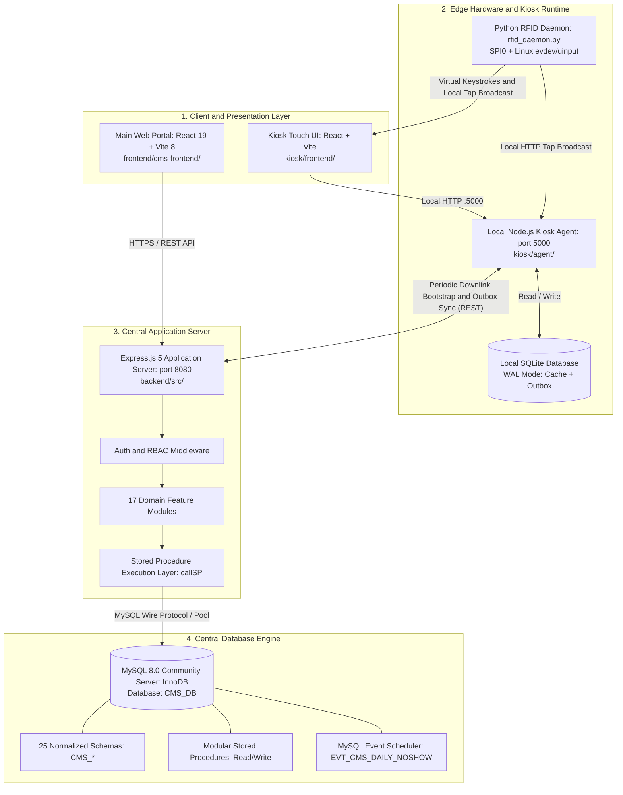
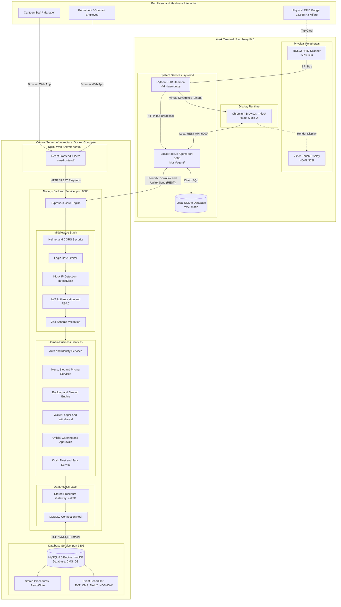
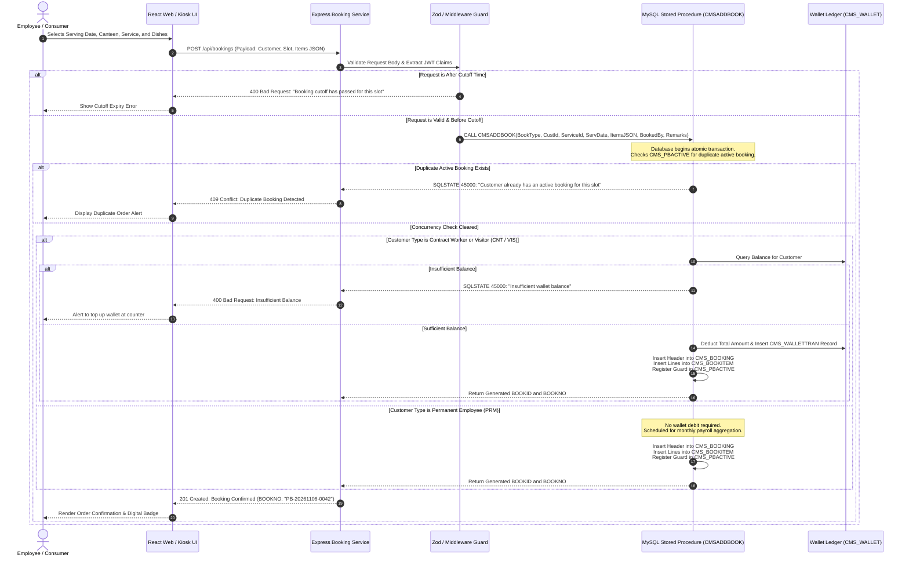
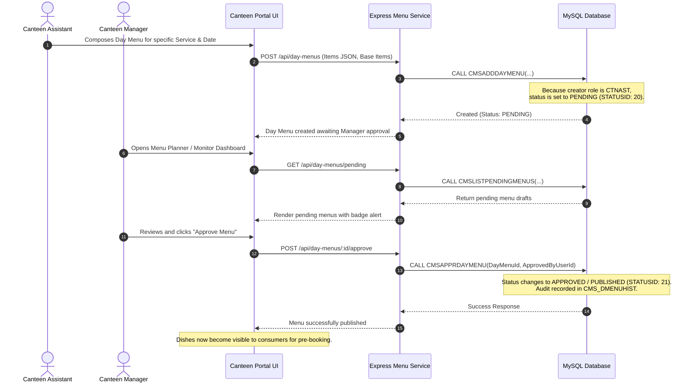
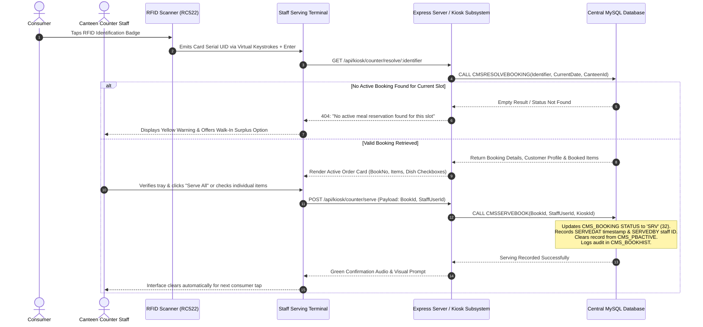
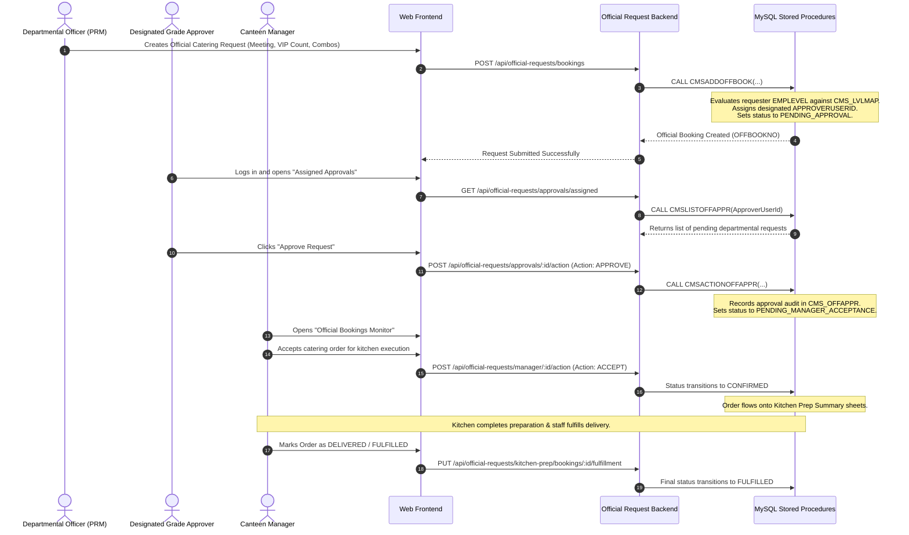
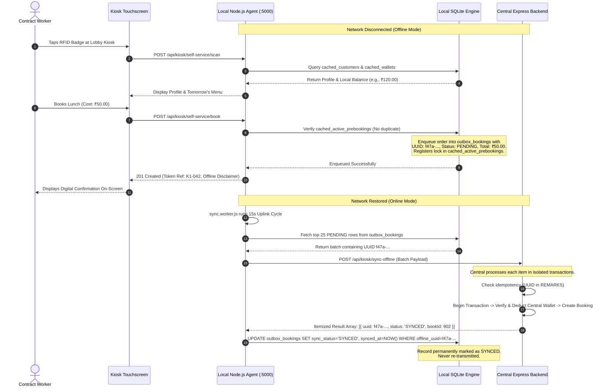
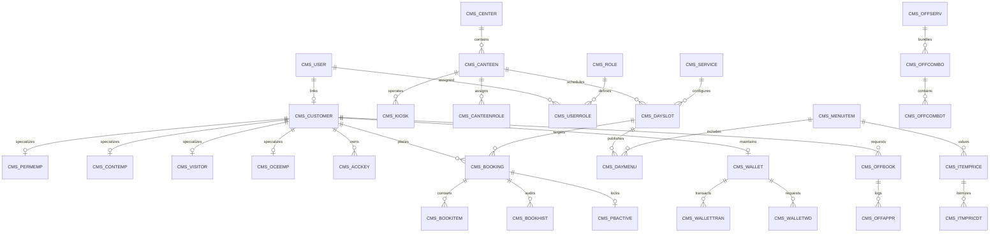
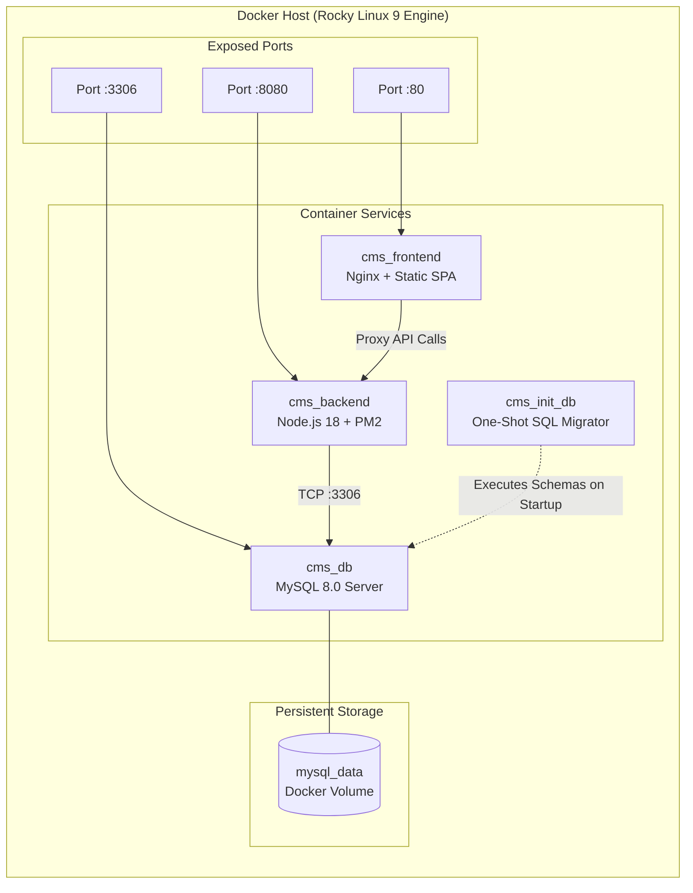

# System Overview - ISRO Canteen Management System (CMS)

## Document Information
- Target System: ISRO Internal Canteen Management System (CMS)
- Classification: Architecture & System Overview Specification
- Status: Verified against Implementation Codebase
- File Location: `documents/architecture/system_overview.md`

---

## 1. Introduction

### 1.1 Project Purpose and Objectives
The ISRO Internal Canteen Management System (CMS) is an enterprise-grade solution engineered to manage institutional canteen facilities, advance meal planning, multi-tiered subsidized pricing, automated meal provisioning, cash/wallet transactions, and paperless serving counter operations across organizational centers and canteens.

The system primary objectives include:
1. Operational Efficiency: Eliminating paper coupons and manual cash handling during meal service through fast digital verification (RFID cards and touch terminals).
2. Elimination of Food Waste: Operating primarily as an advance meal pre-booking system, enabling kitchen management to compute precise preparation manifests ahead of operational cutoffs.
3. Multi-Canteen Governance: Centralizing master data, menu catalogs, pricing matrices, and facility configurations while delegating day-to-day operational execution (day slots, daily menus, serving) to canteen-scoped personnel.
4. Tiered Pricing and Financial Compliance: Accurately calculating food subsidies and tariffs based on distinct organizational customer classifications (Permanent Employees, Contract Workers, Visitors, and Other Centre Employees).

### 1.2 Problems the System Solves
Traditional institutional catering faces significant organizational challenges:
- High Food Wastage: Unpredictable dining turnouts force kitchens to either over-prepare (leading to food disposal) or under-prepare (causing employee dissatisfaction).
- Counter Congestion: Manual validation of paper tokens or physical ticket distribution creates severe queue bottlenecks during lunch and breakfast rush hours.
- Reconciliation Overhead: Cash transactions at counters slow down food dispensing and introduce cash-handling risks, audit complexities, and reconciliation delays.
- Disparate Subsidies: Managing varying meal rates across diverse workforce categories (subsidized permanent staff vs. non-subsidized contract labor vs. guest visitors) without an automated rule engine causes tariff leakage.
- Network Instability at Remote Counters: Canteen serving counters often experience intermittent local network disconnects, which can halt counter operations if the system lacks offline edge capability.

### 1.3 Intended Users and Major Capabilities

| User Category | Identifier / Code | Access Channels | Primary Responsibilities & Capabilities |
| :--- | :--- | :--- | :--- |
| System Administrator | `SYSADM` | Web Portal (`cms-frontend`) | High-level system governance, center and canteen facility management, kiosk terminal fleet registration and monitoring, screen-role RBAC governance, holiday calendars, approver level mappings. |
| Canteen Manager | `CNTMGR` | Web Portal (`cms-frontend`), Counter Terminal | Global menu item and service catalog management, customer-type pricing matrices, day slot scheduling, day menu preparation and automatic approval, official meeting combo setup, contract worker/visitor wallet top-ups, withdrawal approvals, operational kitchen prep monitoring, and monthly payroll reports. |
| Canteen Assistant | `CNTAST` | Web Portal (`cms-frontend`) | Service scheduling, day slot configuration, day menu composition (submitted as Pending for Manager approval), bulk menu generation, and kitchen prep sheet viewing. |
| Canteen Staff | `CNTSTF` | Web Portal (`cms-frontend`), Staff Counter Station, Handheld Kiosk | Serving table operations, RFID badge scanning, itemized meal collection confirmation, spot walk-in surplus meal dispensing, and real-time order status tracking. |
| Permanent Employee | `PRM` / `PERMEMP` | Web Portal (`cms-frontend`), Self-Service Kiosk | Advance pre-booking (1 to 30 days ahead), booking cancellations prior to cutoff, official departmental catering requests for meetings/VIPs, peer/subordinate approval processing, and monthly consumption history. Billing processed via organizational payroll integration without requiring upfront wallet debit. |
| Contract Employee | `CNT` / `CONTEMP` | Web Portal (`cms-frontend`), Self-Service Kiosk | Advance meal pre-booking, self-service RFID kiosk inquiries, next-day express meal booking, prepaid wallet management, cash top-ups at canteen counters, and balance refunds/withdrawals upon contract completion. |
| Visitor / Guest | `VIS` / `VISITOR` | Self-Service Kiosk, Staff Counter Terminal | Fast registration at canteen counters, RFID card allocation, prepaid wallet top-up, next-day advance booking at lobby kiosks, and spot surplus dining. Visitors do not access the web application. |
| Other Centre Employee | `OCE` / `OCEEMP` | Web Portal (`cms-frontend`), Self-Service Kiosk | Inter-center guest bookings adhering to organizational guest tariffs and configured eligibility rules. |

---

## 2. System Scope

The ISRO CMS ecosystem comprises four primary architectural pillars, complemented by edge hardware drivers and deployment automation:



### 2.1 Main Backend (`backend/`)
- Runtime & Framework: Node.js (ESM modules) with Express.js 5.
- Architectural Style: Layered N-tier architecture (Router -> Middleware -> Controller -> Service -> Repository).
- Database Gateway: Enforces a strict stored-procedure boundary via `mysql2/promise` connection pooling. Production operations bypass dynamic query generation.
- Cross-Cutting Concerns: Zod schema validation, JWT token issuance and claim extraction, Pino structured logging with request correlation, Express rate-limiting, and Helmet security headers.

### 2.2 Central Database (`database/`)
- Database Management System: MySQL 8.0 running the InnoDB storage engine with `utf8mb4` character encoding.
- Schema Structure: 25 domain-driven SQL schema definitions. All table names adhere to the normalized `CMS_` prefix followed by 10 characters or fewer without underscores (e.g., `CMS_USERROLE`, `CMS_ITMPRICDT`, `CMS_BOOKITMHST`).
- Compatibility Layer: `COMPATIBILITY_VIEWS.sql` provides backward-compatible SQL views (e.g., `CMS_CONSUMERROLE`, `CMS_KIOSK_DEVICE`, `CMS_ITEMPRICEDT`).
- Stored Procedures: Over 80 modular stored procedures partitioned into `read/` and `write/` directories per domain.
- Automated Maintenance: Native MySQL Event Scheduler (`EVT_CMS_DAILY_NOSHOW`) running nightly at 23:59:50 to sweep uncollected bookings into a No-Show status.

### 2.3 Main Frontend (`frontend/cms-frontend/`)
- Framework: React 19 Single Page Application bundled with Vite 8.
- Styling: TailwindCSS 4 utilizing `@tailwindcss/vite` and utility-first layout structures.
- Routing & RBAC: React Router DOM 7 with declarative route guards (`ProtectedRoute`) evaluating system-wide (`SYSTEMROLES`) and canteen-scoped (`CANTEENROLES`) permissions.
- Modular Architecture: Feature-driven co-location uniting UI components, custom React hooks, and Axios API services inside distinct feature packages.

### 2.4 Kiosk Subsystem (`kiosk/`)
- Target Hardware: Raspberry Pi 5 single-board computer (64-bit OS), paired with an RC522 RFID reader module connected via SPI0 and a 7-inch HDMI/touch display.
- Local Agent (`kiosk/agent/`): Lightweight Node.js/Express service listening on `localhost:5000`, using `better-sqlite3` in WAL (Write-Ahead Logging) mode.
- Local Database Schema: Local SQLite database storing cached master datasets (`cached_customers`, `cached_wallets`, `cached_day_slots`, `cached_menu_items`, `cached_today_bookings`) and FIFO synchronization queues (`outbox_bookings`, `outbox_serving_events`).
- RFID Driver Daemon (`kiosk/drivers/rfid_daemon.py`): Python service reading card serial UIDs over SPI bus and emitting input simultaneously via Linux `/dev/uinput` virtual keyboard keystrokes (auto-focused in the browser) and local HTTP tap broadcasts.
- Operating Modes:
  1. Employee Self-Service Mode: RFID-based profile identification, wallet balance display, active booking viewing, and next-day express meal pre-booking.
  2. Staff Serving Counter Mode: Slot-aware booking lookup, itemized dish fulfillment, and spot walk-in surplus dispensing.
- System Services: Managed via Linux `systemd` units (`cms-kiosk.service` and `cms-rfid.service`) configured with RAM log buffering (`log2ram`) to prevent micro-SD flash memory wear.

### 2.5 Auxiliary Implemented Subsystems
- Official Meeting Catering & Multi-Tier Approvals (`modules/officialrequest/`): Departmental meeting catering workflow allowing employees to request packaged meal combos (`CMS_OFFCOMBO`), routing requests through hierarchical approver tiers mapped by employee grade (`CMS_LVLMAP`), followed by Canteen Manager operational confirmation and kitchen prep tracking.
- Surplus Walk-In Point of Sale (`modules/walkin/`): Point-of-sale workflow enabling canteen operators to dispense surplus meals to employees and unregistered visitors on the spot with atomic wallet deduction and immediate transition to served status.

---

## 3. Technology Stack

### 3.1 Technology Matrix and Version Inventory

| Layer / Subsystem | Technology | Version | Functional Responsibility |
| :--- | :--- | :--- | :--- |
| **Backend Runtime** | Node.js | >= 18.0.0 (ESM) | Asynchronous runtime environment executing server logic. |
| **Backend Web Framework** | Express.js | ^5.2.1 | HTTP routing, middleware pipeline, and REST API surface. |
| **Database Driver** | `mysql2/promise` | ^3.22.5 | MySQL connection pooling, prepared statements, and stored procedure unwrapping. |
| **Authentication & Tokens** | `jsonwebtoken` | ^9.0.3 | Stateless JWT generation and cryptographic signature verification. |
| **Password Security** | `bcrypt` / `bcryptjs` | ^6.0.0 | Salt generation and one-way password hashing. |
| **Validation Engine** | `zod` | ^4.4.3 | Type-safe schema validation for request bodies, queries, and route parameters. |
| **Structured Logging** | `pino` & `pino-http` | ^10.3.1 / ^11.0.0 | High-performance JSON logging with request tracing and log level filtering. |
| **Security Headers** | `helmet` | ^8.2.0 | HTTP response header hardening (CSP, HSTS, frame protection). |
| **Cross-Origin Handling** | `cors` | ^2.8.6 | Strict CORS origin verification supporting localhost, local network IPs, and Docker DNS. |
| **API Rate Limiting** | `express-rate-limit` | ^8.5.2 | Volumetric protection against brute-force attacks on `/api/auth/login`. |
| **Date Manipulation** | `dayjs` | ^1.11.21 | Timezone parsing, operational cutoff arithmetic, and IST conversions. |
| **API Documentation** | `swagger-ui-express` & `swagger-jsdoc` | ^5.0.1 / ^6.3.0 | Interactive OpenAPI 3.0 specification rendering at `/api-docs`. |
| **Central Database Engine** | MySQL Community Server | 8.0+ | ACID-compliant relational data persistence with InnoDB storage engine. |
| **Frontend Framework** | React | ^19.2.8 | Declarative component UI engine. |
| **Frontend DOM Engine** | React DOM | ^19.2.8 | Virtual DOM diffing and browser rendering. |
| **Frontend Build Tool** | Vite | ^8.2.0 | Rapid development server, HMR, and production roll-up bundling. |
| **Frontend Routing** | React Router DOM | ^7.18.2 | Client-side SPA navigation and role-guarded route trees. |
| **Frontend Styling** | TailwindCSS | ^4.3.3 | Utility-first responsive styling powered by `@tailwindcss/vite`. |
| **HTTP Client (Frontend)** | Axios | ^1.19.0 | Promise-based HTTP client with request/response interceptors. |
| **Icons Library** | `@heroicons/react` | ^2.2.0 | Standard UI iconography. |
| **Kiosk Local Storage** | SQLite / `better-sqlite3` | ^11.8.1 | Synchronous, zero-latency local embedded SQL storage in WAL mode. |
| **Kiosk Hardware Driver** | Python | 3.10+ | Embedded device execution environment. |
| **Hardware SPI Driver** | `spidev` | 3.6+ | Linux Userspace SPI interface accessing RC522 registers. |
| **Hardware Input Injection**| Linux `evdev` / `uinput` | Kernel 5+ | Linux kernel subsystem creating virtual HID keyboard input devices. |
| **Kiosk Web Display** | Chromium Browser | Stable Linux | Full-screen `--kiosk` hardware-accelerated rendering window. |
| **Service Supervisor** | Linux `systemd` | System default | Process lifecycle management, automatic respawn, and journal logging. |
| **Container Engine** | Docker & Docker Compose | 24+ / v2+ | Multi-container orchestration, networking, and reproducible builds. |
| **Production Server Base** | Rocky Linux | 9 | Enterprise-grade Linux container base image. |
| **Process Manager** | PM2 | Runtime built-in | Production cluster execution and restart management in backend container. |
| **Web Server / Reverse Proxy**| Nginx | Mainline | Reverse proxying, static asset caching, and gzip compression. |

---

## 4. High-Level System Architecture

### 4.1 Architectural Pattern
The CMS architecture implements a Hybrid Distributed Client-Edge-Central Enterprise Pattern:
1. Central Tier: Centralized MySQL database and Express.js REST application servers managing authoritative global state, transaction accounting, user identities, and enterprise-wide business rules.
2. Edge Tier (Kiosk Subsystem): Autonomous Raspberry Pi terminals deployed in physical canteens and lobbies. Terminals operate with an offline-first architecture, allowing fast local RFID identification and pre-booking even during network disconnects.
3. Web Client Tier: Single Page Applications connecting over secure REST APIs to serve administrative, canteen management, and employee desktop/mobile users.

### 4.2 Comprehensive Mermaid System Architecture Diagram



### 4.3 Component Boundaries and Dependencies
1. Web Client to Backend Boundary: Communicates exclusively via HTTP/1.1 REST using JSON serialization. Client requests transmit authentication context via `Authorization: Bearer <JWT>` and operational facility context via `X-Canteen-ID`.
2. Backend to Database Boundary: Strict stored procedure boundary. The backend does not build runtime SQL queries for domain operations. The repository invokes stored procedures using the `callSP(spName, params)` wrapper, and atomic workflows use `withTransaction(callback)`.
3. Kiosk to Backend Boundary: The kiosk agent interfaces with the central server through dedicated endpoints:
   - `GET /api/kiosk/bootstrap-package`: Downlink sync pulling tomorrow's menus, active slots, customer rosters, and wallet snapshots. Supports HTTP 304 conditional updates.
   - `POST /api/kiosk/sync-offline`: Uplink sync pushing offline-created pre-bookings in idempotent batches.
   - `POST /api/kiosk/sync-serving`: Uplink sync pushing offline meal serving and spot-dispensing events.
   - `POST /api/kiosk/heartbeat`: Telemetry beacon sending terminal hardware health (CPU temperature, disk usage, uptime).
4. Kiosk Hardware to UI Boundary: The Python RFID daemon captures card scans over SPI and writes characters directly to `/dev/uinput`. The operating system treats these characters as physical keyboard events, which fill the active `<input>` field in the kiosk browser, followed by `Enter`. This eliminates browser hardware driver dependencies and network latency.

---

## 5. Module Overview

The system functionality is organized into 15 domain modules:

| Module Name | Primary Responsibility | Key Entities / Stored Procedures | Downstream Dependencies |
| :--- | :--- | :--- | :--- |
| **Auth Module** | User authentication, password verification, SSO callback integration, and JWT token issuance. | `CMS_USER`, `CMSLOGININFO` | Identity Module, Database Pool |
| **Identity & Access** | Customer identity records, customer types (`PRM`, `CNT`, `VIS`, `OCE`), profile schemas, user-role mapping, and RFID badge credentials (`CMS_ACCKEY`). | `CMS_CUSTOMER`, `CMS_PERMEMP`, `CMS_CONTEMP`, `CMS_VISITOR`, `CMS_USERROLE`, `CMS_CANTEENROLE` | Auth Module, Common Module |
| **Facility Management** | Administrative hierarchy representing physical organizational centers and individual canteen facilities. | `CMS_CENTER`, `CMS_CANTEEN`, `CMSCANTEENREAD` | Identity Module |
| **Services Catalog** | Definitions of meal service categories (Breakfast, Lunch, Snacks, Dinner). | `CMS_SERVICE`, `CMS_SERVHIST` | Canteen Management |
| **Menu Items Catalog** | Master food dish definitions, dietary markers, base meal flags, and descriptions. | `CMS_MENUITEM`, `CMS_MENUHIST` | Services Catalog |
| **Dynamic Pricing** | Effective-dated, Type-2 Slowly Changing Dimension (SCD) pricing models partitioned by customer classification. | `CMS_ITEMPRICE`, `CMS_ITMPRICDT`, `CMSGETITEMPRICES` | Menu Items, Customer Types |
| **Day Slots Module** | Daily operational meal time windows per service date and canteen, enforcing operational start, end, and booking cutoff times. | `CMS_DAYSLOT`, `CMS_SLOTHIST`, `CMSGETDAYSLOT` | Services, Facilities |
| **Day Menus Module** | Operational dish assignments for a specific day slot. Supports Assistant drafting, Pending status, Manager approval, and bulk creation. | `CMS_DAYMENU`, `CMS_DMENUHIST`, `CMSAPPRDAYMENU` | Day Slots, Menu Items |
| **Menu Templates** | Reusable weekly dish configurations allowing managers to populate multi-day meal plans in single bulk operations. | `CMS_MENUTPL`, `CMS_MENUTPLDT` | Day Menus, Services |
| **Pre-Booking Engine** | Advance ordering system. Validates user eligibility, operating cutoffs, duplicate bookings, and base-dish rules. Enforces single active booking concurrency. | `CMS_BOOKING`, `CMS_BOOKITEM`, `CMS_PBACTIVE`, `CMSADDBOOK` | Day Menus, Day Slots, Wallet |
| **Serving Operations** | Meal distribution counter workflows. Verifies bookings upon badge tap, executes itemized dish dispensing, and tracks operator attribution. | `CMS_BOOKHIST`, `CMS_BOOKITMHST`, `CMSSERVEBOOK` | Pre-Booking Engine, Identity |
| **Surplus Walk-In** | Immediate spot-dispensing point-of-sale for surplus prepared food. Supports rapid visitor registration and direct-to-served order creation. | `CMS_BOOKTYPE` (`WI`), `CMSWALKINSERVE` | Menu Items, Wallet Ledger |
| **Wallet Ledger** | Double-entry prepaid balance tracking for contract workers and visitors. Manages cash top-ups, booking debits, refunds, and withdrawal lifecycle. | `CMS_WALLET`, `CMS_WALLETTRAN`, `CMS_WALLETWD` | Identity, Booking Engine |
| **Official Requests** | Departmental official meal requests, packaged combo sets (`CMS_OFFCOMBO`), grade-based approver assignment (`CMS_LVLMAP`), multi-tier approval logs (`CMS_OFFAPPR`), and kitchen prep tracking. | `CMS_OFFSERV`, `CMS_OFFCOMBO`, `CMS_OFFBOOK`, `CMS_OFFAPPR` | Menu Items, Identity |
| **Kiosk Subsystem** | Kiosk hardware fleet registry, IP-based auto-detection, edge cache synchronization, offline pre-booking ingestion, and hardware health telemetry. | `CMS_KIOSK`, `CMS_ACCKEY`, `CMSGETBOOTSTRAP` | Booking, Identity, Serving |
| **Reporting & Audit** | Kitchen daily preparation quantities, serving manifests, no-show summaries, and monthly employee payroll meal deductions. | `CMS_HOLIDAY`, `CMS_STATUS`, `CMSRPTPREPSHEET` | Booking, Identity, Facilities |

---

## 6. End-to-End System Workflows

### 6.1 Advance Pre-Booking and Financial Settlement Workflow
This sequence details how employees place advance meal reservations, demonstrating the behavioral divergence between permanent employees (payroll-deducted) and contract workers (wallet-debited).



### 6.2 Canteen Menu Planning, Approval, and Publication Workflow
This workflow shows the transition of daily menus from preparation to public availability.



### 6.3 Serving Counter Operations Workflow
This workflow shows the real-time identification and meal dispensing interaction at canteen counters.



### 6.4 Official Departmental Meeting Catering Lifecycle
This sequence illustrates the end-to-end processing of official hospitality requests.



### 6.5 Offline Edge Kiosk Pre-Booking and Synchronization Workflow
This sequence details how the Raspberry Pi kiosk handles offline pre-bookings and resolves transactions upon reconnection without rolling back valid batches.



---

## 7. Data Architecture

### 7.1 Database Organization and Conventions
The relational database is architected around strict normalization, explicit integrity constraints, and domain-isolated lifecycle tracking.
- Schema Prefix: All core database tables begin with `CMS_` followed by an uppercase alphanumeric identifier of 10 characters or fewer without internal underscores (e.g., `CMS_USER`, `CMS_CANTEEN`, `CMS_DAYSLOT`, `CMS_BOOKITEM`, `CMS_OFFCOMBDT`).
- Column Conventions: Column names are uppercase alphanumeric with zero underscores (e.g., `CUSTOMERID`, `SERVICEDATE`, `TOTALAMOUNT`, `CREATEDAT`).
- Reserved Word Safety: Column identifiers avoid MySQL reserved terms (e.g., `EMPLEVEL` is used instead of `LEVEL`; `ACTIONCODE` is used instead of `ACTION`).
- Uniform Audit Timestamps: Tables include audit metadata using standard naming: `CREATEDBY`, `CREATEDAT`, `UPDATEDBY`, and `UPDATEDAT`. Operational milestones utilize explicit `...AT` suffixes (`BOOKEDAT`, `SERVEDAT`, `CANCELLEDAT`, `NOSHOWAT`).

### 7.2 Core Relational Entities



### 7.3 Domain Schema Groupings
1. Identity & Governance:
   - `CMS_USER`: Login authentication credentials, password hashes, and active flags.
   - `CMS_ROLE` & `CMS_USERROLE`: System-level roles (`SYSADM`, etc.).
   - `CMS_CANTEENROLE`: Facility-scoped operational roles (`CNTMGR`, `CNTAST`, `CNTSTF`) binding users to specific canteens.
   - `CMS_CUSTOMER`: Base customer record linked to `CMS_USER`.
   - `CMS_PERMEMP`, `CMS_CONTEMP`, `CMS_VISITOR`, `CMS_OCEEMP`: Role-specific profile extensions.
   - `CMS_ACCKEY`: Hardware authentication identifiers (RFID card UIDs, QR codes).
2. Facility & Time Configuration:
   - `CMS_CENTER`: Institutional research centers.
   - `CMS_CANTEEN`: Individual physical canteens scoped under centers.
   - `CMS_KIOSK`: Terminal registry storing device codes, IP addresses, terminal types, and active statuses.
   - `CMS_HOLIDAY`: Institutional holiday dates preventing menu planning on non-operational days.
3. Catalog, Scheduling & Tariffs:
   - `CMS_SERVICE`: Global meal services (Breakfast, Lunch, Snacks, Dinner).
   - `CMS_MENUITEM`: Global food item definitions.
   - `CMS_ITEMPRICE` & `CMS_ITMPRICDT`: Type-2 SCD pricing bands with effective start dates, storing customer-type tariffs (`PRM`, `CNT`, `VIS`, `OCE`).
   - `CMS_DAYSLOT`: Dated operational serving windows defining start times, end times, and order cutoffs.
   - `CMS_DAYMENU`: Menu configurations linking specific dishes to day slots.
   - `CMS_MENUTPL` & `CMS_MENUTPLDT`: Reusable weekly menu planning templates.
4. Transactional Bookings & Serving:
   - `CMS_BOOKTYPE`: Booking channels (`PB` = Pre-Booking, `KS` = Kiosk, `WI` = Walk-in).
   - `CMS_BOOKCTR`: Sequence generator for unique human-readable booking numbers.
   - `CMS_BOOKING`: Central order header recording customer, service, date, status, total amount, and timestamps.
   - `CMS_BOOKITEM`: Line items recording dish ID, quantity, and applied unit rate.
   - `CMS_BOOKHIST` & `CMS_BOOKITMHST`: Append-only audit logs tracking lifecycle status changes.
   - `CMS_PBACTIVE`: Concurrency control table enforcing a strict unique constraint on `(CUSTOMERID, SERVICEID, SERVICEDATE)` to prevent duplicate active pre-bookings.
5. Wallet Ledger:
   - `CMS_WALLET`: Prepaid account balances for contract workers and visitors.
   - `CMS_WALLETTRAN`: Immutable double-entry financial ledger recording debits, credits, refunds, and running balances.
   - `CMS_WALLETWD`: Lifecycle tracking for user refund/withdrawal claims.
6. Official Departmental Requests:
   - `CMS_OFFSERV` & `CMS_OFFCOMBO`: Meeting catering packages and combo definitions.
   - `CMS_OFFCOMBDT`: Line-item dishes bundled inside official combos.
   - `CMS_OFFBOOK`: Departmental catering requests.
   - `CMS_OFFAPPR`: Multi-tier approval audit trail.
   - `CMS_LVLMAP`: Matrix mapping employee hierarchical grades (`EMPLEVEL`) to required approval tiers.

### 7.4 Stored Procedure Boundary and Data Access Patterns
To comply with security and architecture rules, the application layer does not perform ad-hoc SQL queries:
- Standardized Execution: All database transactions execute via `callSP(spName, params)` in `backend/src/db/connection.js`, using parameterized `CALL <procedure>(?, ?)` syntax.
- Dual-Aliasing Layer: Stored procedures return dual-aliased field names to maintain backward compatibility across API consumers:
  - Timestamps: Returns both `BOOKEDAT` and `BOOKEDON`, `SERVEDAT` and `SERVEDON`.
  - Keys: Returns both `ITMPRICDTID` and `ITEMPRICEDTID`, `OFFCOMBDTID` and `COMBOITEMID`.
  - Descriptors: Returns both `DESCR` and `ITEMDESCR`, `SERVICEDATE` and `SERVDATE`.
- Backward-Compatibility View Layer: Maintained via `COMPATIBILITY_VIEWS.sql`:
  - `CMS_CONSUMERROLE` -> `CMS_USERROLE`
  - `CMS_KIOSK_DEVICE` -> `CMS_KIOSK`
  - `CMS_ITEMPRICEDT` -> `CMS_ITMPRICDT`
  - `CMS_OFFCOMBO_ITEM` -> `CMS_OFFCOMBDT`
  - `CMS_BOOKITMHS` -> `CMS_BOOKITMHST`
  - `CMS_ROLESCN` -> `CMS_SCRNROLE`

---

## 8. Application Communication

### 8.1 Communication Protocols and Topologies

| Channel / Interface | Source | Destination | Protocol | Payload / Format | Security / Authentication |
| :--- | :--- | :--- | :--- | :--- | :--- |
| **Web REST API** | React Web Portal | Express Backend | HTTPS / HTTP REST | JSON | Authorization: Bearer JWT |
| **Local Kiosk API** | React Kiosk UI | Local Node Agent | HTTP (127.0.0.1:5000) | JSON | Loopback Binding / Unauthenticated |
| **Hardware RFID Stream** | RC522 Module | Python Daemon | SPI0 Bus | Binary Register Frames | Hardware Bus Security (SPI Mode 0) |
| **Keystroke Injection** | Python Daemon | Linux Input Subsystem | Linux `/dev/uinput` | Kernel Input Events (`EV_KEY`) | OS User Group (`input` / root) |
| **Local Tap Broadcast** | Python Daemon | Local Node Agent | HTTP (127.0.0.1:5000) | JSON (`{ rfidUid }`) | Localhost REST Call |
| **Edge Downlink Sync** | Kiosk Agent | Central Backend | HTTP REST | JSON (Gzip) | Kiosk IP Auto-Resolution (`detectKiosk`) |
| **Edge Outbox Uplink** | Kiosk Agent | Central Backend | HTTP REST | JSON (Gzip) | Kiosk IP Auto-Resolution (`detectKiosk`) |
| **Telemetry Heartbeat** | Kiosk Agent | Central Backend | HTTP REST | JSON (`/heartbeat`) | Terminal Device Code & IP |
| **Database Gateway** | Express Backend | MySQL Server | MySQL Wire Protocol | TCP / Binary Protocol | MySQL Native / `caching_sha2_password` |

### 8.2 Kiosk Peripheral and Inter-Process Communication
The Raspberry Pi kiosk employs a decoupled, multi-process architecture:
1. Low-Level SPI Communication: The Python daemon interacts with the RC522 RFID reader across the SPI bus (`/dev/spidev0.0`) at 1 MHz, asserting the hardware reset pin on GPIO 25.
2. Kernel Keystroke Injection: When a 13.56 MHz Mifare card is detected, the Python daemon validates the BCC checksum, applies a 2.0-second debounce cooldown, translates hex nibbles into virtual keycodes (`KEY_0` to `KEY_9`, `KEY_A` to `KEY_F`), and injects them followed by `KEY_ENTER` into Linux `/dev/uinput`.
3. Simultaneous Local Broadcast: In addition to keystroke injection, the daemon transmits an asynchronous HTTP POST to `http://127.0.0.1:5000/api/kiosk/system/rfid/tap`. This enables browser sessions to receive card scans without relying on DOM element focus.

---

## 9. Deployment and Runtime Architecture

### 9.1 Multi-Container Docker Architecture
The central infrastructure is orchestrated using Docker Compose (`docker-compose.yml`), comprising four interconnected services within an isolated bridge network (`cms_net`):



1. `cms_db`: MySQL 8.0 community engine. Persistent data is preserved in the named Docker volume `mysql_data`. Exposes health checks using `mysqladmin ping`.
2. `cms_init_db`: One-shot automated migration container. Boots after `cms_db` becomes healthy, runs `node scripts/run-all-sql.js --if-empty`, executes schema, procedure, event, and seed scripts in dependency order, and exits cleanly.
3. `cms_backend`: Express application running under PM2 in cluster mode (`ecosystem.config.cjs`). Connects to `cms_db` via Docker internal DNS.
4. `cms_frontend`: High-performance Nginx web server hosting pre-built Vite assets. Listens on port 80 and reverse-proxies API requests.

### 9.2 Edge Kiosk Physical Runtime Architecture
Physical kiosk terminals (Raspberry Pi 5) run a Linux runtime environment:
- Operating System: Raspberry Pi OS (64-bit Debian Bookworm).
- Background Services: Supervised by `systemd`:
  - `cms-rfid.service`: Python driver script (`rfid_daemon.py`). Auto-restarts on unexpected termination.
  - `cms-kiosk.service`: Node.js local agent (`kiosk/agent/src/server.js`). Auto-restarts with a 5-second backoff.
- Graphical Environment: Lightweight X11 / Wayland display manager running `kiosk/scripts/start-kiosk.sh`. Launches Chromium in full-screen mode:
  ```bash
  chromium-browser --kiosk --noerrdialogs --disable-infobars --check-for-update-interval=31536000 http://localhost:5000
  ```
- Flash Memory Wear Prevention: Configured with `log2ram` (`/etc/log2ram.conf`). Application and systemd logs are buffered in a temporary RAM filesystem (`tmpfs`) and flushed to physical flash storage in hourly batches. Pino loggers enforce a 5 MB file cap with a maximum of three rolling archives.

---

## 10. Security Architecture

### 10.1 Authentication and Token Architecture
- Dual Identity Model: The system maintains an explicit separation between authentication credentials (`CMS_USER`) and canteen service identities (`CMS_CUSTOMER`). A user may exist for authentication without being a customer, or a customer (such as a visitor) may exist without direct web login credentials.
- Local Password Hashing: Local credentials use bcrypt password hashing with auto-generated salts.
- Production SSO Boundary: Ready for enterprise ISRO SSO integration. Dedicated callback endpoints (`/api/auth/sso` and `/sso/callback`) isolate organizational single sign-on tokens, mapping external identities to internal CMS user records.
- JSON Web Tokens (JWT): Successful authentication emits an HMAC-SHA256 signed JWT containing:
  - Subject Claims: `USERID`, `LOGINID`, `CUSTOMERID`, `CTYPECODE`, `DEFAULTCANTEENID`.
  - Permission Claims: `SYSTEMROLES` (e.g., `['SYSADM']`), `CANTEENROLES` (array of objects defining `CANTEENID`, `ROLECODE`, and `ISDEFAULT`).
  - Lifetime: Default expiration set to 8 hours in production (`JWT_EXPIRES_IN: 8h`).

### 10.2 Two-Tier Authorization Model (RBAC)
CMS enforces authorization using two independent middleware mechanisms:
1. System Role Authorization (`authorizeSystemRoles`): Inspects `req.user.SYSTEMROLES` for high-level administrative tasks (fleet device registration, facility setup, role governance).
2. Canteen-Scoped Operational Authorization (`authorizeCanteenRoles`): Inspects `req.user.CANTEENROLES`. Canteen managers, assistants, and staff can only access operational datasets (slots, menus, bookings, prep sheets) within canteens to which they are assigned. Operational routes resolve `canteenId` from trusted route parameters or database entity lookups, preventing IDOR (Insecure Direct Object Reference) vulnerabilities.

### 10.3 Edge Kiosk Security and Network Identification
- IP Whitelisting & Auto-Detection: The `detectKiosk` and `requireKiosk` middlewares extract client IP addresses using trusted proxy parsing. Incoming requests are matched against active records in `CMS_KIOSK` to determine terminal identity and assigned canteen scope.
- Loopback Isolation: Local IP addresses (`127.0.0.1`, `::1`) are prevented from masquerading as physical hardware kiosks over remote API routes.
- Privacy & PII Protection: Kiosk terminal logs mask card serial numbers (e.g., `A4****12B3`) and record internal `customerId` rather than employee personal names or mobile numbers.

---

## 11. Architectural Considerations & Constraints

### 11.1 Strict Advance Pre-Booking Paradigm
CMS is fundamentally designed as an advance planning system. Walk-in and spot dining are intentionally constrained to surplus food availability at serving counters. The booking engine enforces cutoff limits tied to `CMS_DAYSLOT`, preventing booking creation or cancellation once the cutoff time has passed.

### 11.2 Distributed Consistency vs. Offline Partitioning
During network disconnects, kiosks must remain operational. However, allowing offline bookings introduces double-booking and wallet balance collision risks:
- Sub-Transactional Outbox Processing: Bulk offline uploads are processed by the central backend using isolated savepoints. If one offline booking in a batch of 50 fails (e.g., insufficient wallet balance), the remaining 49 valid bookings are committed successfully.
- No Overdraft Guarantee: Contract worker and visitor bookings made offline are confirmed with an explicit disclaimer: "Subject to final wallet balance confirmation upon network sync." If a worker overdrafts their wallet across multiple offline kiosks, the central server rejects the second booking during synchronization (`REJECTED_INSUFFICIENT_FUNDS`), marking the outbox item as rejected without endless retry loops.

### 11.3 Database Boundary Maintenance
All core business rules (cutoff checks, duplicate booking guards, Type-2 pricing resolution, wallet deductions, no-show status sweeps) reside inside MySQL stored procedures. Repositories must not introduce ad-hoc SQL updates that could bypass audit logging or concurrency guards.

---

## 12. Documentation References

| Reference Document | Location in Repository | Core Focus & Description |
| :--- | :--- | :--- |
| **Project Specification** | `documents/ISRO_CMS_Project_Specification.md` | Authoritative functional rules, customer classifications, and business requirements. |
| **Database Architecture** | `documents/DATABASE_ARCHITECTURE.md` | Normalized table schemas, compatibility views, and execution sequences. |
| **Backend Architecture** | `documents/architecture/backend-architecture.md` | Layered N-tier backend architecture, middleware stack, and module summaries. |
| **Frontend Architecture** | `documents/architecture/frontend-architecture.md` | Feature-driven React architecture, route configurations, and state handling. |
| **Offline Kiosk Plan** | `kiosk/offline_kiosk_architecture_plan.md` | Raspberry Pi hardware driver design, SQLite schema, and outbox sync engine. |
| **Stored Procedure Mappings** | `database/sp_mapping.md` | Procedure inventory mapped to backend repository invocation signatures. |
| **Docker Operations** | `DOCKER.md` | Container deployment instructions, environment configs, and troubleshooting guides. |
| **Root Project Guide** | `README.md` | Quickstart setup, test credentials, and repository structure. |

---

## 13. Implementation Analysis & Unresolved Questions

### 13.1 Specification vs. Actual Implementation Divergences
1. Surplus Walk-In Module Implementation:
   - Specification Context: `ISRO_CMS_Project_Specification.md` explicitly lists "General walk-in/on-the-spot booking" under Section 36 (Current Non-Goals).
   - Actual Codebase: The codebase includes a dedicated walk-in module (`backend/src/modules/walkin/`), booking type `WI` in `CMS_BOOKTYPE`, stored procedure `CMSWALKINSERVE`, and frontend counter integration (`OnSpotModal.jsx`). This implements spot dining for surplus meals with atomic wallet deductions.
2. Database Engine Alignment:
   - Planning Document Context: `kiosk/offline_kiosk_architecture_plan.md` makes historical references to "Sybase ASE" in Section 1 and Section 7.
   - Actual Codebase: The central database is entirely built on MySQL 8.0 (InnoDB) using MySQL stored procedures, event schedulers, and `mysql2/promise` drivers.
3. Express and Dependency Versions:
   - Early documentation listed Express 4.21.2 and Zod 3.24.4.
   - The actual `package.json` uses Express 5.2.1, Zod 4.4.3, MySQL2 3.22.5, and Socket.io 4.7.4.

### 13.2 Unresolved Implementation Questions
1. Production ISRO SSO Implementation: The auth module provides the callback route structure (`/api/auth/sso` and `/sso/callback`), but the production SSO provider protocol (SAML 2.0 vs. OAuth2/OIDC, endpoint URLs, and public certificate validation) is not present in the repository and must be configured during deployment.
2. Real-Time WebSockets (`socket.io`): `socket.io` (v4.7.4) is present in `backend/package.json`, but real-time socket events for serving counter order updates or kitchen alerts are not yet wired into the main web frontend routes.
3. Menu Templates UI Integration: Backend routes (`/api/menu-templates`) and database schemas (`CMS_MENUTPL`, `CMS_MENUTPLDT`) are implemented, but the corresponding navigation tab in `routeConfig.js` (`menu-templates`) remains commented out.
4. Physical Cash Reconciliation: Canteen managers perform cash top-ups for contract worker wallets (`/api/wallets/topup`), but reconciliation between physical cash drawer receipts and external bank accounts remains outside the application scope.

