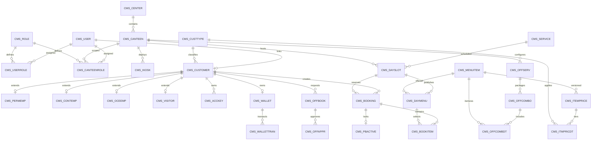
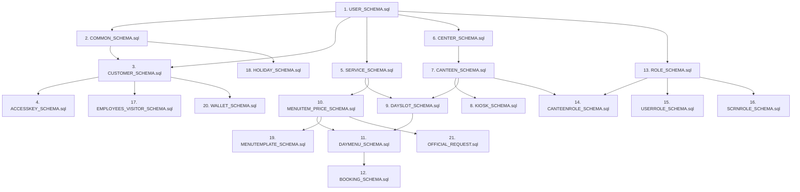

# CanteenMitra Database Schema Specification

## 1. Executive Summary and Engine Profile

The CanteenMitra database (`cms_db`) serves as the central data store for the Canteen Management System implemented for the Indian Space Research Organisation (ISRO). The database manages enterprise multi-canteen operations, meal planning, tier-based tariffs, pre-booking concurrency, physical RFID kiosk fleet integration, digital wallet transactions, and multi-tier institutional approval workflows.

### Database Engine Configuration

| Configuration Property | Target Specification |
| :--- | :--- |
| **Relational Database Management System** | MySQL 8.0+ |
| **Storage Engine** | InnoDB (Strict ACID compliance, row-level locking, foreign key enforcement) |
| **Database Name** | `cms_db` |
| **Default Character Set** | `utf8mb4` |
| **Default Collation** | `utf8mb4_unicode_ci` |
| **SQL Strict Mode** | Enabled (`STRICT_TRANS_TABLES`, `NO_ENGINE_SUBSTITUTION`) |
| **Data Access Pattern** | 100% Encapsulated via Stored Procedures (zero dynamic inline SQL) |

---

## 2. Schema Architecture and Naming Conventions

The schema enforces strict architectural rules across all 47 core tables:

1. **Table Naming Standard:** Every table name begins with the `CMS_` prefix followed by an uppercase suffix of 10 characters or fewer without underscores (e.g., `CMS_USERROLE`, `CMS_ITMPRICDT`, `CMS_BOOKITMHST`, `CMS_OFFCOMBDT`, `CMS_PBACTIVE`).
2. **Column Naming Standard:** Column names are written in uppercase alphanumeric characters without underscores (e.g., `CUSTOMERID`, `CANTEENID`, `BOOKEDAT`, `SERVICEDATE`, `AVAILQTY`).
3. **Standard Audit Columns:** All major operational and entity tables include auditing metadata:
   * `CREATEDBY` (`INT NULL`, foreign key to `CMS_USER.USERID`)
   * `CREATEDAT` (`DATETIME NOT NULL DEFAULT CURRENT_TIMESTAMP`)
   * `UPDATEDBY` (`INT NULL`, foreign key to `CMS_USER.USERID`)
   * `UPDATEDAT` (`DATETIME NULL ON UPDATE CURRENT_TIMESTAMP`)
4. **Transition Timestamp Standard:** Lifecycle event timestamps consistently use the `...AT` suffix (e.g., `BOOKEDAT`, `SERVEDAT`, `CANCELLEDAT`, `NOSHOWAT`, `ASSIGNEDAT`, `LASTHEARTBEATAT`).
5. **Standard Status Integration:** Status foreign keys reference `CMS_STATUS.STATUSID` with default values pointing to status code `10` (`ACT` = Active).
6. **Soft Deletions and Audit Mirrors:** Mutating entities maintain dedicated audit mirror tables (e.g., `CMS_BOOKHIST`, `CMS_BOOKITMHST`, `CMS_SLOTHIST`, `CMS_DMENUHIST`, `CMS_MENUHIST`, `CMS_SERVHIST`) to record operational audit trails.

---

## 3. High-Level Entity Relationship Architecture



---

## 4. Domain-by-Domain Schema Breakdown

The 47 tables in `cms_db` are structured into 8 functional domains:

### Domain 1: System Master & Governance

Master reference catalogs and sequence controllers governing application-wide lookups:

| Table Name | Primary Key | Key Foreign Keys | Purpose & Business Responsibility |
| :--- | :--- | :--- | :--- |
| **`CMS_STATUS`** | `STATUSID` | None | Unified system status catalog partitioned by `STATUSGRP` (e.g. `GENERIC`, `BOOKING`, `MENU`, `WALLET`). Ensures code consistency across modules. |
| **`CMS_AUTONOS`** | `AUTONOID` | `STATUSID`, `CREATEDBY` | Sequence configuration controlling prefix characters, padding lengths, and last generated numbers for human-readable codes (`CMSGENAUTO`). |
| **`CMS_CUSTTYPE`** | `CTYPEID` | None | Customer classification types (`PRM` = Permanent, `CNT` = Contract, `OCE` = Other Centre, `VIS` = Visitor, `OFF` = Official). |
| **`CMS_HOLIDAY`** | `HOLIDAYID` | `STATUSID`, `CREATEDBY` | Calendar holiday registry. Used by day-slot generators and bulk planners to block menu publishing on non-working days. |

### Domain 2: Campus, Facilities & Hardware Terminals

Geographic and physical plant layout defining centers, canteens, and hardware kiosks:

| Table Name | Primary Key | Key Foreign Keys | Purpose & Business Responsibility |
| :--- | :--- | :--- | :--- |
| **`CMS_CENTER`** | `CENTERID` | `CREATEDBY` | Campus or geographical center master record (e.g., HQ, VSSC, SDSC). |
| **`CMS_CANTEEN`** | `CANTEENID` | `CENTERID`, `CREATEDBY`, `STATUSID` | Individual physical canteen facility within a center. Scopes meal slots, menus, prices, and staff permissions. |
| **`CMS_CANTEENROLE`**| `CANTEENROLEID`| `USERID`, `ROLEID`, `CANTEENID`, `ASSIGNEDBY` | Scopes staff and manager roles (`CNTMGR`, `CNTAST`, `CNTSTF`) to specific canteens. Supports multi-canteen switching. |
| **`CMS_KIOSK`** | `KIOSKID` | `CANTEENID`, `STATUSID`, `CREATEDBY`, `UPDATEDBY` | Registry of physical Raspberry Pi touchpoints. Tracks static IP addresses, MAC addresses, kiosk type (`STAFF_COUNTER` vs `EMP_SELF_SERVICE`), and last heartbeat timestamps. |

### Domain 3: Identity, Access Control & Customer Profiles

Authentication accounts, system-wide role assignments, and tiered customer identity records:

| Table Name | Primary Key | Key Foreign Keys | Purpose & Business Responsibility |
| :--- | :--- | :--- | :--- |
| **`CMS_USER`** | `USERID` | `CREATEDBY` | Central login credentials table supporting password hashes (`PWDHASH`) and external SSO intranet authentication (`AUTHPROV`, `AUTHID`). |
| **`CMS_ROLE`** | `ROLEID` | `CREATEDBY` | Role catalog defining permission codes (`SYSADM`, `CNTMGR`, `CNTAST`, `CNTSTF`). |
| **`CMS_USERROLE`** | `USERROLEID` | `USERID`, `ROLEID`, `ASSIGNEDBY` | Global system role assignments independent of canteen scoping (e.g. system administration). |
| **`CMS_CUSTOMER`** | `CUSTOMERID` | `USERID`, `CTYPEID`, `STATUSID`, `CREATEDBY` | Base customer profile representing anyone eligible to consume meals or hold balances. |
| **`CMS_PERMEMP`** | `PERMEMPID` | `CUSTOMERID` | Permanent employee profile extension storing employee code, department, designation, and official approval level (`EMPLEVEL`). |
| **`CMS_CONTEMP`** | `CONTEMPID` | `CUSTOMERID`, `DEFAULTCANTEENID` | Contract worker profile storing vendor company name, contract start/end dates, and default canteen facility. |
| **`CMS_OCEEMP`** | `OCEEMPID` | `CUSTOMERID` | Other Centre Employee profile storing deputation home center and validity dates. |
| **`CMS_VISITOR`** | `VISITORID` | `CUSTOMERID` | Visitor profile recording sponsor organization, contact mobile number, and visit purpose. |
| **`CMS_ACCKEY`** | `ACCKEYID` | `CUSTOMERID`, `CREATEDBY`, `STATUSID` | Hardware credentials storing RFID card UIDs and encoded QR tokens with cryptographic expiration checks. |

### Domain 4: Meal Services, Catalog & Pricing Architecture

Catalog definitions, dietary classifications, recurring templates, and effective-date tariffs:

| Table Name | Primary Key | Key Foreign Keys | Purpose & Business Responsibility |
| :--- | :--- | :--- | :--- |
| **`CMS_SERVICE`** | `SERVICEID` | `STATUSID`, `CREATEDBY` | Meal service definitions (Breakfast, Lunch, Evening Snacks, Dinner) with default operating windows. |
| **`CMS_SERVHIST`** | `SERVHISTID` | `SERVICEID`, `CHANGEDBY` | Audit transition log tracking modifications to meal service parameters. |
| **`CMS_MENUITEM`** | `MENUITEMID` | `SERVICEID`, `STATUSID`, `CREATEDBY` | Master food item catalog storing item code, short name, full name, dietary flags (`ISSPECIAL`), and official catering eligibility (`ISOFFSER`). Contains no price columns. |
| **`CMS_MENUHIST`** | `MENUHISTID` | `SERVICEID`, `CHANGEDBY` | Audit log capturing food item modifications and renaming histories. |
| **`CMS_ITEMPRICE`** | `ITEMPRICEID` | `MENUITEMID`, `CREATEDBY`, `STATUSID` | Type-2 Slowly Changing Dimension (SCD Type-2) pricing header establishing effective date ranges (`EFFECTIVEFROM`, `EFFECTIVETO`). |
| **`CMS_ITMPRICDT`** | `ITMPRICDTID` | `ITEMPRICEID`, `CTYPEID` | Granular price points attaching specific tariffs (in INR) per customer type (`PRM`, `CNT`, `VIS`) for a given price version. |
| **`CMS_MENUTPL`** | `MENUTPLID` | `CANTEENID`, `SERVICEID`, `CREATEDBY`, `STATUSID` | Named menu template headers for cyclical scheduling (e.g. "Monday Standard Lunch", "Special Festival Menu"). |
| **`CMS_MENUTPLDT`** | `MENUTPLDTID` | `MENUTPLID`, `MENUITEMID` | Line-item dishes assigned to a template with default limits (`MAXQTY`, `DEFAVAILQTY`). |

### Domain 5: Operational Day Slots & Menu Publishing

Dated instances of services representing live canteen shifts and published dishes:

| Table Name | Primary Key | Key Foreign Keys | Purpose & Business Responsibility |
| :--- | :--- | :--- | :--- |
| **`CMS_DAYSLOT`** | `DAYSLOTID` | `SERVICEID`, `CANTEENID`, `STATUSID`, `APPRSTATUSID`, `MENUSUBMITTEDBY`, `MENUAPPROVEDBY`, `CREATEDBY` | A specific meal service shift on a specific date at a specific canteen facility. Governs operating hours (`STARTTIME`, `ENDTIME`) and approval workflow states (`DRF`, `SUB`, `APP`, `REJ`). |
| **`CMS_SLOTHIST`** | `SLOTHISTID` | `SERVICEID`, `CANTEENID`, `CHANGEDBY` | Audit trail recording slot rescheduling, cutoff changes, and approvals. |
| **`CMS_DAYMENU`** | `DAYMENUID` | `DAYSLOTID`, `MENUITEMID`, `STATUSID`, `CREATEDBY` | Specific food items published for sale during a day slot. Governs channel permissions (`ISPREBOOK`, `ISKIOSK`), booking deadlines (`BOOKUNTIL`, `CANCELUNTIL`), available batches (`AVAILQTY`), and customer purchase caps (`MAXQTY`). |
| **`CMS_DMENUHIST`**| `DMENUHISTID` | None (Loose ID) | Historical snapshot tracking menu item swaps, quantities, and cancellations. |

### Domain 6: Meal Bookings, Concurrency & Serving Transitions

Order placement, batch processing, concurrency locking, and live counter fulfillment:

| Table Name | Primary Key | Key Foreign Keys | Purpose & Business Responsibility |
| :--- | :--- | :--- | :--- |
| **`CMS_BOOKTYPE`** | `BOOKTYPEID` | `STATUSID`, `CREATEDBY`, `UPDATEDBY` | Booking channels: `PB` (Pre-Booking), `KS` (Kiosk Self-Service), `WI` (Walk-in Staff Counter). |
| **`CMS_BOOKCTR`** | Composite (`BOOKTYPEID`, `SERVICEID`) | `BOOKTYPEID`, `SERVICEID` | High-throughput atomic sequence generator providing monotonically increasing booking numbers without table locks. |
| **`CMS_BOOKING`** | `BOOKID` | `BOOKTYPEID`, `CUSTOMERID`, `DAYSLOTID`, `STATUSID`, `SERVEDBY`, `CANCELBY`, `CREATEDBY` | Master order header storing unique booking number (`BOOKINGNO`), booking timestamp, channel, total amount, serving counter operator, and terminal token. |
| **`CMS_BOOKITEM`** | `BOOKITEMID` | `BOOKID`, `DAYMENUID`, `STATUSID` | Line-item dishes reserved within a booking, recording reserved quantity, unit price at booking time, subtotal, and individual item serving status. |
| **`CMS_PBACTIVE`** | `PBACTIVEID` | `CUSTOMERID`, `SERVICEID`, `BOOKID` | Concurrency guard enforcing a strict unique constraint on `(CUSTOMERID, SERVICEID, SERVICEDATE)`. Prevents duplicate meal reservations during concurrent network requests. |
| **`CMS_BOOKHIST`** | `BOOKHISTID` | `BOOKID`, `CHANGEDBY` | Comprehensive audit trail logging every lifecycle state change (`BOOKED`, `SERVED`, `CANCELLED`, `NOSHOW`) with exact timestamps and operators. |
| **`CMS_BOOKITMHST`**| `BOOKITMHSTID` | `BOOKITEMID`, `CHANGEDBY` | Audit trail logging line-item quantity edits, item cancellations, and refunds. |

### Domain 7: Digital Wallet Ledger & Financial Auditing

Prepaid balance management, atomic hold reserves, and cashier top-up ledger:

| Table Name | Primary Key | Key Foreign Keys | Purpose & Business Responsibility |
| :--- | :--- | :--- | :--- |
| **`CMS_WALLET`** | `WALLETID` | `CUSTOMERID`, `STATUSID` | Customer wallet header enforcing non-negative balances (`BALANCE >= 0.00`) and reserving funds during active bookings (`RESERVEDAMT <= BALANCE`). |
| **`CMS_WALLETTRAN`**| `TRANID` | `WALLETID`, `BOOKID`, `STATUSID`, `CREATEDBY` | Immutable double-entry financial ledger recording transactions (`TOPUP`, `DEBIT`, `REFUND`, `HOLD`, `WITHDRAW`). Records exact closing balance (`BALAFTER`) for financial reconciliation. |
| **`CMS_WALLETWD`** | `WALLETWDID` | `WALLETID`, `STATUSID`, `REQUESTEDBY`, `APPROVEDBY` | Withdrawal request tracking for contract workers and visitors leaving the organization. Manages cashier approval and disbursement cycles. |

### Domain 8: Institutional Catering & Multi-Tier Approvals

High-level institutional catering, custom VIP combos, and tiered approval hierarchies:

| Table Name | Primary Key | Key Foreign Keys | Purpose & Business Responsibility |
| :--- | :--- | :--- | :--- |
| **`CMS_LVLMAP`** | `LVLMAPID` | `CREATEDBY`, `UPDATEDBY` | Maps employee seniority levels (`EMPLEVEL`) to required institutional approver tiers (`L1`, `L2`). |
| **`CMS_OFFSERV`** | `OFFSERVID` | `CANTEENID`, `STATUSID`, `CREATEDBY`, `UPDATEDBY` | Institutional service catalog (e.g., Executive Meeting Tea, VIP Lunch, Conference Catering). |
| **`CMS_OFFCOMBO`** | `OFFCOMBOID` | `OFFSERVID`, `STATUSID`, `CREATEDBY`, `UPDATEDBY` | Packaged institutional combo definitions bundling gross prices and administrative handling charges into a final `COMBOPRICE`. |
| **`CMS_OFFCOMBDT`**| `OFFCOMBDTID` | `OFFCOMBOID`, `MENUITEMID` | Individual dish recipes and portions comprising an official packaged combo. |
| **`CMS_OFFBOOKCTR`**| `OFFBOOKCTRID`| None | Specialized atomic sequence generator for official booking requisition codes (`REQ-YYYYMMDD-XXXX`). |
| **`CMS_OFFBOOK`** | `OFFBOOKID` | `OFFSERVID`, `CUSTOMERID`, `CANTEENID`, `STATUSID`, `CREATEDBY` | Official catering requisition header storing event date, guest counts, venue, purpose, billing accounts, and approval status. |
| **`CMS_OFFAPPR`** | `OFFAPPRID` | `OFFBOOKID`, `APPROVERID` | Multi-tier sign-off audit log recording each approver tier action (`APPROVE`, `REJECT`), comments, and timestamps. |
| **`CMS_OFFPREP`** | `OFFPREPID` | `OFFBOOKID`, `CANTEENID`, `STATUSID` | Kitchen operational preparation manifest for official events. |

---

## 5. Architectural Integrity and Concurrency Patterns

### 1. Active Booking Concurrency Guard (`CMS_PBACTIVE`)
To eliminate race conditions where a customer might open simultaneous browser tabs or spam reservation buttons, the database employs `CMS_PBACTIVE`:
* Enforces `UNIQUE KEY UQ_PBACTIVE (CUSTOMERID, SERVICEID, SERVICEDATE)`.
* When a booking is created, a row is inserted inside the same database transaction.
* If a duplicate request arrives concurrently, the InnoDB unique index triggers an immediate duplicate key error, safely rejecting the second request without data corruption.
* Upon meal serving or booking cancellation, the row is cleanly removed.

### 2. Immutable Financial Ledger (`CMS_WALLETTRAN`)
Digital wallet balances never mutate via raw inline updates. All monetary changes follow strict double-entry ledger rules:
* Balances update solely through `CMS_WALLETTRAN` inserts within transactional stored procedures (`CMSWALLETTOPUP`, `CMSWALLETDEBIT`, `CMSWALLETREFUND`).
* Every ledger entry records `TRANAMT`, `TRANTYPE`, `BOOKID`, and the closing `BALAFTER`.
* Strict check constraints on `CMS_WALLET` prevent overdrafts:
  ```sql
  CONSTRAINT CK_WAL_BALANCE CHECK (BALANCE >= 0.00),
  CONSTRAINT CK_WAL_RESERVED CHECK (RESERVEDAMT >= 0.00),
  CONSTRAINT CK_WAL_RES_BAL CHECK (RESERVEDAMT <= BALANCE)
  ```

### 3. Type-2 Slowly Changing Dimension Pricing
Food item prices change over time due to inflation, subsidies, or seasonal revisions. Rather than overwriting menu item records, pricing uses a temporal SCD Type-2 model:
* `CMS_MENUITEM` contains no price attributes.
* `CMS_ITEMPRICE` defines effective periods (`EFFECTIVEFROM`, `EFFECTIVETO`, `ISACTIVE`).
* `CMS_ITMPRICDT` attaches specific prices per customer type (`PRM`, `CNT`, `VIS`).
* Existing historical bookings retain their original prices, while new bookings automatically resolve the currently effective rate.

---

## 6. Execution Order and Migration Pipeline

The database schema is deployed across 21 modular SQL files executed in strict foreign-key dependency order (configured in `database/execution_order.txt` and `database/RUN_ALL.sql`):



---

## 7. Backward Compatibility Layer (`COMPATIBILITY_VIEWS.sql`)

To guarantee zero downtime and ensure backward compatibility with reporting tools, legacy scripts, and operational views, the database maintains standard SQL views:

| Compatibility View | Underlying Physical Table | Purpose |
| :--- | :--- | :--- |
| **`CMS_CONSUMERROLE`** | `CMS_USERROLE` | Preserves compatibility with legacy identity mapping scripts. |
| **`CMS_KIOSK_DEVICE`** | `CMS_KIOSK` | Aliases the hardware kiosk device table for network telemetry scrapers. |
| **`CMS_ITEMPRICEDT`** | `CMS_ITMPRICDT` | Preserves unabbreviated price detail naming for historical reports. |
| **`CMS_OFFCOMBO_ITEM`**| `CMS_OFFCOMBDT` | Aliases official combo dish items for kitchen inventory queries. |
| **`CMS_BOOKITMHS`** | `CMS_BOOKITMHST` | Maps shortened audit table names for legacy line-item audits. |
| **`CMS_ROLESCN`** | `CMS_SCRNROLE` | Supports older role-screen permission queries. |

---

## 8. Scheduled Automated Maintenance Events

* **Event Name:** `EVT_CMS_DAILY_NOSHOW` (defined in `database/events/NOSHOW_EVENT.sql`)
* **Schedule:** Executes automatically every night at 23:59:00 IST (`EVERY 1 DAY`).
* **Responsibility:**
  * Identifies unserved, confirmed meal bookings (`STATUSID = 21` / `CRT`) whose service slot end times have passed.
  * Transitions their status to No-Show (`STATUSID = 24` / `NOS`).
  * Emits audit log entries into `CMS_BOOKHIST` recording the automated sweep.
  * Ensures payroll reports and kitchen consumption reconciliation accurately record unused meal counts.

