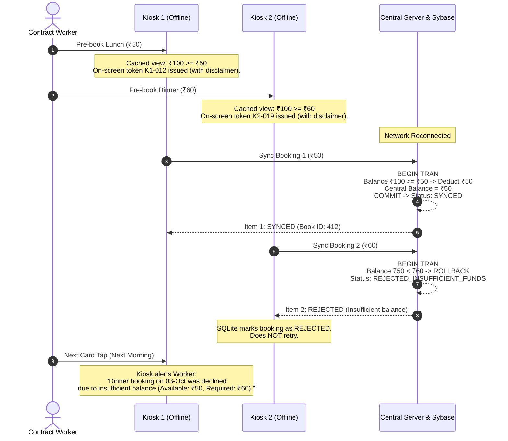

# Offline-First Kiosk Architecture & Implementation Plan
**Hardware**: Raspberry Pi 5 (Raspberry Pi OS 64-bit)  
**Peripherals**: RC500 / RC522 RFID Module (GPIO / SPI), Touchscreen / HDMI Display (Purely Paperless)  
**Local Kiosk Runtime**: Python 3 (GPIO Driver) + Node.js (Local Agent + SQLite)  
**Central Backend**: Express.js + Sybase ASE  

---

## 1. System Architecture Overview

```mermaid
flowchart TB
    subgraph Pi5["Raspberry Pi 5 (Kiosk Terminal)"]
        subgraph HardwareLayer["Hardware Layer"]
            RFID["RC500 / RC522 Module (SPI / GPIO)"]
            Display["Touchscreen / HDMI Display"]
        end

        subgraph Daemons["System Background Services (systemd)"]
            PyDriver["Python RFID Daemon (rfid_daemon.py)"]
            NodeAgent["Node.js Local Agent (:5000)"]
            SQLite[("Local SQLite Database")]
        end

        subgraph ClientUI["Kiosk Display"]
            Browser["Chromium (Full Screen --kiosk) / React UI"]
        end

        RFID -->|SPI / Pins 19, 21, 23, 24| PyDriver
        PyDriver -->|Virtual Keyboard Keystrokes (uinput)| Browser
        NodeAgent <-->|Cache & FIFO Outbox| SQLite
        Browser <-->|Local HTTP localhost:5000| NodeAgent
        Browser -.->|Renders to| Display
    end

    subgraph Central["Central Server Infrastructure"]
        Express["Central Express API (:8080)"]
        Sybase[("Central Sybase ASE Database")]
        
        Express <--> Sybase
    end

    NodeAgent <-->|When Online: Periodic Sync & FIFO Chunk Push| Express
```

---

## 2. Distributed Wallet Handling: Strictly Prepaid Transactional Model

### The Collision Scenario
* **Initial State**: Contract worker has **₹100** in their central wallet.
* **Network State**: Both Kiosk 1 (K1) and Kiosk 2 (K2) are offline.
* **Step 1**: Worker pre-books **Lunch for ₹50** at K1. K1 displays cached balance ₹100, shows on-screen digital confirmation with local token `K1-012`.
* **Step 2**: Worker walks to K2 and pre-books **Dinner for ₹60**. K2 displays cached balance ₹100, shows on-screen digital confirmation with local token `K2-019`.
* **Total Value**: ₹110 vs. ₹100 available. **Deficit**: -₹10.

---

### Transactional Rejection Logic & Operational UX

Under this strict model, the system operates with **zero credit / zero overdraft risk**. The central database enforces strict transactional atomicity.



#### Key Elements of this Model:
1. **Local Wallet Display Only**:
   - The local SQLite `cached_wallets` table is used for customer display and immediate pre-validation.
   - Regular staff/officers bypass wallet checks (billed via payroll / official account).
2. **On-Screen Digital Confirmation & Offline Notice (Paperless)**:
   - There is **no physical printer**. The system is completely paperless.
   - Any booking created while the kiosk is offline presents a digital confirmation modal showing the local reference number (e.g., `#K2-019`), items, and clear notification:  
     `"Offline Booking Ref: K2-019. Saved locally. Subject to final wallet balance confirmation upon network sync. Present your RFID badge at the counter to collect your meal."`
3. **Identity-Driven Meal Dispensing**:
   - Meal collection at the serving counter does not require paper tokens. The canteen operator terminal resolves the worker's active booking directly when their RFID badge is tapped.
4. **Rejection Notification on Next Card Tap**:
   - When the worker taps their RFID badge next time at any kiosk, the terminal checks their notifications and alerts them:  
     `"Notice: Your Dinner pre-booking was declined due to insufficient wallet balance (Available: ₹50, Required: ₹60). Please top up at counter."`
5. **Kitchen Prep Integrity**:
   - Because meals are strictly pre-booked in advance of prep cutoff windows, rejected bookings are excluded from the aggregated kitchen prep sheet prior to cooking.

---

## 3. High-Performance Bulk Upload & Failure Isolation Architecture

When a terminal reconnects after hours of network downtime, it may hold **50 to 200 queued offline pre-bookings**.

### A. Core Principle: Isolated Sub-Transactions (No "All-or-Nothing")
* **Golden Rule**: If a batch of 50 bookings contains **1 booking that fails** (e.g., insufficient wallet balance), the other 49 valid bookings **must NOT be rolled back**.
* Each booking is processed independently within its own database transaction/savepoint.

### B. Optimal Chunking & Compression
* **Batch Size**: Chunks of **25 to 50 bookings** per HTTP request.
  - Keeps payload size under 5 KB gzipped.
  - Keeps HTTP round-trip latency under **150–200 ms**.
  - Prevents memory spikes on the Raspberry Pi 5.
* **HTTP Compression**: `Content-Encoding: gzip` enabled for sync payloads.

### C. Itemized Response Protocol
The central server processes the batch and returns an **itemized status array**:

```json
{
  "batchId": "BATCH-K1-1727871000",
  "processedCount": 3,
  "results": [
    {
      "offlineUuid": "f47ac10b-58cc-4372-a567-0e02b2c3d479",
      "status": "SYNCED",
      "centralBookId": 1042,
      "message": "Booking created successfully"
    },
    {
      "offlineUuid": "9b1deb4d-3b7d-4bad-9bdd-2b0d7b3dcb6d",
      "status": "REJECTED",
      "errorCode": "INSUFFICIENT_WALLET_BALANCE",
      "message": "Required: 60.00, Available: 50.00"
    },
    {
      "offlineUuid": "8c5e2a11-1a2b-4c3d-8e4f-5a6b7c8d9e0f",
      "status": "SYNCED",
      "centralBookId": 1043,
      "message": "Already processed previously (Idempotent match)"
    }
  ]
}
```

### D. SQLite Outbox State Machine on the Pi 5

```
[ PENDING ] ──(Send batch)──► [ SYNCING ]
                                   │
               ┌───────────────────┼───────────────────┐
               ▼                   ▼                   ▼
          [ SYNCED ]          [ REJECTED ]      [ RETRYABLE_ERROR ]
     (Permanent Success)  (Permanent Business Fail)  (Network/Crash)
                                                       │
                                            (Reset to PENDING after backoff)
```

1. **`SYNCED`**: Marked permanently as completed. Never re-sent.
2. **`REJECTED`**: Marked permanently as rejected with `rejection_reason`. Never re-sent (prevents infinite retry loops).
3. **`RETRYABLE_ERROR`** (Network drop or 500 error): Rows remain intact and are reset to `PENDING` with **exponential backoff** (retries in 10s, 30s, 60s).

---

## 4. Python RC500 / RC522 GPIO Background Daemon

### Hardware Interface (Raspberry Pi 5)
* Interface: **SPI0** (`/dev/spidev0.0`) via 40-pin GPIO header.
* Pin Mapping:
  - Pin 24 (GPIO 8 / CE0) ➔ SDA / NSS
  - Pin 23 (GPIO 11 / SCLK) ➔ SCK
  - Pin 19 (GPIO 10 / MOSI) ➔ MOSI
  - Pin 21 (GPIO 9 / MISO) ➔ MISO
  - Pin 22 (GPIO 25) ➔ RST
  - Pin 1 / 17 ➔ 3.3V (Do not connect to 5V)
  - Pin 6 / 9 / 14 ➔ GND

### Python Service Architecture (`rfid_daemon.py`)
1. Uses `spidev` and `rpi-lgpio` (compatible with Pi 5 RP1 I/O controller chip) and Linux `evdev` / `uinput`.
2. Runs an event loop:
   - Polls SPI bus for card presence (`PICC_IsNewCardPresent`).
   - Reads card UID (`PICC_ReadCardSerial`).
   - Debounces taps (ignores continuous hold of the same card for 2.5 seconds).
3. **Virtual Keyboard Injection (`uinput`)**:
   - Creates a virtual input device via Linux `evdev` / `uinput`.
   - Emits the RFID card UID characters directly as virtual keyboard keystrokes, followed by `KEY_ENTER`.
   - The focused React `<input>` in Chromium receives the scan naturally as if a physical USB keyboard scanner typed it.
   - **Zero network overhead, zero WebSockets, zero IPC latency.**
4. Packaged as a Linux `systemd` service (`cms-rfid.service`) with auto-restart on exit.

---

## 5. Local Node.js Kiosk Agent (`kiosk-agent`)

Runs on `http://127.0.0.1:5000` via `systemd` (`cms-kiosk.service`) using `better-sqlite3`.

### Core Responsibilities
1. **Local SQLite Management**: Maintains local master data cache and FIFO outbox.
2. **Local REST API Gateway for React UI**:
   - `POST /api/kiosk/self-service/scan` ➔ Verifies card UID typed into React UI, returns profile and cached wallet.
   - `GET /api/kiosk/self-service/services` ➔ Reads published slots from local SQLite.
   - `GET /api/kiosk/self-service/menu` ➔ Reads published dishes from local SQLite.
   - `POST /api/kiosk/self-service/book` ➔ Creates local pre-booking, generates `K1-xxx` token, enqueues to outbox.
   - `POST /api/kiosk/self-service/cancel` ➔ Cancels active booking locally before cutoff.
3. **Background FIFO Sync Worker**:
   - Runs a 15-second heartbeat checking `http://<central-server>:8080/api/health`.
   - **Downlink Sync**: Pulls tomorrow's published menus, active slots, and wallet snapshot for contract workers.
   - **Uplink Sync (FIFO Outbox)**: Selects oldest pending rows from `outbox_bookings` in chunks of 25–50 and posts them to the central server.

---

## 6. Local SQLite Database Schema

```sql
-- 1. Cached Customers & RFID Badges
CREATE TABLE cached_customers (
    customer_id INTEGER PRIMARY KEY,
    rfid_uid TEXT UNIQUE NOT NULL,
    disp_name TEXT NOT NULL,
    ctype_code TEXT NOT NULL -- 'REG', 'CONTEMP', 'VIS'
);

-- 2. Cached Contract & Visitor Wallets (For Local View)
CREATE TABLE cached_wallets (
    customer_id INTEGER PRIMARY KEY,
    balance REAL NOT NULL DEFAULT 0.00,
    status_id INTEGER DEFAULT 10
);

-- 3. Upcoming Published Service Slots (Tomorrow & Future Dates)
CREATE TABLE cached_day_slots (
    day_slot_id INTEGER PRIMARY KEY,
    service_id INTEGER NOT NULL,
    service_name TEXT NOT NULL,
    serv_date TEXT NOT NULL,       -- 'YYYY-MM-DD'
    start_time TEXT NOT NULL,      -- 'HH:MM'
    end_time TEXT NOT NULL
);

-- 4. Kiosk-Enabled Dishes for Pre-booking
CREATE TABLE cached_menu_items (
    day_menu_id INTEGER PRIMARY KEY,
    day_slot_id INTEGER NOT NULL,
    menu_item_id INTEGER NOT NULL,
    item_name TEXT NOT NULL,
    rate REAL NOT NULL,
    is_base INTEGER DEFAULT 0,
    is_special INTEGER DEFAULT 0,
    max_qty INTEGER DEFAULT 1,
    book_until TEXT,
    FOREIGN KEY(day_slot_id) REFERENCES cached_day_slots(day_slot_id)
);

-- 5. Active Pre-bookings (Prevents double-booking same slot offline)
CREATE TABLE cached_active_prebookings (
    customer_id INTEGER NOT NULL,
    service_id INTEGER NOT NULL,
    serv_date TEXT NOT NULL,
    PRIMARY KEY(customer_id, service_id, serv_date)
);

-- 6. Local Token Sequence per Service Date
CREATE TABLE local_token_seq (
    serv_date TEXT PRIMARY KEY,
    last_token_num INTEGER DEFAULT 0
);

-- 7. Outbox (FIFO Queue for Central Sync)
CREATE TABLE outbox_bookings (
    offline_uuid TEXT PRIMARY KEY,
    kiosk_code TEXT NOT NULL,        -- 'K1'
    token_no TEXT NOT NULL,          -- 'K1-001'
    customer_id INTEGER NOT NULL,
    service_id INTEGER NOT NULL,
    serv_date TEXT NOT NULL,
    items_json TEXT NOT NULL,
    total_amount REAL NOT NULL,
    payment_method TEXT NOT NULL,    -- 'OFFICIAL' | 'WALLET'
    created_at TEXT NOT NULL,
    sync_status TEXT DEFAULT 'PENDING', -- 'PENDING', 'SYNCING', 'SYNCED', 'REJECTED'
    synced_at TEXT,
    sync_error TEXT
);
```

---

## 7. Sybase ASE Central Integration & Idempotency

### Schema Adaptations in Central Sybase
1. Add `OFFLINE_UUID VARCHAR(36) NULL` to `CMS_BOOKING`.
2. Add unique non-clustered index:
   ```sql
   CREATE UNIQUE NONCLUSTERED INDEX UQ_BK_OFFLINE_UUID 
   ON CMS_BOOKING (OFFLINE_UUID) 
   WHERE OFFLINE_UUID IS NOT NULL
   ```
3. Set `LOCK DATAROWS` on `CMS_BOOKING` and `CMS_WALLET` to avoid lock contention during bulk offline sync:
   ```sql
   ALTER TABLE CMS_BOOKING LOCK DATAROWS
   ALTER TABLE CMS_BOOKITEM LOCK DATAROWS
   ALTER TABLE CMS_WALLET LOCK DATAROWS
   ```

### Central Sybase Sync Procedure (`USP_SYNC_SINGLE_OFFLINE_BOOKING`)

```sql
CREATE PROCEDURE USP_SYNC_SINGLE_OFFLINE_BOOKING
    @OFFLINE_UUID   VARCHAR(36),
    @KIOSK_CODE     VARCHAR(10),
    @CUSTOMER_ID    INT,
    @SERVICE_ID     INT,
    @SERV_DATE      DATE,
    @TOTAL_AMOUNT   DECIMAL(12,2),
    @PAYMENT_METHOD VARCHAR(10),
    @STATUS_OUT     VARCHAR(20) OUTPUT,
    @MSG_OUT        VARCHAR(255) OUTPUT
AS
BEGIN
    -- 1. Idempotency Check: Already processed?
    IF EXISTS (SELECT 1 FROM CMS_BOOKING WHERE OFFLINE_UUID = @OFFLINE_UUID)
    BEGIN
        SELECT @STATUS_OUT = 'SYNCED', @MSG_OUT = 'Already processed previously'
        RETURN 0
    END

    -- 2. Transactional Wallet Check for Contract Workers / Visitors
    IF @PAYMENT_METHOD = 'WALLET'
    BEGIN
        DECLARE @CURRENT_BAL DECIMAL(12,2)
        SELECT @CURRENT_BAL = BALANCE 
        FROM CMS_WALLET 
        WHERE CUSTOMERID = @CUSTOMER_ID

        IF @CURRENT_BAL IS NULL OR @CURRENT_BAL < @TOTAL_AMOUNT
        BEGIN
            SELECT @STATUS_OUT = 'REJECTED', 
                   @MSG_OUT = 'INSUFFICIENT_WALLET_BALANCE'
            RETURN 0
        END

        -- Deduct from central wallet inside transaction
        UPDATE CMS_WALLET 
        SET BALANCE = BALANCE - @TOTAL_AMOUNT 
        WHERE CUSTOMERID = @CUSTOMER_ID
    END

    -- 3. Insert Booking Header
    INSERT INTO CMS_BOOKING (OFFLINE_UUID, BOOKTYPEID, CUSTOMERID, SERVICEID, SERVICEDATE, TOTALAMOUNT, KIOSKID)
    VALUES (@OFFLINE_UUID, 2, @CUSTOMER_ID, @SERVICE_ID, @SERV_DATE, @TOTAL_AMOUNT, ...)

    SELECT @STATUS_OUT = 'SYNCED', @MSG_OUT = 'Booking synced successfully'
    RETURN 0
END
```

---

## 8. Embedded Logging Strategy & Storage Health (Raspberry Pi 5)

Kiosks run unattended 24/7 on flash storage (microSD or NVMe SSD). Uncontrolled, continuous logging can **degrade flash memory within months** or **fill the disk and freeze the terminal**.

### A. Protecting Flash Storage (Preventing SD Card Burnout)
1. **Pino Logger (Zero-Overhead Async I/O)**:
   - Use `pino` instead of `winston`. It writes asynchronously in chunks rather than blocking the event loop on each line, with virtually zero CPU/memory overhead on ARM64.
2. **Strict Size Cap & File Rotation**:
   - Max file size: **5 MB per file**.
   - Max retained archives: **3 files** (hard cap of 15 MB across all system logs).
   - Old archives automatically rolled over and compressed.
3. **RAM Buffering with `log2ram` (Pi OS Best Practice)**:
   - Configure `log2ram` on Raspberry Pi OS (`sudo apt install log2ram`).
   - Buffers `/var/log` in RAM (`tmpfs`) and flushes to flash disk in bulk once per hour, drastically extending flash lifespan.
4. **Poll Chatter Suppression**:
   - Do **not** log healthy 15-second heartbeat pings or polling ticks at `INFO` level.
   - Only log network state transitions (`ONLINE ➔ OFFLINE` or `OFFLINE ➔ ONLINE`).

### B. Standardized Structured JSON Format
Every log entry is written as machine-readable JSON:

```json
{
  "timestamp": "2026-10-02T11:45:10.124Z",
  "level": "info",
  "kioskId": "K1",
  "module": "BOOKING",
  "event": "PREBOOK_CREATED",
  "offlineUuid": "f47ac10b-58cc-4372-a567-0e02b2c3d479",
  "tokenNo": "K1-014",
  "customerId": 8,
  "serviceId": 2,
  "amount": 50.00,
  "durationMs": 14
}
```

### C. Log Stream Separation & Retention

| Stream | Target File | What it Records | Retention |
| :--- | :--- | :--- | :--- |
| **Operational** | `/var/log/cms/app.log` | Daemon lifecycles, network transitions, background sync status, uncaught exceptions. | 3 days (15 MB cap) |
| **Hardware** | `/var/log/cms/hardware.log` | Python GPIO reader taps, SPI bus events, card read latency. | 3 days (10 MB cap) |
| **Financial Audit** | `/var/log/cms/audit.log` | Immutable record of every booking created, token issued, and wallet check. | 30 days |

### D. Security & Privacy (PII Protection)
* **Never Log**: Plaintext RFID cryptographic sector keys, employee passwords, or personal mobile numbers.
* **Card UID Masking**: Log only first 2 and last 4 hex characters: `A4****12B3`.
* **Identities**: Log `customerId` rather than raw employee personal names.

### E. Remote Telemetry & Health Beacon (Centralized Monitoring)
Kiosks cannot be manually monitored in person. During the periodic central heartbeat (`POST /api/kiosk/heartbeat`), the local agent sends a diagnostic snapshot:

```json
{
  "kioskId": "K1",
  "deviceCode": "KSK-01",
  "status": "ONLINE",
  "outboxPending": 0,
  "lastSyncTime": "2026-10-02T11:40:00Z",
  "hardware": {
    "rfidReader": "HEALTHY",
    "cpuTempC": 48.2,
    "diskUsagePct": 14
  },
  "recentErrors": [
    {
      "timestamp": "2026-10-02T10:12:00Z",
      "module": "SYNC",
      "code": "SERVER_UNREACHABLE"
    }
  ]
}
```
* **Dashboard Alerting**: The central manager dashboard turns Kiosk 1 yellow if CPU temperature or disk usage is elevated, or red if the RFID daemon fails, without requiring onsite inspection.

### F. Linux `systemd` & `journald` Configuration
```ini
# /etc/systemd/system/cms-kiosk.service
[Unit]
Description=CMS Kiosk Node Agent
After=network.target

[Service]
Type=simple
User=pi
WorkingDirectory=/home/pi/cms-kiosk
ExecStart=/usr/bin/node src/agent.js
Restart=always
RestartSec=5
StandardOutput=journal
StandardError=journal
SyslogIdentifier=cms-kiosk

[Install]
WantedBy=multi-user.target
```
* **Onsite Inspection**: Technicians can inspect color-formatted live logs via:
  ```bash
  journalctl -u cms-kiosk.service -f --output=cat
  ```

---

## 9. Step-by-Step Implementation Roadmap

| Milestone | Deliverable | Description |
| :--- | :--- | :--- |
| **Stage 1** | Python RFID GPIO Daemon | Script using `spidev` on Pi 5 that reads card UIDs and injects them as virtual keyboard keystrokes (`uinput` + `Enter`) to the focused kiosk window. Packaged as `systemd` service (`cms-rfid.service`). |
| **Stage 2** | Local SQLite Engine & Agent | Node.js process with `better-sqlite3`. Implements token sequence generator (`K1-xxx`), local booking creation, wallet view, and `pino` structured logger with size caps. |
| **Stage 3** | Central Sync Endpoints (`backend`) | Implement `POST /api/kiosk/sync-offline` (itemized chunk processing) and `GET /api/kiosk/bootstrap-package` in Express with Sybase stored procedures. |
| **Stage 4** | Background Sync Worker | Background interval in Node agent that flushes FIFO outbox in 25–50 item chunks and pulls fresh master data when online. |
| **Stage 5** | Kiosk Frontend & Linux Packaging | Wire React Kiosk UI to `localhost:5000`. Configure `log2ram`, `systemd` services, and Chromium `--kiosk` auto-launch on Pi OS boot. |
